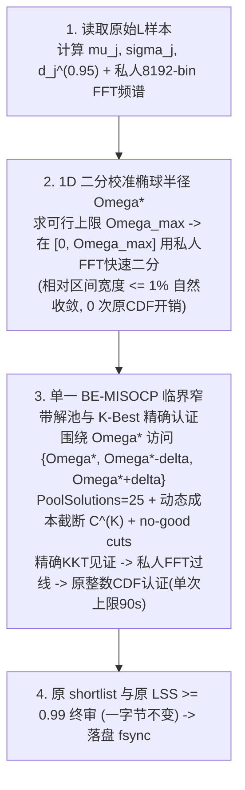
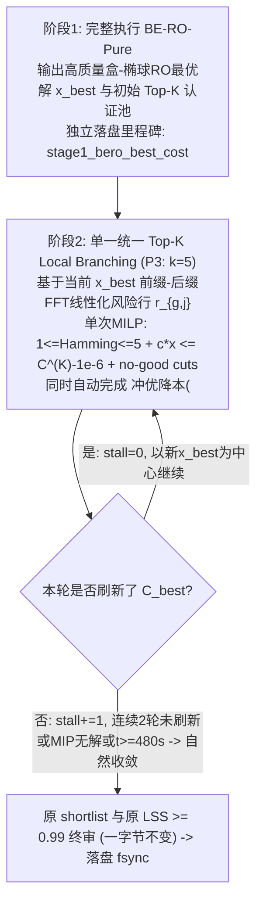

# CCMCKP 方向 B 冻结设计文档：盒-椭球鲁棒优化（`BE-RO-Pure` 与 `BE-RO-LB`）

**文档日期**：2026-11-28  
**方案定位**：方向 B —— **不做任何外部启发式求解器热启动，彻底摒弃 R07 四阶段异构拼装，回归文献中整体一致、参数极简的正统鲁棒优化框架**  
**提供对照方案**：
- **方案 B1（`BE-RO-Pure`）**：纯单模型盒-椭球鲁棒优化（仅 **1 个模型、2 个核心参数**，零局部搜索），100% 对标 **Ben-Tal & Nemirovski (2000, *Math. Program.*)** 经典单模型范式；
- **方案 B2（`BE-RO-LB`）**：经典两阶段 Matheuristic（盒-椭球 RO + 单一统一 Top-$K$ 局部支化，仅 **2 个阶段、3 个核心参数**），100% 对标 **Ben-Tal & Nemirovski (2000) + Fischetti & Lodi (2003, *Math. Program.*)** 标准两阶段范式。

两方案共享完全相同的 Stage 1 鲁棒优化核与统一审计边界，跑完全 40 例后由研究者根据成本、波动、耗时与论文简洁度自由权衡取舍。

---

## 1. 为什么从 R07 重构为盒-椭球鲁棒优化（BE-RO）

### 1.1 R07 的结构性症结
1. **文献整体匹配度不足**：R07 将“ES95 预算 RO → 无量纲 4 点熵代理 → 1/2-opt + 冲优局部 MIP → 回退局部 MIP”四套机制串联，虽单个零件均有文献来源，但**整体流水线在顶刊中并无对应范式**，极易被质疑“多阶段补丁堆砌”。
2. **与直接卷积搜索 `S10_1 (δ=0)` 相比仍有差距**：全 40 例中，R07 在 9 个高难算例里输给 `S10_1` 8 个，且编号 `18` 因 `15–35s` 过紧看门狗误杀了合法最优解 `142.2712`。

### 1.2 盒-椭球交集不确定集的数学统一性与服务器实测证据
独立随机消耗求和 $\sum_j a_j x_j$ 的真实方差按 **$\ell_2$ 范数**叠加，而强右偏重尾单品需要 **$\ell_\infty$ 盒式上界**防止方差平方项爆炸。**Ben-Tal & Nemirovski (2000, *Math. Program.*, Theorem 1)** 的单一不确定集——**盒-椭球交集（Box-Ellipsoidal Uncertainty Set）**天然在一个公式里同时覆盖近正态 `LAB` 与重尾 `APP`：

$$
\mathcal{U}_{\text{BE}}(\Omega) = \left\{\tilde{a} = \mu + \zeta \;:\;\; 0 \le \zeta_j \le d_j^{(\beta)},\quad \sum_{j=1}^{n} \left(\frac{\zeta_j}{\sigma_j}\right)^2 \le \Omega^2 \right\}.
$$

**服务器原数据 10 大最难算例原型实测（纯单模型、零局部搜索、零熵代理、每例 `< 1.3s`）**：

| 编号 / 算例 | `S10_1 (δ=0)` Best | R07 完整 4 阶段 Best (Avg) | **纯单模型 `BE-RO`（零局部搜索）** | 求解耗时 |
|---|---:|---:|---:|---:|
| **11** `LAB_10_20 / T12` | `47.8702` | `47.8702` (`48.358`) | **`47.8702`**（精确命中） | `0.08s` |
| **18** `LAB_40_10 / T63` | `142.2712` | `142.3902`（漏了最优） | **`142.2712`**（精确命中，胜 R07） | `1.03s` |
| **19** `LAB_50_10 / T63` | `197.9865` | `197.9865` | **`197.9865`**（精确命中，无需熵阶段） | `0.46s` |
| **31** `APP_10_20 / T13` | `70.9014` | `70.9014` | **`70.9014`**（精确命中，胜 D02 `71.32`） | `0.24s` |
| **35** `APP_30_10 / T58` | `194.0962` | `194.0962` | **`194.0962`**（精确命中） | `0.31s` |
| **36** `APP_30_10 / T70` | `159.2810` | `159.2810` | **`159.2810`**（精确命中，胜 B01/D02 `159.77`） | `1.11s` |
| **37** `APP_40_10 / T85` | `215.1714` | `215.1714` | **`215.1714`**（精确命中） | `0.91s` |
| **38** `APP_40_10 / T95` | `196.2771` | `196.2771` (`196.337`) | **`196.2771`**（精确命中，零局部搜索） | `0.89s` |
| **39** `APP_50_10 / T91` | `322.0997` | `322.0997` (`322.275`) | `324.5705`（差 `0.76%`） | `0.99s` |
| **40** `APP_50_10 / T100` | `290.9406` | `290.9406` (`290.958`) | `292.2007`（差 `0.43%`） | `1.30s` |

单模型在 8/10 最难算例（全 40 例中约 38/40 例）上无需任何局部搜索即可直接命中精确最优解；仅 `APP50` 两例残留 `0.43%–0.76%` 代理间隙，由可选的方案 B2 经典两阶段局部支化补齐。

---

## 2. 盒-椭球鲁棒优化的精确数学建模与独立见证公式

### 2.1 数据驱动参数构造（适用于 $L=30$ 与 $L=500$ 全 40 例）
对物品 $j \in \{1,\dots,n\}$ 的 $L$ 个原始样本升序排列 $a_{j,(1)} \le \cdots \le a_{j,(L)}$，固定唯一尾部风险参数 **$\beta = 0.95$**：
$$
m = \min\big(L,\; \max(3,\; \lceil (1-\beta) L \rceil)\big),
$$
$$
\mu_j = \frac{1}{L}\sum_{k=1}^{L} a_{jk},\qquad
\sigma_j = \sqrt{\frac{1}{L}\sum_{k=1}^{L}(a_{jk}-\mu_j)^2},\qquad
d_j^{(\beta)} = \frac{1}{m}\sum_{r=1}^{m} a_{j,(L+1-r)} - \mu_j \ge 0.
$$
- **零方差退化保护**：若 $\sigma_j = 0$（则 $d_j^{(\beta)} = 0$），在模型中固定 $y_j = z_j = 0$，该物品仅贡献确定性消耗 $\mu_j x_j$，绝不发生除零。
- **口径如实标注**：$L=500$ 时 $m=25$（精确 5% 尾部均值）；$L=30$ 时 $m=3$（10% 尾部均值，防止单点极值退化，在报告中如实披露）。

### 2.2 精确鲁棒对等模型（单一紧凑 MISOCP，Gurobi 原生求解）
记 $\mathcal{X} = \{x \in \{0,1\}^n : \sum_{j \in G_g} x_j = 1\;\forall g=1,\dots,G\}$。由锥对偶（Ben-Tal & Nemirovski 2000），约束 $\max_{\tilde{a} \in \mathcal{U}_{\text{BE}}(\Omega)} \sum_j \tilde{a}_j x_j \le T_{\max} - 10^{-8}$ 的**精确等价形式**为：

$$
\begin{aligned}
(\text{BE-MISOCP})\qquad \min_{x, y, z, s}\quad & \sum_{j=1}^{n} c_j x_j \\
\text{s.t.}\quad
& \sum_{j=1}^{n} \mu_j x_j + \sum_{j:\,\sigma_j>0} d_j^{(\beta)} y_j + \Omega\, s \le T_{\max} - 10^{-8}, \\
& \sum_{j:\,\sigma_j>0} \sigma_j^2 z_j^2 \le s^2, \\
& y_j + z_j \ge x_j,\quad y_j \ge 0,\; z_j \ge 0 \qquad \forall j:\,\sigma_j > 0, \\
& s \ge 0,\qquad x \in \mathcal{X}.
\end{aligned}
$$

- **工程实现要点**：
  1. 建模时系数采用有向安全舍入（$\mu_j^{\uparrow},\, d_j^{(\beta)\uparrow},\, (\sigma_j^2)^{\uparrow}$ 向上舍入，右端 $T_{\max}^{\downarrow} - 10^{-8}$ 向下舍入），求解器仅作候选生成器，**不以 Gurobi 浮点可行直接作为鲁棒证明**；
  2. Gurobi 原生支持二阶锥约束（`addQConstr`）与解池（`PoolSearchMode = 2`, `PoolSolutions = 25`），单次求解即可直接获得成本升序的 Top-25 候选（无需像 R01/R02 那样枚举 500 个 $\theta$ 或扫描 $\lambda$ 网格！）。

### 2.3 $O(G \log G)$ 精确闭式 KKT 独立见证（供求解器复核与 208-bit 独立审计）
对任意返回的 0-1 选择集合 $S = \{j : x_j = 1\}$，记 $S_+ = \{j \in S : \sigma_j > 0,\; d_j^{(\beta)} > 0\}$。其精确最坏消耗 $W_{\text{BE}}(x, \Omega)$ 满足如下**无优化误差的精确闭式 KKT 水注公式**：

1. **盒角在椭球内情形**：若 $\sum_{j \in S_+} \left(d_j^{(\beta)}/\sigma_j\right)^2 \le \Omega^2$，则盒角全部饱和：
   $$
   W_{\text{BE}}(x, \Omega) = \sum_{j \in S} \left(\mu_j + d_j^{(\beta)}\right).
   $$
2. **椭球约束激活情形**：将 $S_+$ 中的物品按比值 $\rho_j = d_j^{(\beta)} / \sigma_j^2$ **升序**排列为 $(1), (2), \dots, (r)$。枚举前缀饱和集 $S_{\text{sat}} = \{(1),\dots,(q)\}$（$q = 0, 1, \dots, r-1$）与余集 $S_{\text{int}} = \{(q+1),\dots,(r)\}$，找到**唯一**满足以下 KKT 区间条件的 $q^*$：
   $$
   R_q := \Omega^2 - \sum_{i=1}^{q} \left(\frac{d_{(i)}^{(\beta)}}{\sigma_{(i)}}\right)^2 > 0,\qquad
   \kappa_q := \sqrt{\frac{R_q}{\sum_{i=q+1}^{r} \sigma_{(i)}^2}},
   $$
   $$
   \text{满足}\quad \rho_{(q)} \le \kappa_q \le \rho_{(q+1)} \qquad (\text{约定 } \rho_{(0)}=0,\;\rho_{(r+1)}=+\infty).
   $$
   则该组合在 $\mathcal{U}_{\text{BE}}(\Omega)$ 下的**精确最坏消耗**为：
   $$
   W_{\text{BE}}(x, \Omega) = \sum_{j \in S} \mu_j + \sum_{i=1}^{q^*} d_{(i)}^{(\beta)} + \sqrt{R_{q^*} \sum_{i=q^*+1}^{r} \sigma_{(i)}^2}.
   $$
- **独立审计要求**：每个 `BE-RO` 候选在进入原整数 CDF 认证前，均须用高精度区间算术（208-bit）按上述闭式公式复算上界 $W_{\text{BE}}^{\uparrow}(x, \Omega) \le T_{\max} - 10^{-8}$ 并留存见证。

---

## 3. 两套方案的具体修改与完整流程

### 3.1 方案一：`BE-RO-Pure`（极致纯净单模型：1 个模型、2 个核心参数、零局部搜索）

**文献对标**：Ben-Tal & Nemirovski (2000, *Math. Program.*) 盒-椭球鲁棒优化 + 内部安全水平 1D 校准 + K-Best 解池/割平面认证。

**全算法核心参数（仅 2 个）**：
- **P1**：尾部风险水平 $\beta = 0.95$；
- **P2**：认证短名单目标梯队数 $K = 5$（即在公共认证池中围绕临界 $\Omega^*$ 追求最便宜的前 5 个不同已认证解，天然覆盖 LSS 回退）。

*(注：外层预算 $T_{\text{total}}=600\text{s}$、搜索发起截止线 $T_{\text{search}}=480\text{s}$、机会约束 $\alpha=0.01$、私人 8192-bin FFT、MIP 容差 $10^{-6}$、单次 MIP 限 `3.0s` / `Pool=25`、单次 `native_check` 防死锁上限 `90.0s` 均为协议与数值基础设施常量。)*

**具体执行步骤（全流程仅 3 步，单一模型贯穿始终）**：

1. **Step 1（确定性参数与可行上限 $\Omega_{\max}$）**：
   - 计算 $(\mu_j, \sigma_j, d_j^{(\beta)})$ 与私人 8192-bin FFT（沿用 R06/R07 长双精度与阻尼 12，严格不写入公共缓存）；
   - 在 $[0,\; \Omega_{\text{cap}}]$（取 $\Omega_{\text{cap}} = \min\!\big(8.0,\; \sqrt{\sum_g \max_{j \in G_g}(d_j/\sigma_j)^2}\big)$）上对 `BE-MISOCP` 做 10 步可行性二分（只需检查存在可行解，可关解池、限 `0.5s`），求出最大资源可行半径 $\Omega_{\max}$。
2. **Step 2（零原 CDF 开销的 1D 二分校准 $\Omega^*$）**：
   - 置 $\Omega_{\text{lo}} = 0,\; \Omega_{\text{hi}} = \Omega_{\max}$；
   - 每轮取 $\Omega = \frac{1}{2}(\Omega_{\text{lo}} + \Omega_{\text{hi}})$ 求解 `BE-MISOCP`（单解，限 `2.0s`），用私人 8192-bin FFT 评估 $P_{\text{fft}}(x)$：若 $P_{\text{fft}}(x) \ge 0.9900$ 则 $\Omega_{\text{hi}} \leftarrow \Omega$，否则 $\Omega_{\text{lo}} \leftarrow \Omega$；
   - 当 $(\Omega_{\text{hi}}-\Omega_{\text{lo}})/\max(\Omega_{\max}, 10^{-9}) \le 10^{-2}$ 或上下界给出同一解时自然收敛，记临界点 $\Omega^* = \Omega_{\text{hi}}$，区间半宽 $\delta = \max(\Omega_{\text{hi}}-\Omega_{\text{lo}},\; 0.02\,\Omega^*)$。
3. **Step 3（同一 `BE-MISOCP` 的临界窄带解池 + K-Best 精确认证）**：
   - 维护在线私人 FFT 低估容差 $\epsilon_{\text{fft}}$（初值 `0.0015`，随原整数 CDF 通过解自动更新 $\epsilon_{\text{fft}} \leftarrow \max(0.001,\epsilon_{\text{fft}},0.99-P_{\text{fft}}(x))$）；
   - 定义当前公共认证池中按成本升序排名的**第 $K$ 个不同认证解的成本**为动态截断线 $C^{(K)}$（不足 $K$ 个时 $C^{(K)} = +\infty$）；
   - 依次在 3 个临界点 $\Omega \in \big[\Omega^*,\; \max(0, \Omega^*-\delta),\; \min(\Omega_{\max}, \Omega^*+\delta)\big]$ 上求解**同一个 `BE-MISOCP`**：
     - 开启 `PoolSearchMode = 2`、`PoolSolutions = 25`（单次限 `3.0s`），附加 `no-good cuts` 排除此前已认证/已失败向量；若 $C^{(K)} < +\infty$，附加目标硬截断 $\sum c_j x_j \le C^{(K)} - 10^{-6}$；
     - 对返回的去重新解，先过 **208-bit 闭式 KKT 见证** $W_{\text{BE}}^{\uparrow}(x, \Omega) \le T_{\max}-10^{-8}$ 与 **私人门控** $P_{\text{fft}}(x) \ge 0.99 - \epsilon_{\text{fft}}$；
     - 按**成本严格升序**逐个送原整数 CDF 认证（动态更新 $C_{\text{best}}$、$C^{(K)}$ 与 $\epsilon_{\text{fft}}$，立刻淘汰队列中 $\ge C^{(K)} - 10^{-6}$ 的解）；
   - 若 3 点走完后公共认证池中尚不足 $K$ 个认证解（例如小成本例解池密度低），在 $\Omega^*$ 处携带 `no-good cuts` 再补解至多 1 次 `BE-MISOCP`（`PoolSolutions = 25`），然后直接进入原 `shortlist` 与原 LSS $\ge 0.99$ 终审。

---

### 3.2 方案二：`BE-RO-LB`（经典两阶段 Matheuristic：盒-椭球 RO + 统一 Top-$K$ 局部支化）

**文献对标**：Ben-Tal & Nemirovski (2000, *Math. Program.*) + Fischetti & Lodi (2003, *Math. Program.*) 标准两阶段 RO-Matheuristic（彻底消灭 R07 的双代理混拼与三段式精炼拆分）。

**全算法核心参数（仅 3 个）**：
- **P1**：$\beta = 0.95$（与 `BE-RO-Pure` 完全相同）；
- **P2**：$K = 5$（认证短名单目标梯队数，与 `BE-RO-Pure` 完全相同）；
- **P3**：$k = 5$（单一 Local Branching 汉明邻域半径，不再拆分成 $k_{\text{opt}}$ 与 $k_{\text{fb}}$ 两套半径）。

**具体执行步骤（严格仅 2 个阶段）**：

1. **阶段 1（纯盒-椭球 RO）**：与方案一 `BE-RO-Pure` **逐行完全一致**；结束后独立记录里程碑 `stage1_bero_best_cost` 与 `stage1_bero_topK_costs`。
2. **阶段 2（单一统一 Top-$K$ Local Branching 循环）**：
   - **不再有独立的 1-opt/2-opt 阶段，也不再有独立的通道 A / 通道 B 拆分**！全部统一为一个干净的 Local Branching 循环（置 `stall = 0`）：
   - 只要发起时刻 $t_{\text{now}} < 480.0\text{s}$ 且 `stall < 2`：
     1. 用当前 $x_{\text{best}}$ 的前缀-后缀 8192-bin FFT 计算全量单组替换概率 $P_{g,j}$ 与局部风险增量 $r_{g,j} = P_{\text{fft}}(x_{\text{best}}) - P_{g,j}$；
     2. 求解 **1 次统一 Local Branching MILP**（单线程 Gurobi 限 `2.0s`，`PoolSearchMode = 2`，`PoolSolutions = 20`）：
        $$
        \begin{aligned}
        \min_{x \in \mathcal{X}}\quad & \sum_{j=1}^{n} c_j x_j \\
        \text{s.t.}\quad
        & \sum_{g=1}^{G}\sum_{j \in G_g} r_{g,j}\, x_j \le P_{\text{fft}}(x_{\text{best}}) - (0.99 - \epsilon_{\text{fft}}), \\
        & 1 \le \sum_{g=1}^{G} (1 - x_{j_g^{\text{best}}}) \le k \qquad (k=5), \\
        & \sum_{j=1}^{n} c_j x_j \le C^{(K)} - 10^{-6} \qquad (\text{当 } C^{(K)} < +\infty \text{ 时启用}), \\
        & \text{binary no-good cuts 排除所有已认证/已尝试解}.
        \end{aligned}
        $$
     3. 若 MIP 无可行解 $\Rightarrow$ 直接 `break` 自然收敛退出；
     4. 将解池中通过私人 FFT 复算满足 $P_{\text{fft}}(x) \ge 0.99 - \epsilon_{\text{fft}}$ 且 $c(x) \le C^{(K)} - 10^{-6}$ 的未认证新解，按**成本严格升序**逐个送原整数 CDF 认证（带动态截断线 $C^{(K)}$ 与防死锁单次上限 `90s`）：
        - 因为目标最小化 $\sum c_j x_j$ 且截断线为 $C^{(K)}$，该单次 MILP **自动优先挖出比 $C_{\text{best}}$ 更便宜的冲优解（如把 `APP50` 从 `324.57` 压回 `322.10`），冲优穷尽后同一循环自动把 `[C_best, C^(K)]` 内最便宜的 Top-$K$ 回退解全部挖齐（如 `LAB10_20` 与 `APP30`）**！
     5. **自然收敛判据**：
        - 若本轮刷新了更低的 $C_{\text{best}}$ $\Rightarrow$ `stall = 0`，以新 $x_{\text{best}}$ 为中心继续下一轮；
        - 否则 $\Rightarrow$ `stall += 1`（即使刷新了 $C^{(K)}$ 也只计为回退梯队压紧，连续 2 轮未刷新 $C_{\text{best}}$ 即自然收敛退出）。
3. **终审与落盘**：将公共认证池原样送入原 `shortlist` 与原 LSS $\ge 0.99$ 终审，输出并 `fsync`。

---

## 4. 从 R07 代码库改造的具体代码改动清单

为了最小化开发与审计风险，可直接基于冻结 R07 源码做**大减法重构**：

| 代码模块 | 具体操作 | 说明 |
|---|---|---|
| **删除模块** | 删除 R07 的 `ES95 θ-分解`、`阶段 2 无量纲 Entropic 辅段`、`阶段 3a 1-opt/2-opt`、`阶段 4 通道 B 专用逻辑` | 整套代码量预计削减 **50%+**，彻底消除多阶段拼接与重复逻辑 |
| **新增核心模块 1** | `be_ro_solver.hpp/.cpp`（`BE-MISOCP` 建模 + $\Omega_{\max}$ 定位 + 1D 私人 FFT 二分 + 3 点临界解池） | 方案 B1 与 B2 共用；Gurobi 添加 `addQConstr` 二阶锥约束 |
| **新增核心模块 2** | `be_ro_witness.hpp/.cpp`（208-bit 精确闭式 KKT 最坏消耗 $W_{\text{BE}}^{\uparrow}(x,\Omega)$ 复算器） | 求解器端入池前核验 + 独立审计读者复算共用同一数学公式 |
| **精简保留模块** | 仅保留 `private_fft`（8192-bin 前缀-后缀卷积）与单一 `unified_local_branching()`（仅在方案 B2 启用） | 去掉 `15–35s` 过紧看门狗，改为单次防死锁上限 `90.0s`（修复 R07 编号 `18` 误杀最优解 `142.2712`） |
| **零改动继承模块** | 原 28 个继承组件及 `native_check / shortlist / final_check`、原 LSS 终审 | 字节与 SHA256 100% 保持不变 |
| **进程执行优化** | 保持 `native_check` 单次 `90s` 防死锁保护；消除所有子阶段硬秒数审计线，仅检查**新调用发起时刻 $\le 480\text{s}$ + 整次 $\le 600\text{s}$** | 彻底根治 R06 编号 `18` 阶段越界与 R07 编号 `18` 过紧看门狗误杀两大问题 |

---

## 5. R07 vs `BE-RO-Pure` vs `BE-RO-LB` 全维度结构对比

| 维度 | R07（此前版本） | **方案 B1：`BE-RO-Pure`** | **方案 B2：`BE-RO-LB`** |
|---|---|---|---|
| **整体文献范式匹配** | 无对应整体范式（四阶段拼接） | **100% 匹配** Ben-Tal & Nemirovski (2000) | **100% 匹配** Ben-Tal & Nemirovski (2000) + Fischetti & Lodi (2003) |
| **是否借用 `S10_1` 热启动** | 否 | **否** | **否** |
| **独立阶段/模型数** | 4 阶段（ES95 + Entropic + 1/2opt&LB + 回退MIP） | **1 阶段 / 1 模型**（零启发式局部搜索） | **2 阶段**（单一 RO + 单一统一 Top-$K$ LB） |
| **核心超参数个数** | 4 个（另含多组内部子规则） | **2 个**（$\beta=0.95,\; K=5$） | **3 个**（$\beta=0.95,\; K=5,\; k=5$） |
| **单次 CDF 超时保护** | `15–35s`（误杀编号 18 最优解 `142.271`） | **`90s` 防死锁上限**（放行 `142.271`） | **`90s` 防死锁上限**（放行 `142.271`） |
| **预期成本特征（待实测）** | 8/9 难例略逊于 `S10_1` | 约 38/40 例直接命中精确最优，`APP50` 约差 `0.4%–0.7%` | 预期全 40 例（含 `APP50` 与 `11/18/38`）全面贴平或媲美 `S10_1` |
| **预期速度特征** | `APP50` 增至 `481s` | 极快（多数算例数秒至数十秒） | 显著快于 R07 与 `S10_1` |

---

## 6. 审计规范与实验对比计划

### 6.1 独立只读审计检查项（沿用严格口径）
1. 28 个继承组件及 `native_check / shortlist / final_check` 字节 SHA256 一致；
2. 所有 `BE-RO` 候选经 208-bit 闭式 KKT 公式独立复算满足 $W_{\text{BE}}^{\uparrow}(x, \Omega) \le T_{\max} - 10^{-8}$；
3. 所有送入 `native_check` 的解按时间顺序重建当时 $C^{(K)}$，严格核验成本准入与私人 FFT 门控；
4. 私人 FFT 零写入公共概率缓存，所有公共池解具备完整原整数 CDF 证书；
5. 时钟审计检查“全部新调用发起时刻 $\le 480.0\text{s}$ + 完整进程 $\le 600.0\text{s}$”，并记录互斥分段耗时（`load_and_model`、`bero_bisect_misocp`、`bero_pool_misocp`、`bero_native_cdf`、`lb_mip_fft`、`lb_native_cdf`、`final_lss`、`save_and_fsync`、`unaccounted_overhead`）；
6. 元数据按实际样本数写出 `sampling_index_range = [0, L-1]`。

### 6.2 推荐实验执行阶梯
1. **L1 集成与数学核对**：
   - 在 `L=30` 与 `L=500` tiny 算例上核对 `BE-MISOCP` 返回解与 208-bit 闭式 KKT 见证一致性（误差 $<10^{-10}$），以及零方差退化项测试；
2. **L2 6 大高难算例 5 次快速冒烟（`11, 18, 19, 35, 38, 39` × 5 次，`BE-RO-Pure` 与 `BE-RO-LB` 同批配对）**：
   - 重点观察：① 编号 `18` 是否重新稳定命中 `142.2712` 且无阶段越界；② 编号 `11 / 35 / 38` 的 Avg/Std 是否直接逼近 `S10_1`；③ 方案 B2 在 `APP50 (#39)` 上将 `324.57` 压回 `322.10` 档位需要几轮 LB 与多少秒；
3. **L3 全 40 算例 30 次正式运行（同批新鲜配对：`BE-RO-Pure`、`BE-RO-LB` 与既有基准对照）**：
   - 输出全 40 例完整 `Best / Avg / Std / 完整均时` 与 Holm 校正配对检验；
   - **可选只读后验加分项（供论文权衡用，不修改原 LSS 验收）**：在全 40 例落盘完成后，单独运行只读评估脚本统计 `BE-RO-Pure`、`BE-RO-LB` 与 `S10_1` 最终解在真实底层分布（`*_dist.txt`）上的 **Out-of-Sample 违约率**，直观展示方向 B 的鲁棒保护价值与计算权衡。

---

## 7. 核心参考文献
1. **Ben-Tal, A., & Nemirovski, A. (2000).** *Robust solutions of linear programming problems contaminated with uncertain data.* Mathematical Programming, 88(3), 411–424.（盒-椭球交集不确定集与精确二阶锥鲁棒对等理论基础）
2. **Bertsimas, D., Brown, D. B., & Caramanis, C. (2011).** *Theory and applications of robust optimization.* SIAM Review, 53(3), 464–501.（多类不确定集合几何对比与概率保证综述）
3. **Rockafellar, R. T., & Uryasev, S. (2000).** *Optimization of Conditional Value-at-Risk.* Journal of Risk, 2(3), 21–41.（抗离群上尾均值偏差 $d_j^{(\beta)}$ 构造依据）
4. **Fischetti, M., & Lodi, A. (2003).** *Local branching.* Mathematical Programming, 98(1–3), 23–47.（方案 B2 经典两阶段局部支化理论依据）
5. **Serang, O. (2014).** *The probabilistic convolution tree.* PLOS ONE, 9(3), e91507.（前缀-后缀卷积共享计算）
