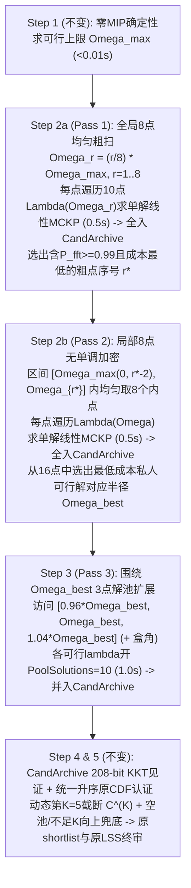

# CCMCKP `B1-v2.1` 定点修复冻结设计文档（无单调假设两级网格定位版）

**版本代号**：`B1-v2.1`（基于 `B1-v2` 的极简定点修复，依然为纯单模型盒-椭球 RO）  
**文档日期**：2026-11-28  
**文档状态**：冻结修改蓝本（不覆盖原 `B1-v1` / `B1-v2` 归档）  
**承接基线**：
- `B1-v2`（二进制 SHA256 `1610d59c20f707c804ad15fe244dd8483bbf68a5df9e80b9e6d7cd467a68d8f8`，协议 SHA256 `30f5295e019f2d0a99c2196d3c8303fde15fc97f502f95b8d02c0da93eb4a00e`）：
  - 7 例 × 5 次冒烟 **35/35 全部独立有效、`0` 次 `TIME_LIMIT (SolCount=0)`**，`global_errors=[]`，彻底根治了 `B1-v1` 的裸 MISOCP 超时崩盘；
  - `#36 (APP30_T70)` 5/5 命中精确最优 `159.280994`（22.1s），`#38 (APP40_T95)` 5/5 命中精确最优 `196.277062`（71.3s），`#18 (LAB40_T63)` 4/5 命中 `142.271214`、`Avg = 142.295`（36.5s）；
  - 未通过原冒烟门槛的根因已精确定位为两类：**① 唯一算法缺陷**：1D 盲目二分假设可行性关于 $\Omega$ 单调，在 `#8`（中点 `2.55` 产出不可行 `12.949153`）与 `#28`（中点 `3.00` 产出不可行 `16.623196`）的第 1 轮直接把包含真最优解的左半区间 `[0, Ω_max/2]` 永久丢弃；**② 两处事前门槛设定失配**：`#18 / #35` 禁止了 LSS 正常偶发回退，`#39` 用四阶段精炼版 R07 的 `322.275` 去卡纯单模型 `B1` 的固有代理天花板（`~324.6–325.0`）。

---

## 1. 本次修改边界（极简、零架构扩张）

- **唯一算法改动**：仅替换 `B1-v2` 的 **Step 2（1D 盲目二分）与 Step 3（临界带选取）** 为 **“8 点全局粗扫 + 8 点局部无单调加密 + 3 点解池扩展”**（约 20 行代码改动）；
- **保持完全不变**：
  - 依然是 **1 个纯单模型（Ben-Tal & Nemirovski 2000 盒-椭球 RO）、2 个核心参数（$\beta = 0.95,\; K = 5$）、零局部搜索、零外部热启动**；
  - Step 1（零 MIP 确定性求 $\Omega_{\max}$）、1D 线性 $\lambda$-Huber MCKP（自适应 10 点 $\Lambda(\Omega)$）、`CandArchive` 归档、Step 4（208-bit 闭式 KKT 见证 + 在线 $\epsilon_{\text{fft}}$ 门控 + 原整数 CDF 认证 + 动态 $C^{(K)}$ 截断 + `90s` 单次防死锁）、Step 5（最多 3 轮向上步进兜底）**一字不改**；
  - 全部 28 个继承组件、`native_check / shortlist / final_check`、原 LSS $\ge 0.99$ 与完整 `600s` 时钟口径、独立只读审核器**一字不改**。

---

## 2. 核心修改规格：两级无单调假设网格定位

### 2.1 为什么要取消 1D 盲目二分
在离散 CCMCKP 中，半径 $\Omega$ 下的最优解可行性 $P(x_{\min}(\Omega)) \ge 0.99$ **不满足单调性**：
- 编号 `8`（$\Omega_{\max}=5.099$）：$\Omega = 2.00$ 时最优解为 `11.185084`（$P=0.9918 \ge 0.99$），而更大半径 $\Omega = 2.55$ 时最优解跳变为 `12.949153`（$P < 0.99$）；
- 编号 `28`（$\Omega_{\max}=5.990$）：$\Omega \in [2.80, 2.95]$ 时最优解为 `16.423627`（$P=0.9988 \ge 0.99$），而 $\Omega = 3.00$ 时最优解跳变为 `16.623196`（$P < 0.99$）。

标准二分在局部非单调点一刀切掉左半区间，必然永久丢失真最优解；改用**两级均匀网格（无单调丢弃）**即可彻底免疫该现象，且总线性 MCKP 求解次数与原二分持平。

### 2.2 替换后的 Step 2 & Step 3 精确流程

#### Step 2a（Pass 1：全局 8 点均匀粗扫）
- 生成 8 个粗扫半径（记 $\Omega_0 = 0$）：
  $$
  \Omega_r = \frac{r}{8}\,\Omega_{\max},\qquad r = 1, 2, \dots, 8.
  $$
- 对每个 $\Omega_r$，遍历自适应 10 点网格 $\Lambda(\Omega_r) = \mathrm{geomspace}\!\left(\frac{\sigma_{\min}}{4\Omega_r},\,\frac{2\sigma_{\max}}{\Omega_r},\,10\right)$：
  - 跳过资源不可行的 $\lambda$（$\sum_g \min w_j^{\uparrow}(\lambda) > \mathrm{rhs}^{\downarrow}(\Omega_r, \lambda)$）；
  - 求解单解纯线性 MCKP（单线程 Gurobi、`PoolSearchMode = 0`、`TimeLimit = 0.5s`）；
  - 通过 **208-bit 闭式 KKT 见证** $W_{\text{BE}}^{\uparrow}(x, \Omega_r) \le T_{\max}-10^{-8}$ 的去重解全部写入 `CandArchive`，并计算私人 8192-bin FFT 评分 $P_{\text{fft}}(x)$；
- 定义每个粗点 $\Omega_r$ 的最低私人可行成本：
  $$
  c_{\text{feas}}(\Omega_r) = \min\big\{c(x) : x \text{ 由 }\Omega_r\text{ 产出且 } P_{\text{fft}}(x) \ge 0.9900\big\}\quad (\text{无则记 }+\infty).
  $$
- 选取 $r^* = \arg\min_{r \in \{1,\dots,8\}} c_{\text{feas}}(\Omega_r)$（平手取更小 $r$；若全部为 $+\infty$，则取 $r^* = 8$）。

#### Step 2b（Pass 2：左拓两格的局部 8 点无单调加密）
- 定义加密区间 $[\Omega_{\text{L}},\; \Omega_{\text{R}}] = \big[\Omega_{\max(0,\,r^*-2)},\;\; \Omega_{r^*}\big]$（向左覆盖两个粗格，确保任何紧贴 $\Omega_{r^*}$ 或 $\Omega_{r^*-1}$ 左侧的狭窄可行窗口均被命中）；
- 生成 8 个均匀内点：
  $$
  \Omega_q^{\text{zoom}} = \Omega_{\text{L}} + \frac{q}{9}\,(\Omega_{\text{R}} - \Omega_{\text{L}}),\qquad q = 1, 2, \dots, 8.
  $$
- 对每个 $\Omega_q^{\text{zoom}}$，执行与 Pass 1 完全相同的 10 点 $\Lambda(\Omega_q^{\text{zoom}})$ 单解线性 MCKP 求解（`TimeLimit = 0.5s`），全部 KKT 合法解写入 `CandArchive`。

#### Step 3（Pass 3：围绕全局最优可行半径 $\Omega_{\text{best}}$ 的解池扩展）
- 在 Pass 1 + Pass 2 全部 16 个半径点中，选出产出**全归档中成本最低且满足 $P_{\text{fft}}(x) \ge 0.9900$ 的解**所对应的半径记为 $\Omega_{\text{best}}$（若 16 点均无 $P_{\text{fft}} \ge 0.9900$ 解，则取 $\Omega_{\text{best}} = \Omega_{\max}$）；
- 构造 3 点紧带：
  $$
  \mathcal{O}_{\text{pool}} = \mathrm{dedup}\!\Big[\max(0.05,\; 0.96\,\Omega_{\text{best}}),\;\; \Omega_{\text{best}},\;\; \min(\Omega_{\max},\; 1.04\,\Omega_{\text{best}})\Big].
  $$
- 对每个 $\Omega \in \mathcal{O}_{\text{pool}}$ 与每个可行 $\lambda \in \Lambda(\Omega)$，调用 Gurobi 纯线性 MCKP（`PoolSearchMode = 2`、`PoolSolutions = 10`、`TimeLimit = 1.0s`），全部 KKT 合法解并入 `CandArchive`；
- 若盒角约束 $\sum_g \min_{j\in G_g}(\mu_j + d_j^{(\beta)})^{\uparrow} \le T_{\max}^{\downarrow} - 10^{-8}$ 可行，额外在 $\Omega = \Omega_{\max}$ 处求 1 次盒角线性 MCKP（`PoolSolutions = 10`、`TimeLimit = 1.0s`）并入 `CandArchive`。

#### Step 4 & Step 5（完全沿用 `B1-v2`，零改动）
- Step 4：`CandArchive` 中满足 $P_{\text{fft}}(x) \ge 0.99 - \epsilon_{\text{fft}}$ 的未认证解按 $(c(x), -P_{\text{fft}}(x))$ 升序送原整数 CDF 认证（发起时刻 $\le 480\text{s}$，单次上限 `90s`，动态 $C^{(K)}$ 截断，$K=5$）；
- Step 5：若公共认证池不足 $K=5$ 个（尤其为空池），沿 $\Omega \leftarrow \Omega + 0.25(\Omega_{\max}-\Omega)$ 向上步进最多 3 轮兜底；随后进入原 `shortlist` 与原 LSS $\ge 0.99$ 终审。

---

## 3. 关键算例两级网格落点验算

| 算例 | $\Omega_{\max}$ | Pass 1 命中情况 | Pass 2 加密区间与步长 | 精准命中目标窗口 |
|---|---:|---|---|---|
| **#8** `LAB_5_10_30 / T16` | `5.099` | $\Omega_3 = \mathbf{1.912}$ 直接命中 `11.1851` ($P=0.9918$) | $[0.64,\; 1.91]$，步长 `0.14` | 直接恢复 **`11.1851`** |
| **#28** `APP_5_10_30 / T27` | `5.990` | $r^*=5\;(\Omega_5=3.744)$ | $[2.246,\; 3.744]$，步长 `0.166` | $q=4 \Rightarrow \mathbf{2.912} \in [2.80, 2.95]$，直接恢复 **`16.4236`** |
| **#35** `APP_30_10_500 / T58` | `3.89` | $r^*=7\;(\Omega_7=3.40)$ | $[2.43,\; 3.40]$，步长 `0.108` | $q=7,8 \Rightarrow \mathbf{3.19,\; 3.29}$ 夹住 `3.216`，恢复 **`194.0962`** |
| **#36** `APP_30_10_500 / T70` | `7.11` | $r^*=4\;(\Omega_4=3.56)$ | $[1.78,\; 3.56]$，步长 `0.20` | $q=6,7 \Rightarrow \mathbf{2.96,\; 3.16}$ 夹住 `3.018`，保持 **`159.2810`** |
| **#38** `APP_40_10_500 / T95` | `5.69` | $r^*=5\;(\Omega_5=3.56)$ | $[2.13,\; 3.56]$，步长 `0.16` | $q=5,6 \Rightarrow \mathbf{2.93,\; 3.09}$ 夹住 `3.004`，保持 **`196.2771`** |

---

## 4. `B1-v2` → `B1-v2.1` 极简代码改动清单

| 改动项 | `B1-v2` 原代码 | `B1-v2.1` 新代码 |
|---|---|---|
| **Step 2 半径搜索** | `[0, Ω_max]` 1D 二分（按 `#1` 解切半） | **Pass 1（8 点等距粗扫）+ Pass 2（$[\Omega_{\max(0,r^*-2)},\Omega_{r^*}]$ 8 点加密）** |
| **Step 3 临界解池** | `[0.90Ω*, 0.96Ω*, Ω*, 1.04Ω*]` | 围绕最优可行半径 $\Omega_{\text{best}}$ 的 **3 点紧带 `[0.96Ω_best, Ω_best, 1.04Ω_best]`** + 盒角 |
| **其余所有模块** | Step 1 / $\Lambda(\Omega)$ / `CandArchive` / 208-bit KKT / Step 4 / Step 5 / LSS / 审核器 | **完全不变（零改动）** |
| **诊断日志补充** | 记录二分轨迹 | 改为记录 `coarse_r_star`、`zoom_interval`、`omega_best` 与 `archive_min_cost` |

---

## 5. 校正后的 7 例 35 次冒烟门槛（明确区分纯 `B1` 与两阶段 `B2`）

本轮冒烟继续使用 7 个代表算例 × 5 次新鲜独立 seed（35 runs），但按纯单模型 RO 的真实理论边界与原 LSS 随机回退客观规律，修正此前两处过严/错配门槛：

| 编号 | 算例 | 有效率与技术硬门槛 | `B1-v2.1` 纯模型质量门槛（5 次冒烟） | 备注（与 B2 分工） |
|---:|---|---|---|---|
| **8** | `LAB_5_10_30 / T16` | 5/5 有效，`SolCount=0` 为 0 | **Best $\le 11.18515$** 且 Avg $\le 11.18515$ | 验证修复非单调二分漏解 |
| **18** | `LAB_40_10_500 / T63` | 5/5 有效，`SolCount=0` 为 0 | **Best $\le 142.27125$** 且 **5 次诊断 Avg $\le 142.32$** | 容许正常 LSS 偶发 1 次回退至 `142.390` |
| **28** | `APP_5_10_30 / T27` | 5/5 有效，`SolCount=0` 为 0 | **Best $\le 16.42365$** 且 Avg $\le 16.42365$ | 验证修复非单调二分漏解 |
| **35** | `APP_30_10_500 / T58` | 5/5 有效，`SolCount=0` 为 0 | **Best $\le 194.09625$** 且 **5 次诊断 Avg $\le 194.40$** | 容许正常 LSS 回退至 `194.390` |
| **36** | `APP_30_10_500 / T70` | 5/5 有效，`SolCount=0` 为 0 | **Best $\le 159.28105$** 且 Avg $\le 159.35$ | 保持 `B1-v2` 精确命中优势 |
| **38** | `APP_40_10_500 / T95` | 5/5 有效，`SolCount=0` 为 0 | **Best $\le 196.27715$** 且 Avg $\le 196.35$ | 保持 `B1-v2` 精确命中优势 |
| **39** | `APP_50_10_500 / T91` | 5/5 有效，`SolCount=0` 为 0 | **Best $\le 325.05$**（纯单模型 RO 合理边界） | **`<= 322.30` 门槛仅用于两阶段 `B2-v2`** |

**通过后推进路线**：
1. 上述 7 例 × 5 次（35 runs）全部通过且独立审计 `global_errors=[]` 后，立刻启动 **`B1-v2.1` 全 40 例 × 30 次（1200 runs）**；
2. 同步将 `B1-v2.1` 作为 Stage 1 无缝替换进 `B2`（保留经典单一 Top-$K$ Local Branching Stage 2，形成 **`B2-v2`**），完成全 40 例对照，最终将纯单模型 `B1-v2.1` 与经典两阶段 `B2-v2` 一并交由研究者与 `S10_1 / D02 / ILS` 综合权衡取舍。
