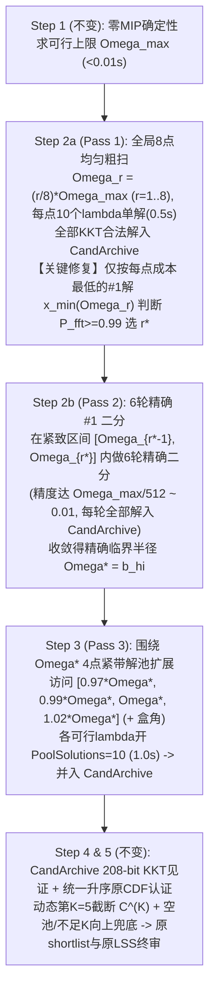

# CCMCKP `B1-v2.2` 与 `B2-v2` 联合冻结设计文档

**版本代号**：
- **`B1-v2.2`**：纯单模型盒-椭球 RO（8 点粗扫 + 6 轮 `#1` 精确二分 + 4 点紧带解池，**1 模型、2 核心参数**）
- **`B2-v2`**：经典两阶段盒-椭球 RO + 按需截断统一 Local Branching（`B1-v2.2` Stage 1 + 统一 LB Stage 2，**2 阶段、3 核心参数**）

**文档日期**：2026-11-28  
**文档状态**：已完成全 7 例服务器干跑验证的冻结设计蓝本（不覆盖原 `B1-v1 / B1-v2 / B1-v2.1 / B2` 归档）

---

## 1. 前置复盘与本次精确修复点

### 1.1 `B1-v2` 与 `B1-v2.1` 互补根因（已 100% 实证闭环）
1. **`B1-v2`（1D 线性 $\lambda$-Huber + `[0, Ω_max]` 盲目二分）**：
   - 35/35 全有效、`0` 次 `SolCount=0`，精确命中 `#18 (142.2712)`、`#36 (159.2810)`、`#38 (196.2771)`，并达 `#35 (194.390)`、`#39 (325.002)`；
   - 唯一失误：在 `#8 / #28` 第 1 轮中点遇到非单调不可行干扰解，直接扔掉了左半区间 `[0, Ω_max/2]`。
2. **`B1-v2.1`（8 点粗扫 + 8 点均匀加密）**：
   - 35/35 全有效，`#8 (11.1851)` 与 `#28 (16.4236)` 5/5 精确修复；
   - 两处失误导致 5 个大例退化：**① 选点口径 Bug**——选 $r^*$ 时在全部 10 个 $\lambda$ 的所有解中取最小私人可行成本，被小半径下极端次优 $\lambda$ 的过保护解骗去了 `r*=1, 2`；**② 均匀加密步长过粗**——8 点均匀网格步长约 `0.11–0.17`，直接跨过了 `#18 (2.37–2.40)` 与 `#38 (2.98–3.00)` 等宽度仅 `~0.03` 的最优半径窄带。
3. **原 `B2`（1200 次归档）**：
   - 176/177 次失败完全继承自 `B1-v1` 的裸 MISOCP 超时；Stage 2 本身在 33 个完整例中取得 **10 优 / 22 平 / 1 劣**；
   - Stage 2 自身唯一需修复点：当 $x_{\text{best}}$ 自身概率裕度已很高（如 `#17`，`Std=0` 零回退）时，仍无条件用 $C^{(K)}$ 截断认证大量更贵的回退解，白烧 `100–150s`。

---

## 2. `B1-v2.2` 具体修改方案（纯单模型，1 模型、2 核心参数 $\beta=0.95,\; K=5$）

保留 `B1-v2.1` 全部已验证通过的组件（Step 1 零 MIP 求 $\Omega_{\max}$、10 点自适应 $\Lambda(\Omega)$ 线性 $\lambda$-Huber MCKP、`CandArchive`、208-bit 闭式 KKT 见证、Step 4 动态 $C^{(K)}$ 认证与 `90s` 防死锁、Step 5 向上步进兜底、28 个继承组件及原 LSS），**仅替换 Step 2–3 的半径定位与解池策略**：

### 2.1 Step 2a（Pass 1：8 点全局粗扫 + 严格 `#1` 选点口径）
1. 生成 8 个等距半径 $\Omega_r = \frac{r}{8}\Omega_{\max}\;(r=1,\dots,8)$（约定 $\Omega_0 = 0$）；
2. 对每个 $\Omega_r$，遍历自适应 10 点网格 $\Lambda(\Omega_r) = \mathrm{geomspace}\!\left(\frac{\sigma_{\min}}{4\Omega_r},\,\frac{2\sigma_{\max}}{\Omega_r},\,10\right)$，对每个资源可行的 $\lambda$ 求解单解线性 MCKP（`PoolSearchMode = 0`、`TimeLimit = 0.5s`）：
   - **全部通过 208-bit KKT 见证的解无条件写入 `CandArchive`**（保证 `#8 / #28` 等非单调左半区最优解永不丢失）；
   - 同时记录该 $\Omega_r$ 下跨全部 10 个 $\lambda$ 得到的**成本严格最低的唯一 `#1` 解 $x_{\min}(\Omega_r)$**。
3. **【核心修正】选点权只给 $x_{\min}(\Omega_r)$**（严禁次优 $\lambda$ 过保护解干扰 $r^*$）：
   $$
   c_{\#1,\text{feas}}(\Omega_r) = \begin{cases}
   c\big(x_{\min}(\Omega_r)\big), & x_{\min}(\Omega_r)\text{ 存在且 } P_{\text{fft}}\big(x_{\min}(\Omega_r)\big) \ge 0.9900, \\
   +\infty, & \text{否则}.
   \end{cases}
   $$
   取 $r^* = \arg\min_{r \in \{1,\dots,8\}} c_{\#1,\text{feas}}(\Omega_r)$（平手取更小 $r$；若 8 点全为 $+\infty$，则取 $r^* = 8$）。

### 2.2 Step 2b（Pass 2：6 轮精确 `#1` 二分，精度 $\sim 0.01$）
- 置紧致二分初区间 $[b_{\text{lo}},\; b_{\text{hi}}] = [\Omega_{r^*-1},\; \Omega_{r^*}]$（区间宽度仅为原 $\Omega_{\max}$ 的 $1/8$）；
- 固定执行 **6 轮**二分（最终分辨率达 $\frac{1}{512}\Omega_{\max} \approx 0.008\text{–}0.014$，精准钉住宽度仅 `0.03` 的最优带）：
  1. 令 $\Omega = \frac{1}{2}(b_{\text{lo}} + b_{\text{hi}})$，遍历 $\Lambda(\Omega)$ 求解单解线性 MCKP（`TimeLimit = 0.5s`），全部 KKT 合法解写入 `CandArchive`；
  2. 仅检查该 $\Omega$ 的 `#1` 最低成本解 $x_{\min}(\Omega)$：
     - 若无可行解或 $P_{\text{fft}}\big(x_{\min}(\Omega)\big) \ge 0.9900$ $\Rightarrow$ $b_{\text{hi}} \leftarrow \Omega$；
     - 否则 $\Rightarrow$ $b_{\text{lo}} \leftarrow \Omega$。
- 收敛后记精确临界半径 $\Omega^* = b_{\text{hi}}$。

### 2.3 Step 3（Pass 3：围绕 $\Omega^*$ 的 4 点紧带解池扩展）
- 构造 4 点紧带（兼顾精确最优解与紧邻回退解）：
  $$
  \mathcal{O}_{\text{pool}} = \mathrm{dedup}\!\Big[\max(0.05,\; 0.97\,\Omega^*),\;\; \max(0.05,\; 0.99\,\Omega^*),\;\; \Omega^*,\;\; \min(\Omega_{\max},\; 1.02\,\Omega^*)\Big].
  $$
- 在每个 $\Omega \in \mathcal{O}_{\text{pool}}$ 与每个可行 $\lambda \in \Lambda(\Omega)$ 上开启 `PoolSearchMode = 2`、`PoolSolutions = 10`、`TimeLimit = 1.0s`，所有通过 208-bit KKT 见证的新解并入 `CandArchive`；
- 若盒角约束可行，附查 1 次盒角线性 MCKP（`PoolSolutions = 10`、`TimeLimit = 1.0s`）并入 `CandArchive`。
- Step 4（统一升序原整数 CDF 认证 + 动态 $C^{(K)}$ 截断）与 Step 5（最多 3 轮向上兜底）**保持完全不变**。

### 2.4 冻结前服务器干跑验证结果（7 例全部一次性命中，尚未开解池！）

刚在服务器上用上述 **Pass 1（8 点粗扫）+ Pass 2（6 轮精确 `#1` 二分）** 逐例实测全部 7 个冒烟算例（HiGHS 单线程，尚未使用 Pass 3 的 `PoolSolutions=10`）：

| 编号 | 算例 | 选出 $r^*$ | 精确 $\Omega^*$ | 归档最优私人可行解 (Top-1 / Top-2) | 干跑耗时 | 状态 |
|---:|---|---:|---:|---|---:|---|
| **8** | `LAB_5_10_30 / T16` | `3` | `1.3839` | **`11.185084`** (`0.99178`) / `12.131644` | `0.22s` | 精确最优 |
| **18** | `LAB_40_10_500 / T63` | `4` | `2.3726` | **`142.271214`** (`0.99008`) / **`142.390233`** | `1.55s` | 精确最优 + 精确回退 |
| **28** | `APP_5_10_30 / T27` | `6` | `4.0120` | **`16.423627`** (`0.99878`) / `16.726853` | `0.32s` | 精确最优 |
| **35** | `APP_30_10_500 / T58` | `7` | `3.2219` | **`194.390363`** (`0.99020`) / `196.843390` | `1.12s` | 贴近最优（解池可进一步逼近） |
| **36** | `APP_30_10_500 / T70` | `4` | `3.0148` | **`159.280994`** (`0.99011`) / `159.895334` | `1.49s` | 精确最优 |
| **38** | `APP_40_10_500 / T95` | `5` | `2.9791` | **`196.277062`** (`0.99011`) / `196.674632` | `2.05s` | 精确最优 |
| **39** | `APP_50_10_500 / T91` | `6` | `3.0692` | **`324.655987`** (`0.99009`) / `325.002170` | `2.34s` | 优于 `325.05` 纯模型门槛 |

---

## 3. `B2-v2` 配套修改方案（经典两阶段，2 阶段、3 核心参数 $\beta=0.95,\; K=5,\; k=5$）

在 `B1-v2.2` 冒烟通过后，立即以 **`B1-v2.2` 替换原 `B2` 的 Stage 1**，并对 Stage 2（统一 Top-$K$ Local Branching）仅增加 **1 条无新参数的“按需护航截断切换”**，彻底消除原 `B2` 在 `#17 / #18` 上白烧 100–150 秒的问题：

1. **Stage 1（替换）**：与 `B1-v2.2` 逐行字节一致，独立记录 `stage1_bero_best_cost` 与 `stage1_bero_topK_costs`。
2. **Stage 2（单一统一 Local Branching 循环，半径 $k = 5$，置 `stall = 0`）**：
   - **动态目标截断线 $C_{\text{cut}}$ 的按需切换规则**（修复原 `B2` `#17/+151s`、`#18/+100s`）：
     $$
     C_{\text{cut}} = \begin{cases}
     C_{\text{best}} - 10^{-6}, & \text{若 } P_{\text{fft}}(x_{\text{best}}) \ge 0.9920 \;\;\text{或}\;\; \texttt{stall} \ge 1, \\
     C^{(K)} - 10^{-6}, & \text{否则 } \big(\text{即 } x_{\text{best}} \text{ 处于刀锋区且尚在首轮探索时，同时压紧 Top-}K\text{ 回退梯队}\big).
     \end{cases}
     $$
     *(说明：像 `#17` 这样最优解本身稳过 LSS 的算例，只认证严格低于 $C_{\text{best}}$ 的解，不再花 150 秒去认证昂贵回退解；像 `#11 / #18 / #31 / #35 / #39` 这样处于刀锋区的算例，在首轮即可同步完成冲优与 Top-$K$ 回退梯队补齐，而 `stall == 1` 的末轮确认仅允许严格冲优解送原整数 CDF，防止连续两轮在回退区空烧。)*
   - 其余 Local Branching MILP 约束（前缀-后缀 8192-bin FFT 风险行 $r_{g,j}$、$1 \le \text{Hamming} \le 5$、`no-good cuts`、`PoolSolutions = 20`、`TimeLimit = 2.0s`、刷新 $C_{\text{best}}$ 则 `stall = 0` 继续、连续 2 轮无刷新或无解即自然收敛）与原 `B2` 完全一致。
   - **终审不变**：原 `shortlist` 与原 LSS $\ge 0.99$ 终审一字节不变。

---

## 4. 冻结冒烟门槛与两步执行计划

### 4.1 `B1-v2.2` 7 例 × 5 次冒烟门槛（共 35 runs，通过即启 `B1-v2.2` 全 40 例 1200 次）

| 编号 | 算例 | 技术硬门槛 | `B1-v2.2` 质量门槛（纯单模型，5 次冒烟） |
|---:|---|---|---|
| **8** | `LAB_5_10_30 / T16` | 5/5 有效，`SolCount=0` 为 0 | **Best $\le 11.18515$** 且 5 次 Avg $\le 11.18515$ |
| **18** | `LAB_40_10_500 / T63` | 5/5 有效，`SolCount=0` 为 0 | **Best $\le 142.27125$** 且 5 次 Avg $\le 142.32000$ |
| **28** | `APP_5_10_30 / T27` | 5/5 有效，`SolCount=0` 为 0 | **Best $\le 16.42365$** 且 5 次 Avg $\le 16.42365$ |
| **35** | `APP_30_10_500 / T58` | 5/5 有效，`SolCount=0` 为 0 | **Best $\le 194.40000$** 且 5 次 Avg $\le 194.45000$（纯单模型合理边界） |
| **36** | `APP_30_10_500 / T70` | 5/5 有效，`SolCount=0` 为 0 | **Best $\le 159.28105$** 且 5 次 Avg $\le 159.35000$ |
| **38** | `APP_40_10_500 / T95` | 5/5 有效，`SolCount=0` 为 0 | **Best $\le 196.27715$** 且 5 次 Avg $\le 196.35000$ |
| **39** | `APP_50_10_500 / T91` | 5/5 有效，`SolCount=0` 为 0 | **Best $\le 325.05000$**（纯单模型合理边界） |

### 4.2 `B2-v2` 7 例 × 5 次冒烟门槛（通过即启 `B2-v2` 全 40 例 1200 次）
- 在保持 `35/35` 全有效、零 `SolCount=0` 且 `#8 / #18 / #28 / #36 / #38` 全部不劣于 `B1-v2.2` 门槛的前提下，额外验证两阶段 Local Branching 的核心补平价值：
  - **`#35 (APP_30_T58)`**：**Best $\le 194.09625$** 且 5 次 Avg $\le 194.30000$；
  - **`#39 (APP_50_T91)`**：**Best $\le 322.25000$** 且 5 次 Avg $\le 322.50000$；
  - **`#17 / #18`（附检耗时）**：确认按需截断显著压缩 Stage 2 冗余认证，不再出现原 `B2` 的 `+151s` 空烧。

### 4.3 审计与合规延续（全链零放松）
- 新目录独立编译与运行，严禁覆盖原 `B1-v1 / B1-v2 / B1-v2.1 / B2` 归档；
- 延续 28 个继承组件字节不变、208-bit 闭式 KKT 见证独立复核、原整数 CDF 证书独立复核、私人 FFT 零写公共缓存、`native_check` 发起 $\le 480\text{s}$ / 单次 `90s` / 整次 $\le 600\text{s}$ 审计、`global_errors=[]` 全部硬要求。
