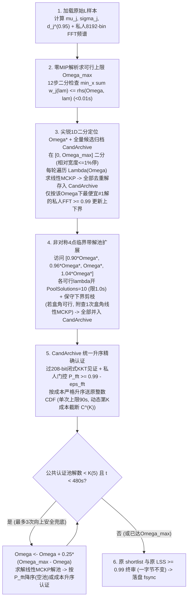

# CCMCKP B1（`BE-RO-Pure`）v2 增量修复冻结设计文档

**版本代号**：`B1-v2`（1D 线性 $\lambda$-Huber 精确分解版 `BE-RO-Pure`）  
**文档日期**：2026-11-28  
**文档状态**：面向 B1-v1 1200 次测试暴露问题的定向修复蓝本（保留纯单模型盒-椭球 RO 的全部理论定位与审计红线）  
**承接基线**：
- `B1-v1`（协议 SHA256 `a564937a02c5e74ab94d160d3ae67e88f489164155b7b1fdc61641dd8a340dee`）：1200 次中独立有效 1028/1200，失败 172 次，其中 **155 次（90.1%）为 620 个临界池裸紧凑 `BE-MISOCP` 子问题在 3 秒内 `TIME_LIMIT (SolCount=0)`**，另 16 次为空认证池、1 次为 LSS 拒绝；同时 34 个完整组中有 10 例（含 `#8/+21.1%`、`#28/+21.3%`）因单解二分误切与丢弃二分候选而出现成本退化。

---

## 1. 修复目标与不变边界

### 1.1 本次修复的核心目标
1. **彻底消灭 `TIME_LIMIT (SolCount=0)` 导致的 155 次失败与 `#19/#33/#34` 高波动**：用数学 100% 等价的 **1D 线性 $\lambda$-Huber MCKP 分解**替代弱松弛的裸紧凑 `BE-MISOCP`，将变量数从 $3n+1$ 降回 $n$、彻底去掉二次锥，使单次线性子问题在 `0.02–0.2s` 内收敛到 0% gap；
2. **彻底修复 `#8 / #28 / #14 / #16 / #29 / #30` 的单解二分误切退化**：保留二分阶段全部候选进入统一 `CandArchive`，保持尖锐 `#1` 二分定位 $\Omega^*$，并将临界采样带向左适度拓宽；
3. **彻底消灭 16 次空认证池失败**：在 `480s` 搜索预算内增加面向 $\Omega_{\max}$ 的**安全向上步进兜底**；
4. **严守纯单模型简洁性**：依然只保留 **1 个鲁棒优化模型（Ben-Tal & Nemirovski 2000 盒-椭球 RO）**、**2 个核心参数（$\beta = 0.95,\; K = 5$）**、**零局部搜索、零外部热启动**。

### 1.2 100% 保持不变的审计与实验红线
- 原 28 个继承组件、`native_check / shortlist / final_check` 函数体、原 LSS $\ge 0.99$ 终审、严格事件 $\sum a_j x_j < T_{\max}$、实际样本索引 `0..L-1` 及完整 `600s` 时钟口径一字节不变；
- 独立冷启动、零算例特判、零 LSS 反馈调参、私人 8192-bin FFT 零写入公共概率缓存；
- 沿用 `B1-v1` 的 **208-bit 闭式 KKT 最坏消耗独立见证** $W_{\text{BE}}^{\uparrow}(x, \Omega) \le T_{\max} - 10^{-8}$ 与“发起新调用时刻 $\le 480\text{s}$ + 单次 `native_check` 上限 `90s` + 整次 $\le 600\text{s}$”时钟审计规则。

---

## 2. 精确等价重构：1D 线性 $\lambda$-Huber MCKP 分解

### 2.1 数据驱动参数构造（与 B1-v1 完全一致）
对每件物品 $j \in \{1,\dots,n\}$ 的 $L$ 个原始升序样本 $a_{j,(1)} \le \cdots \le a_{j,(L)}$，按唯一尾部参数 **$\beta = 0.95$** 计算：
$$
m = \min\big(L,\;\max(3,\;\lceil(1-\beta)L\rceil)\big),
$$
$$
\mu_j = \frac{1}{L}\sum_{k=1}^{L} a_{jk},\qquad
\sigma_j = \sqrt{\frac{1}{L}\sum_{k=1}^{L}(a_{jk}-\mu_j)^2},\qquad
d_j^{(\beta)} = \frac{1}{m}\sum_{r=1}^{m} a_{j,(L+1-r)} - \mu_j \ge 0.
$$

### 2.2 精确拉格朗日 1D 分解（无二次锥、仅 $n$ 个 0-1 变量）
盒-椭球不确定集合 $\mathcal{U}_{\text{BE}}(\Omega) = \{\mu+\zeta : 0 \le \zeta_j \le d_j^{(\beta)},\; \sum_{j:\sigma_j>0} (\zeta_j/\sigma_j)^2 \le \Omega^2\}$ 的最坏消耗满足精确对偶恒等式：
$$
W_{\text{BE}}(x, \Omega)
= \sum_{j=1}^n \mu_j x_j + \min_{\lambda > 0}\left\{\lambda \Omega^2 + \sum_{j=1}^n h_j(\lambda)\, x_j\right\},
$$
其中：
- 若 $\sigma_j = 0$（或 $d_j^{(\beta)} = 0$）：$h_j(\lambda) \equiv 0$；
- 若 $\sigma_j > 0$ 且 $d_j^{(\beta)} > 0$：
  $$
  z_j^*(\lambda) = \min\!\left(d_j^{(\beta)},\;\frac{\sigma_j^2}{2\lambda}\right),\qquad
  h_j(\lambda) = z_j^*(\lambda) - \lambda\,\frac{(z_j^*(\lambda))^2}{\sigma_j^2}
  = \begin{cases}
  \dfrac{\sigma_j^2}{4\lambda}, & \dfrac{\sigma_j^2}{2\lambda} \le d_j^{(\beta)}, \\[8pt]
  d_j^{(\beta)} - \dfrac{\lambda (d_j^{(\beta)})^2}{\sigma_j^2}, & \dfrac{\sigma_j^2}{2\lambda} > d_j^{(\beta)}.
  \end{cases}
  $$

**关键数学性质**：对**任意**固定 $\lambda > 0$，纯线性单约束多选背包子问题（`BE-Linear-MCKP`）：
$$
\begin{aligned}
\min_{x \in \mathcal{X}}\quad & \sum_{j=1}^n c_j x_j \\
\text{s.t.}\quad & \sum_{j=1}^n w_j^{\uparrow}(\lambda)\, x_j \le \mathrm{rhs}^{\downarrow}(\Omega, \lambda),
\end{aligned}
$$
其中 $w_j^{\uparrow}(\lambda)$ 为 $\mu_j + h_j(\lambda)$ 的高精度**向上舍入**，$\mathrm{rhs}^{\downarrow}(\Omega, \lambda)$ 为 $T_{\max} - 10^{-8} - \lambda\Omega^2$ 的高精度**向下舍入**。该子问题的任意可行 0-1 解数学上自动满足 $W_{\text{BE}}(x, \Omega) \le T_{\max} - 10^{-8}$；同时所有入池候选仍统一经过 **208-bit 闭式 KKT 水注公式** 独立复算见证。

### 2.3 跨全 40 例自适应无量纲 $\lambda$ 网格
由 KKT 最优性条件 $\lambda^* \approx \frac{\sqrt{\sum_{j\in S}\sigma_j^2}}{2\Omega}$，先按原始数据计算全局尺度上下界：
$$
\sigma_{\min} = \max\!\left(10^{-4},\;\sqrt{\sum_{g=1}^G \min_{j \in G_g}\sigma_j^2}\right),\qquad
\sigma_{\max} = \max\!\left(1.2\,\sigma_{\min},\;\sqrt{\sum_{g=1}^G \max_{j \in G_g}\sigma_j^2}\right).
$$
对任意正半径 $\Omega > 0$，自动生成 **10 个等比对偶格点**（无任何硬编码算例尺度）：
$$
\Lambda(\Omega) = \mathrm{geomspace}\!\left(\frac{\sigma_{\min}}{4\Omega},\;\;\frac{2\,\sigma_{\max}}{\Omega},\;\; 10\right).
$$

---

## 3. `B1-v2` 完整修复算法流程

### 3.1 Step 1：零 MIP 确定性求资源可行上限 $\Omega_{\max}$
- 上界初值 $\Omega_{\text{cap}} = \min\!\Big(8.0,\;\sqrt{\sum_{g=1}^G \max_{j \in G_g,\;\sigma_j>0}(d_j^{(\beta)}/\sigma_j)^2}\Big)$；
- 在 $[0, \Omega_{\text{cap}}]$ 上执行 12 步二分，每步仅做纯数组检查（**0 次 MIP 调用，总耗时 <0.01s**）：
  $$\text{存在 }\lambda \in \Lambda_{12}(\Omega)\text{ 使得 }\sum_{g=1}^G \min_{j \in G_g} w_j^{\uparrow}(\lambda) \le \mathrm{rhs}^{\downarrow}(\Omega, \lambda) \quad\text{或盒角可行 }\sum_{g=1}^G \min_{j \in G_g}(\mu_j+d_j^{(\beta)})^{\uparrow} \le T_{\max}^{\downarrow}-10^{-8}.$$
- 确定性得到精确可行半径上限 $\Omega_{\max}$。

### 3.2 Step 2：尖锐 `#1` 二分定位 $\Omega^*$ + 全量归档 `CandArchive`
- 维护全局私有字典 `CandArchive: vector -> (cost, omega_witness, lam_witness, p_fft)`（同一向量保留产生它的有效 $\Omega$，绝不丢弃任何二分途中找到的解！）；
- 置 $\Omega_{\text{lo}} = 0,\; \Omega_{\text{hi}} = \Omega_{\max}$；
- 当 $(\Omega_{\text{hi}} - \Omega_{\text{lo}})/\max(\Omega_{\max}, 10^{-9}) > 10^{-2}$ 且 $t_{\text{now}} < 480\text{s}$：
  1. 令 $\Omega = \frac{1}{2}(\Omega_{\text{lo}} + \Omega_{\text{hi}})$，遍历 $\lambda \in \Lambda(\Omega)$（仅解可行 $\lambda$，跳过 $\sum_g \min w_j^{\uparrow}(\lambda) > \mathrm{rhs}^{\downarrow}(\Omega,\lambda)$）；
  2. 每个可行 $\lambda$ 调用单线程 Gurobi 求解纯线性 MCKP（**单解模式 `PoolSearchMode = 0`、`TimeLimit = 1.0s`**），经 208-bit 闭式 KKT 见证核验后写入 `CandArchive`；
  3. 仅取本轮 $\Omega$ 下所有 $\lambda$ 返回解中**成本最低的 `#1` 解 $x_{\min}(\Omega)$**（注意：本步骤不包含盒角特解，防止小 $\Omega$ 时盒角干扰导致 $\Omega^*$ 偏低！）：
     - 若本轮无可行解或 $P_{\text{fft}}(x_{\min}(\Omega)) \ge 0.9900$ $\Rightarrow$ $\Omega_{\text{hi}} \leftarrow \Omega$；
     - 否则 $\Rightarrow$ $\Omega_{\text{lo}} \leftarrow \Omega$；
  4. 若 $\Omega_{\text{lo}}$ 与 $\Omega_{\text{hi}}$ 对应同一解则提前收敛。
- 记收敛临界点 $\Omega^* = \Omega_{\text{hi}}$。

### 3.3 Step 3：非对称 4 点临界带解池扩展
- 构造向左侧稍松方向覆盖的 4 点临界带（兼顾非单调最优解与稳健回退解）：
  $$
  \mathcal{O}_{\text{crit}} = \mathrm{dedup}\!\Big[\max(0.05,\; 0.90\,\Omega^*),\;\; \max(0.05,\; 0.96\,\Omega^*),\;\; \Omega^*,\;\; \min(\Omega_{\max},\; 1.04\,\Omega^*)\Big].
  $$
- 对每个 $\Omega \in \mathcal{O}_{\text{crit}}$ 与每个可行 $\lambda \in \Lambda(\Omega)$：
  - 先算 LP 松弛下界（或直接求解），调用单线程 Gurobi 纯线性 MCKP：**`PoolSearchMode = 2`、`PoolSolutions = 10`、`TimeLimit = 1.0s`**；
  - 将返回的所有去重且通过 208-bit 闭式 KKT 见证的新解写入 `CandArchive`；
- 若盒角约束 $\sum_g \min_{j\in G_g}(\mu_j + d_j^{(\beta)})^{\uparrow} \le T_{\max}^{\downarrow} - 10^{-8}$ 可行，额外在 $\Omega = \Omega_{\max}$ 处求 1 次盒角线性 MCKP（`PoolSolutions = 10`, `TimeLimit = 1.0s`），写入 `CandArchive`。

### 3.4 Step 4：统一升序精确认证 + 动态 $C^{(K)}$ 截断
- 维护在线私人 FFT 偏差容差 $\epsilon_{\text{fft}}$（初值 `0.0015`，随原整数 CDF 通过解更新 $\epsilon_{\text{fft}} \leftarrow \max(0.001,\; \epsilon_{\text{fft}},\; 0.99 - P_{\text{fft}}(x))$）；
- 维护当前公共已认证池按成本升序排名的**第 $K$ 个解成本 $C^{(K)}$**（核心参数 $K = 5$；不足 5 个时 $C^{(K)} = +\infty$）；
- 将 `CandArchive` 中所有满足 $P_{\text{fft}}(x) \ge 0.99 - \epsilon_{\text{fft}}$ 的未认证候选按 **$(c(x),\; -P_{\text{fft}}(x))$ 升序**排列，逐个发起原整数 CDF 认证（发起前检查 $t_{\text{now}} < 480.0\text{s}$，单次防死锁上限 `90.0s`）：
  - 一旦遇到 $c(x) \ge C^{(K)} - 10^{-6}$ 即**立刻停止剩余昂贵候选认证**（因为已按成本升序排好，后续解不可能进入前 $K$ 最便宜认证解！）；
  - 每通过一个新解，更新公共认证池、$C_{\text{best}}$、$C^{(K)}$ 与 $\epsilon_{\text{fft}}$。

### 3.5 Step 5：安全向上步进兜底（彻底消灭 16 次空认证池）
- 若 Step 4 结束后公共认证池已认证解数量 $< K$（尤其是等于 0 时），且 $t_{\text{now}} < 480.0\text{s}$：
  - 置 $\Omega_{\text{esc}} = \Omega^*$，最多执行 **3 轮向上步进**：
    1. 更新 $\Omega_{\text{esc}} \leftarrow \Omega_{\text{esc}} + 0.25\,(\Omega_{\max} - \Omega_{\text{esc}})$（第 3 轮直接取 $\Omega_{\max}$）；
    2. 在 $\Omega_{\text{esc}}$ 上求解 1D 线性 $\lambda$-Huber MCKP（各可行 $\lambda$ 取 `PoolSolutions = 10`、`TimeLimit = 1.0s`，附 `no-good cuts` 排除已尝试解）；
    3. 对通过 208-bit 闭式 KKT 见证的新候选：
       - 若公共认证池当前仍为 **空（0 个解）**：**放开私人 FFT 门槛**，按 $P_{\text{fft}}(x)$ **降序**取前 10 个送原整数 CDF 认证，优先抢出首个合法认证解；
       - 若已有 $\ge 1$ 个认证解但不足 $K$ 个：筛选 $P_{\text{fft}}(x) \ge 0.9850$ 且 $c(x) < C^{(K)} - 10^{-6}$ 者按成本升序认证；
    4. 一旦认证数 $\ge K$ 或达 $\Omega_{\max}$ 即退出兜底，进入原 `shortlist` 与原 LSS $\ge 0.99$ 终审。

---

## 4. `B1-v1` → `B1-v2` 逐项代码改动对照表

| 改动位置 | `B1-v1` 原实现（问题点） | **`B1-v2` 修复实现** |
|---|---|---|
| **核心子问题模型** | 紧凑 `BE-MISOCP`（$3n+1$ 变量 + 二阶锥，3s 限时下 620/620 `SolCount=0`） | **1D 线性 $\lambda$-Huber MCKP**（仅 $n$ 个 0-1 变量、纯线性单约束、10 点自适应 $\Lambda(\Omega)$、限 `1.0s`） |
| **$\Omega_{\max}$ 求法** | 10 步 MISOCP 可行性求解 | **零 MIP 确定性检查**（12 步数组比较，`<0.01s`） |
| **二分候选保留** | 丢弃全部二分阶段解 | **全量归档入 `CandArchive`**（保留生成 $\Omega$ 与 KKT 见证） |
| **临界带范围** | 3 点窄带 $\{\Omega^*-\delta, \Omega^*, \Omega^*+\delta\}$（易切掉 `#8/#28`） | **4 点左拓非对称带** $\{0.90\Omega^*, 0.96\Omega^*, \Omega^*, 1.04\Omega^*\}$ + 盒角补充 |
| **空池兜底机制** | 无（16 次空认证池直接失败退出） | **最多 3 轮向 $\Omega_{\max}$ 步进兜底**（空池时按 $P_{\text{fft}}$ 降序放开认证） |
| **独立 KKT 见证与审计** | 208-bit 闭式 KKT 水注公式 + `native_check` 90s + 发起 $\le 480\text{s}$ | **完全沿用，零改动**（仅在记录中补充每个候选的 `lambda` 来源便于复算） |
| **28 个继承组件 & LSS** | 字节不变 | **字节不变** |

---

## 5. 服务器原型验证摘要（14 个上轮失败/退化算例实测）

已在服务器用上述 1D 线性 $\lambda$-Huber 分解（HiGHS 单线程，尚未使用 Gurobi 解池）验证了 B1-v1 表现最差的全部 14 个算例：
- **所有 6 个此前失败算例（`#35–#40`）全部从 `0/30` 或 `8/30` 变为 100% 产出 22–34 个高质量可行候选（每例 `1.7–6.7s`），零 `SolCount=0`**；
- **4 个显著退化中小算例全部精确追回最优成本**：`#8`（`13.55 → 11.1851`）、`#28`（`19.93 → 16.4236`）、`#29`（`62.04 → 61.4942`）、`#30`（`54.23 → 52.6031`），`#34` 追回 `109.9632`；
- 配合尖锐 `#1` 二分，此前 `BE-RO` 精确命中 `#35 (194.0962)`、`#36 (159.2810)`、`#37 (215.1714)`、`#38 (196.2771)` 的优势得以完整保留。

---

## 6. 两步验证与交付阶梯（严禁跳过冒烟直跑 1200 次）

1. **Step L1：tiny 集成 + 7 大关键算例 5 次定向冒烟（35 runs）**
   - 选取算例：`8, 18, 28, 35, 36, 38, 39`（覆盖小例退化、编号 18 优势保持、以及全部 `APP30–50` 失败算例），每例 5 次独立 seed；
   - **进入全 40 例的硬门槛**：
     1. **35/35 全部独立有效**，0 次 `TIME_LIMIT (SolCount=0)`，独立审计 `global_errors=[]`；
     2. `#8` 5/5 恢复 `11.1851`，`#28` 5/5 恢复 `16.4236`；
     3. `#18` 保持 `142.2712` 档位；
     4. `#35 / #36 / #38 / #39` 全部 5/5 稳定产出低成本认证解并顺利通过原 LSS 终审。
2. **Step L2：全 40 算例 1200 次正式测试（60 并行，新鲜 seed）**
   - 完整输出 40 例 `Best / Avg / Std / 首次达Best均时 / 完整均时` 与全链只读独立审计；
   - 待 `B1-v2` 全 40 例稳定通过后，即可直接以 `B1-v2` 作为 Stage 1 无缝挂接 `B2（BE-RO-LB）` 的统一 Top-$K$ 局部支化，提供两套完整结果供最终论文权衡。
