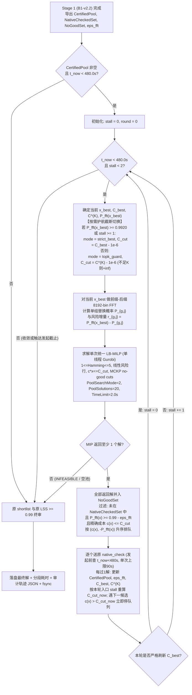

# CCMCKP 下一步代码修改与实验执行实施文档（`B1-v2.2` 零改冻版 + `B2-v2` 代码修改蓝本）

**文档日期**：2026-11-28  
**文档定位**：面向下一轮编码、编译、独立审计与冒烟/全量测试的**直接可执行代码修改规格书**  
**版本继承基线**：`B1-v2.2` 冻结源码与二进制（Binary SHA256: `cd471cac2459b10557678ec667a55f3643f0be4497b792f2c4466d0ea45bc7af`）  
**归档保护原则**：**严禁修改或覆盖**任何已有归档目录、历史设计文档、历史冒烟报告与历史实验结果（含 `B1-v1`、`B1-v2`、`B1-v2.1`、`B1-v2.2` 35 次冒烟与原 `B2` 1200 次归档）。

---

## 0. 双轨执行总览（先分清“哪里不改代码、哪里改代码”）

基于 `B1-v2.2` 35 次冒烟诊断（35/35 有效、`0` 次 `SolCount=0`、`global_errors=[]`、6/7 门槛全部通过；唯一未达门槛的 `#36` 已确认 5/5 次全部生成并认证精确最优解 `159.2809942031` 及精确 2 号回退解 `159.5777060657`，仅因第 4/5 次原 LSS 抽样分别落在 `0.989977 / 0.989979` 产生正常随机回退），下一阶段按**两条严格隔离的轨道**推进：

| 轨道 | 目标版本 | 代码改动量 | 核心参数 | 立即执行动作 |
|---|---|---|---|---|
| **轨道 A** | **`B1-v2.2`**（纯单模型盒-椭球 RO） | **零改动（0 行代码修改）** | 2 个：$\beta=0.95,\; K=5$ | 保持 `B1-v2.2` 35 次冒烟归档与原结论原封不动；**另行登记独立协议、使用原冻结二进制（SHA `cd471cac...`）+ 新目录 + 全新 30 组 seed**，直接运行 **40 例 × 30 次 = 1200 次**正式测试。 |
| **轨道 B** | **`B2-v2`**（两阶段盒-椭球 RO + 按需截断统一 Local Branching） | **本次唯一代码修改任务**（以 `B1-v2.2` 冻结源码为基线，仅接回并定点修复 Stage 2 及配套日志/审计） | 3 个：$\beta=0.95,\; K=5,\; k=5$ | 在新目录完成 `B2-v2` 编码、编译与单元测试 → 先跑 **8 例 × 5 次 = 40 次冒烟** → 全部通过且 `global_errors=[]` 后启动 **40 例 × 30 次 = 1200 次**正式测试。 |

---

## 1. 不可触碰的统一实验与审计红线（`B1-v2.2` 与 `B2-v2` 共同遵守）

1. **继承源码零改动**：`B1-v2.2` 所继承的 **90 个原始源码文件**，以及 `native_check`、`shortlist`、`final_check`、原 LSS $\ge 0.99$ 终审、`quick / MC / exact` 内部判定分支、严格概率事件 $\sum_{j=1}^n a_j x_j < T_{\max}$、实际样本索引 `0..L-1` **全部保持字节一致**。
2. **完全冷启动与零数据泄漏**：每个 run 仅使用本 run 原始样本、成本与注册 seed；严禁读取任何历史解、跨重复输出或外部 MIP start；私人 8192-bin FFT 仅用于候选生成与排序，**严禁写入公共概率缓存**；严禁调用 LSS 反馈调参；**零算例特判**。
3. **统一 600 秒完整进程时钟口径**（无子阶段硬秒数截断报错）：
   - 新原整数 CDF（`native_check`）调用发起时刻 $\le 480.0\text{s}$；
   - 单次 `native_check` 防死锁上限 `90.0s`（最迟完成时刻 $\le 570.0\text{s}$）；
   - 原 LSS 终审阶段截止 `590.0s`；
   - 外部运行器硬守护 `595.0s`；
   - 完整进程耗时（含数据加载、全阶段求解与认证、原 LSS、JSON 落盘与 `fsync`、退出）$\le 600.0\text{s}$；
   - 事后只读独立审计进程运行在求解器退出之后，不计入求解器耗时。
4. **诚实理论边界声明**：
   - `B1-v2.2` 与 `B2-v2` 的 Stage 1 为 **Ben-Tal & Nemirovski (2000, *Math. Program.*)** 盒-椭球鲁棒优化，全部入池候选须通过 **208-bit 闭式 KKT 见证** $W_{\text{BE}}^{\uparrow}(x,\Omega) \le T_{\max}-10^{-8}$；
   - `B2-v2` 的 Stage 2 为 **Fischetti & Lodi (2003, *Math. Program.*)** 局部支化（Local Branching），允许探索离开 Stage 1 盒-椭球半径集合的更优可行解，不宣称继承原半径 KKT 鲁棒见证，也不宣称样本外 `0.99` 分布覆盖保证或 DRO 等价性；其全部输出均经原整数 CDF 认证与原 LSS $\ge 0.99$ 终审。

---

## 2. 轨道 A 实施说明：`B1-v2.2` 零改启动 1200 次正式批量

- **源码与二进制**：直接复用已通过技术验收的 `B1-v2.2` 二进制（SHA256: `cd471cac2459b10557678ec667a55f3643f0be4497b792f2c4466d0ea45bc7af`），**不改动任何一行代码、不重新编译、不回改原 35 次冒烟报告与门槛记录**。
- **独立登记说明**：在新实验目录中独立注册 `B1-v2.2_full_40x30` 协议，注明：“`B1-v2.2` 35 次冒烟中 6/7 算例达标，唯一超 Avg 门槛的 `#36` 已由 `LSS_FALLBACK_DIAGNOSTICS.json` 证实 5/5 生成并认证精确最优解 `159.280994` 及 2 号回退解 `159.577706`，2/5 落入 `0.989977–0.989979` 属于原 LSS 100 万次抽样（$\text{SE} \approx 0.00010$）的正常二项波动；经用户确认，另行启动独立全量 40×30=1200 次正式测试以取得稳定 30 次统计。”
- **运行规范**：40 例 × 30 次独立新鲜 seed（不复用冒烟 seed `1286101–1286105`），完整落盘、独立只读审计要求 `global_errors=[]`。

---

## 3. 轨道 B 代码修改规格：`B2-v2`（基于 `B1-v2.2` 冻结源码构建）

### 3.1 源码目录继承与改动边界清单

从 **`B1-v2.2` 冻结源码树**完整复制到全新的 `B2-v2` 开发目录，严禁从旧 `B2-v1`（裸 MISOCP 版本）拷贝 Stage 1！逐模块改动边界如下：

| 模块 / 代码段 | 处理方式 | 具体要求 |
|---|---|---|
| **90 个继承源码文件**（含原 `native_check`、`shortlist`、`final_check`、LSS、公共缓存） | **原样保留（SHA 字节一致）** | 零修改，由 `STATIC_REVIEW.json` 校验字节 SHA256。 |
| **Stage 1：Step 1（尾部参数 + 零 MIP 求 $\Omega_{\max}$）** | **原样保留（SHA 字节一致）** | 与 `B1-v2.2` 完全一致（$\beta=0.95$，$m=\min(L,\max(3,\lceil 0.05L\rceil))$）。 |
| **Stage 1：Step 2–3（Pass 1 八点粗扫严格 `#1` 选 $r^*$ + Pass 2 六轮精确 `#1` 二分 + Pass 3 四点紧带解池 + 盒角）** | **原样保留（SHA 字节一致）** | 与 `B1-v2.2` 完全一致；208-bit 闭式 KKT 见证与 `CandArchive` 逻辑不变。 |
| **Stage 1：Step 4–5（统一升序原 CDF 认证 + 动态 $C^{(K)}$ 截断 + 最多 3 轮向上兜底）** | **仅增接口导出（核心逻辑零改）** | 保持认证顺序、$\epsilon_{\text{fft}}$ 更新、`90s` 防死锁、向上兜底完全不变；结束时额外导出 Stage 1 里程碑统计与状态集合（见 3.2 节）。 |
| **Stage 2：按需截断统一 Local Branching（新增/修复）** | **本次核心代码修改点** | 接在 Stage 1 结束之后、原 `shortlist` / LSS 之前；按 3.3–3.5 节精确实现（$k=5$ + 按需护航截断切换 $C_{\text{cut}}$）。 |
| **版本标识、分阶段时钟与诊断 JSON** | **增量更新** | 版本字段设为 `B2-v2`；新增 Stage 2 字段与完整互斥分段耗时（见 3.6 节）。 |
| **独立只读审计脚本（Python `Fraction` 读者）** | **增量适配** | 保留 Stage 1 全部 KKT / 半径轨迹核验，新增 Stage 2 按时间序重建 $C_{\text{cut}}$ 与实际送检向量有理数准入核验（见第 4 节）。 |

---

### 3.2 Stage 1 → Stage 2 衔接接口规格

在 Stage 1（Step 1–5）结束、进入 Stage 2 前，冻结并记录以下状态（同时写入诊断 JSON，确保可与纯 `B1-v2.2` 做逐 run 内部净增益拆解）：

1. **只读里程碑字段**：
   - `stage1_bero_certified_count`：$|\text{CertifiedPool}|$；
   - `stage1_bero_best_cost`：Stage 1 结束后公共认证池最低成本（空池为 `null`）；
   - `stage1_bero_topK_costs`：Stage 1 结束后公共认证池按成本升序的前 $K=5$ 个成本列表；
   - `stage1_eps_fft`：Stage 1 结束时的私人 FFT 低估容差 $\epsilon_{\text{fft}}$；
2. **传递给 Stage 2 的内存状态**：
   - `CertifiedPool`：所有已通过原整数 CDF 认证的解集合（含精确成本与私人 FFT 概率）；
   - `NativeCheckedSet`：Stage 1 中所有已调用过 `native_check` 的二进制向量集合（含通过与未通过）；
   - `NoGoodSet`：初始化为 `CertifiedPool ∪ NativeCheckedSet`（去重后的二进制解向量集合，供 Stage 2 生成精确 MCKP no-good cuts）；
   - `eps_fft`：延续 Stage 1 的当前值 $\epsilon_{\text{fft}} \ge 0.001$（不重置）；
   - 私人 8192-bin FFT 预计算频谱（与 Stage 1 复用同一份私有频谱，严禁写入公共概率缓存）。

---

### 3.3 Stage 2 整体流程图



---

### 3.4 Stage 2 核心数学模型与关键规则（逐行可编码）

#### 1. 按需护航截断函数 `compute_cutoff`（修复原 `B2` `#17/+151s`、`#18/+100s` 的唯一核心改动）

在每轮开始及本轮每通过一个新认证解后，均调用同一确定性规则（**零新增调优超参数**；`0.9920` 为 `0.99 + 20 × SE_LSS` 固定安全裕度护栏，其中 100 万次 LSS 在 $p=0.99$ 处的标准误 $\text{SE}_{\text{LSS}} \approx 0.00010$）：

$$
C_{\text{cut}} = \begin{cases}
C_{\text{best}} - 10^{-6}, & \text{若 } P_{\text{fft}}(x_{\text{best}}) \ge 0.9920 \;\;\text{或}\;\; \texttt{stall} \ge 1, \\[4pt]
C^{(K)} - 10^{-6}, & \text{若 } P_{\text{fft}}(x_{\text{best}}) < 0.9920 \;\;\text{且}\;\; \texttt{stall} = 0 \;\;\text{且}\;\; |\text{CertifiedPool}| \ge K, \\[4pt]
+\infty, & \text{若 } P_{\text{fft}}(x_{\text{best}}) < 0.9920 \;\;\text{且}\;\; \texttt{stall} = 0 \;\;\text{且}\;\; |\text{CertifiedPool}| < K.
\end{cases}
$$

> **精准实现细节（防止与 `Fraction` 审计器产生浮点口径分歧）**：
> - 在 Gurobi MILP 模型中，`C_cut < +inf` 时直接添加 `double` 约束 $\sum_{j=1}^n c_j x_j \le C_{\text{cut}}$；
> - **在把候选向量 $x$ 真正提交给 `native_check` 之前**，必须用**精确成本比较**核验准入条件：若 `C_cut_now` 对应参考成本 $C_{\text{ref}} \in \{C_{\text{best}}, C^{(K)}\}$，仅当精确成本满足
>   $$c_{\text{exact}}(x) \le C_{\text{ref,exact}} - 10^{-6}$$
>   （在有理数意义下等价于 $c(x) \le C_{\text{ref}} - \frac{1}{10^6}$）时才允许送入 `native_check`；任何仅因 Gurobi 浮点可行容差（如 `1e-6`）溜进解池但实际 $c_{\text{exact}}(x) > C_{\text{ref,exact}} - 10^{-6}$ 的解，直接丢弃（已加入 `NoGoodSet` 防止重复生成）且不送 `native_check`。
> - **单轮批次内 `stall` 冻结规则**：在一轮的认证队列循环内部，重算 `C_cut_now` 时保持使用**本轮入口时的 `stall` 值**（不会在同一队列中途因为刷新 $C_{\text{best}}$ 突然把 `stall=1` 放宽成 `topk_guard`），直到整轮队列结束后再统一执行 `stall = 0` 或 `stall += 1`。该规则既更省时间，也让独立审计器能够 100% 唯一确定性地按时间序重建每一个 `C_cut_now`。

#### 2. 前缀-后缀 8192-bin FFT 边际概率与风险增量

令当前最优认证解 $x_{\text{best}}$ 在第 $g \in \{1,\dots,G\}$ 组选中的物品为 $j_g^{\text{best}}$：
- 利用已有 8192-bin FFT 频谱，在 $O(G \cdot M)$ 时间内构建前向频谱积 `Pref[g]`（组 $1..g-1$ 的卷积频谱）与后向频谱积 `Suff[g]`（组 $g+1..G$ 的卷积频谱），记其余 $G-1$ 组总频谱为 `Rest[g] = Pref[g] * Suff[g]`；
- 对每组 $g$ 与组内每件物品 $j \in G_g$，单次点乘 + 逆 FFT 得出将 $j_g^{\text{best}}$ 替换为 $j$ 时的严格事件概率 $P_{g,j} = P_{\text{fft}}\big(x_{\text{best}}[g \leftarrow j]\big)$；
- 定义局部风险增量（显然 $r_{g, j_g^{\text{best}}} = 0$）：
  $$r_{g,j} = P_{\text{fft}}(x_{\text{best}}) - P_{g,j}.$$

#### 3. 单轮统一 Local Branching MILP（**P3：$k = 5$**）

使用单线程 Gurobi（`Threads = 1`、`PoolSearchMode = 2`、`PoolSolutions = 20`、`TimeLimit = 2.0s`、关闭内部并发与非确定性选项，沿用 `B1-v2.2` 的统一 Gurobi 环境参数）求解纯线性 0-1 MILP：

$$
\begin{aligned}
\min_{x \in \{0,1\}^n}\quad & \sum_{j=1}^n c_j x_j \\
\text{s.t.}\quad
& \sum_{j \in G_g} x_j = 1, && \forall g \in \{1,\dots,G\}, \\
& \sum_{g=1}^G \sum_{j \in G_g} r_{g,j}\, x_j \le \max\!\Big(0,\; P_{\text{fft}}(x_{\text{best}}) - (0.99 - \epsilon_{\text{fft}})\Big), \\
& 1 \le \sum_{g=1}^G \big(1 - x_{j_g^{\text{best}}}\big) \le k && (k = 5), \\
& \sum_{j=1}^n c_j x_j \le C_{\text{cut}} && (\text{仅当 } C_{\text{cut}} < +\infty), \\
& \sum_{g=1}^G x_{\hat{j}_g} \le G - 1, && \forall \hat{x} \in \texttt{NoGoodSet}.
\end{aligned}
$$

> **关于 MCKP 精确 `no-good cut` 的说明**：因每组严格满足 $\sum_{j \in G_g} x_j = 1$，排除任意已知 MCKP 可行解 $\hat{x}$（其每组选中索引为 $\hat{j}_g$）的精确二元割只需 $\sum_{g=1}^G x_{\hat{j}_g} \le G - 1$（仅 $G$ 个非零元，比一般二进制对称割稀疏且完全等价）。

---

### 3.5 Stage 2 完整工程伪代码（可直接对照翻译为 C++）

```cpp
// 前提：Stage 1 (B1-v2.2) 已完成，已导出：
//   CertifiedPool, NativeCheckedSet, NoGoodSet (= CertifiedPool ∪ NativeCheckedSet), eps_fft
// 常量：
//   constexpr int K_TOPK = 5;
//   constexpr int LB_RADIUS_K = 5;
//   constexpr double SAFE_FFT_MARGIN = 0.9920;
//   constexpr double COST_EPS = 1e-6;
//   constexpr double LAUNCH_GUARD_SEC = 480.0;
//   constexpr double SINGLE_CDF_CAP_SEC = 90.0;

struct CutoffDecision {
    std::string mode;      // "strict_best" or "topk_guard"
    bool has_upper_bound;  // false iff mode=="topk_guard" && CertifiedPool.size() < K_TOPK
    double c_ref;          // C_best or C^(K)
    double c_cut;          // c_ref - COST_EPS (or +inf)
};

CutoffDecision compute_cutoff(const CertifiedPoolType& pool, int stall) {
    // pool 按精确成本严格升序维护，pool[0] 即 x_best
    const auto& best = pool[0];
    if (best.p_fft >= SAFE_FFT_MARGIN || stall >= 1) {
        return {"strict_best", true, best.cost, best.cost - COST_EPS};
    }
    if ((int)pool.size() >= K_TOPK) {
        double c_k = pool[K_TOPK - 1].cost;
        return {"topk_guard", true, c_k, c_k - COST_EPS};
    }
    return {"topk_guard", false, INF, INF};
}

// ---------- Stage 2 主入口 ----------
if (!CertifiedPool.empty() && elapsed_sec() < LAUNCH_GUARD_SEC) {
    int stall = 0;
    int lb_round = 0;

    while (stall < 2 && elapsed_sec() < LAUNCH_GUARD_SEC) {
        ++lb_round;
        const auto center = CertifiedPool[0];               // 当前 x_best
        const double round_start_best_cost = center.cost;
        const int entry_stall = stall;
        CutoffDecision cut = compute_cutoff(CertifiedPool, entry_stall);

        // 1) 前缀-后缀 8192-bin FFT 计算风险增量 r_{g,j}
        auto t_mip_fft_0 = now();
        Matrix r = compute_prefix_suffix_fft_risk_delta(center.x, center.p_fft, private_fft_cache);

        // 2) 构建并求解单次 LB-MILP (单线程, PoolSearchMode=2, PoolSolutions=20, TimeLimit=2.0s)
        double risk_rhs = std::max(0.0, center.p_fft - (0.99 - eps_fft));
        auto mip_res = solve_lb_milp(
            center.x, r, risk_rhs, LB_RADIUS_K,
            cut.has_upper_bound ? std::optional<double>(cut.c_cut) : std::nullopt,
            NoGoodSet, /*pool_solutions=*/20, /*time_limit_sec=*/2.0
        );
        stage2_lb_mip_fft_sec += elapsed_since(t_mip_fft_0);
        record_lb_round_header(lb_round, entry_stall, center, cut, mip_res.status, mip_res.solutions.size());

        // 若 MIP 无可行解（含 INFEASIBLE / 空池），自然收敛退出
        if (mip_res.solutions.empty()) {
            stage2_stop_reason = "mip_infeasible_or_empty";
            break;
        }

        // 3) 全部返回解立即加入 NoGoodSet；筛选通过私人 FFT 与精确成本准入的候选
        std::vector<Candidate> queue;
        auto t_filter_0 = now();
        for (const auto& x : mip_res.solutions) {
            NoGoodSet.insert(x);
            if (NativeCheckedSet.count(x)) continue;

            double p_fft = eval_private_fft_strict_lt_T(x, private_fft_cache); // 严禁写公共缓存
            if (p_fft < 0.99 - eps_fft) continue;

            // 精确成本准入过滤（杜绝 Gurobi 浮点容差越线送检）
            if (cut.has_upper_bound && !exact_cost_le_ref_minus_eps(x, cut.c_ref, COST_EPS)) {
                continue;
            }
            queue.push_back({x, exact_cost(x), p_fft});
        }
        std::sort(queue.begin(), queue.end(), [](const Candidate& a, const Candidate& b) {
            if (a.cost != b.cost) return a.cost < b.cost;
            return a.p_fft > b.p_fft;
        });
        stage2_lb_mip_fft_sec += elapsed_since(t_filter_0);

        // 4) 按 (c(x), -P_fft(x)) 升序送原整数 CDF 认证
        bool improved_best = false;
        for (const auto& cand : queue) {
            if (elapsed_sec() >= LAUNCH_GUARD_SEC) {
                stage2_stop_reason = "launch_guard_480s";
                break;
            }
            // 动态复核当前最新截断线（使用 entry_stall 保持同轮口径一致）
            CutoffDecision cut_now = compute_cutoff(CertifiedPool, entry_stall);
            if (cut_now.has_upper_bound && !exact_cost_le_ref_minus_eps(cand.x, cut_now.c_ref, COST_EPS)) {
                // 队列已按成本升序，后续解必然更贵，立即结束本轮队列
                break;
            }

            NativeCheckedSet.insert(cand.x);
            auto t_cdf_0 = now();
            // 原样调用继承的 native_check（单次防死锁上限 90.0s，不修改函数体）
            auto cert = call_native_check_with_cap(cand.x, SINGLE_CDF_CAP_SEC);
            stage2_lb_native_cdf_sec += elapsed_since(t_cdf_0);
            record_stage2_native_event(lb_round, entry_stall, cut_now, cand, cert);

            if (cert.passed_099) {
                CertifiedPool.insert_sorted(cand.x, cand.cost, cand.p_fft, cert);
                eps_fft = std::max({0.001, eps_fft, 0.99 - cand.p_fft});
                if (exact_cost_lt(CertifiedPool[0].cost, round_start_best_cost)) {
                    improved_best = true;
                }
            }
        }

        if (elapsed_sec() >= LAUNCH_GUARD_SEC) break;

        // 5) 状态转移
        if (improved_best) {
            stall = 0;
        } else {
            stall += 1;
            if (stall >= 2) stage2_stop_reason = "stall_converged_2_rounds";
        }
    }
}
// 随后：CertifiedPool 原样进入继承的 shortlist 与原 LSS >= 0.99 终审、落盘与 fsync
```

---

### 3.6 新增/保留诊断与计时 JSON 字段规范

保留 `B1-v2.2` 全部 Stage 1 字段不变，在输出 JSON 中新增以下 `B2-v2` 专属诊断与互斥计时字段：

1. **版本与 Stage 1 里程碑**：
   - `algorithm_version`: `"B2-v2"`
   - `stage1_bero_certified_count`: `int`
   - `stage1_bero_best_cost`: `double | null`
   - `stage1_bero_topK_costs`: `double[]`
   - `stage1_eps_fft`: `double`
2. **Stage 2 轨迹与审计支撑字段**：
   - `stage2_entered`: `bool`
   - `stage2_lb_rounds`: `int`
   - `stage2_stop_reason`: `"not_entered" | "mip_infeasible_or_empty" | "stall_converged_2_rounds" | "launch_guard_480s"`
   - `stage2_cutoff_mode_per_round`: `string[]`（每轮 `"strict_best"` 或 `"topk_guard"`）
   - `stage2_mip_solcount0_timelimit_count`: `int`（统计 Stage 2 出现 `TIME_LIMIT && SolCount == 0` 的次数，门槛为 `0`）
   - `stage2_native_calls`: `int` / `stage2_native_accepted`: `int`
   - `stage2_best_improved_over_stage1`: `bool`
   - `stage2_events`: 按严格时间顺序记录每次 Stage 2 `native_check` 调用前的 `(round, entry_stall, mode, c_ref, c_cut, p_fft_best, cand_x, cand_cost, cand_p_fft, launch_t_sec, finish_t_sec, passed_099)`，供独立 `Fraction` 审计器零歧义逐条复算。
3. **完整互斥分段耗时（求和应吻合 `total_wall_sec`）**：
   - `load_and_fft_setup_sec`
   - `stage1_coarse_bisect_mip_sec`
   - `stage1_pool_mip_sec`
   - `stage1_native_cdf_sec`
   - `stage2_lb_mip_fft_sec`
   - `stage2_lb_native_cdf_sec`
   - `final_lss_sec`
   - `save_and_fsync_sec`
   - `unaccounted_overhead_sec`

---

## 4. 独立只读审计器适配清单（零放松）

在 `B1-v2.2` 独立只读审计脚本（SHA `4cac950c...`）基础上，复制并扩展为 `B2-v2` 审计器，保留全部 Stage 1 核验并增加以下 5 项硬核验（任一失败即记入 `global_errors`）：

1. **静态字节一致性**：90 个继承源码文件 + Stage 1 核心段（Step 1–3 与原认证/兜底函数体）SHA256 与基线完全一致；`algorithm_version == "B2-v2"`。
2. **Stage 1 全量 KKT 见证复算**：全部 Stage 1 入归档/入池候选 100% 通过 208-bit 闭式 KKT 见证 $W_{\text{BE}}^{\uparrow}(x,\Omega) \le T_{\max}-10^{-8}$ 复算；Pass 1/2/3 半径轨迹由 `Fraction` 读者完整核验。
3. **Stage 2 按时间序精确有理数准入核验**：
   - Stage 2 候选**不要求**满足 Stage 1 原半径 KKT 见证，但必须核验其属于有效 MCKP 解（每组恰选 1 件）、与当时中心 $x_{\text{best}}$ 的汉明距离满足 $1 \le \Delta_H(x, x_{\text{best}}) \le 5$；
   - 独立读者从 Stage 1 结束状态出发，按严格时间顺序逐条重放 `stage2_events`，独立重建每一刻的 `(CertifiedPool, C_best, C^(K), P_fft(x_best), entry_stall, mode, C_ref)`，用 Python `Fraction` 精确验证：
     - 每次发起 `native_check` 的候选确实满足 $c(x) \le C_{\text{ref}} - \frac{1}{10^6}$（当存在上界时）；
     - 仅对**实际送入 `native_check` 的向量**做该核验，不对 Gurobi 原始解池中已拦截丢弃的浮点容差向量误报。
4. **公共缓存隔离与终审完备性**：私人 FFT 零写公共概率缓存；全部最终输出均具原整数 CDF 证书与原 LSS $\ge 0.99$ 终审记录。
5. **时间与无泄漏红线**：全部 Stage 1 与 Stage 2 新 `native_check` 发起时刻 $\le 480.0\text{s}$、单次耗时不违规、完整进程 $\le 600.0\text{s}$；无任何历史解/跨重复/外部 MIP start 注入痕迹。

---

## 5. `B2-v2` 冻结 8 算例 × 5 次定向冒烟验收门槛（共 40 runs）

> **门槛修订说明（透明记录，不回改旧版）**：吸取 `B1-v2.2` 35 次冒烟对 `#36` 的实证经验——`#36` 精确最优解 `159.280994`（$P_{\text{true}} \approx 0.9901$）与精确 2 号回退解 `159.577706` 在 5 次小样本 LSS 抽样下，出现 2 次正常边界波动回退时的 5 次均值为 `159.3997`（而任何真正的候选覆盖退化如 `B1-v2.1` 或 `D02/B01` 均在 `159.77–159.90` 以上）。因此本轮新登记的 **`B2-v2` 40 次冒烟协议**将 `#36` 的 5 次 Avg 诊断上限合理定为 **`159.42000`**（同时死守 `Best <= 159.28105` 零放松），既杜绝小样本 LSS 误杀，又严格拦截任何候选或回退退化。

### 5.1 全局技术硬门槛（40 runs 全部必须满足）
- 有效率：`40 / 40` 独立有效，新鲜注册 seed（不与任何旧批次重复）；
- 零解超时：Stage 1 与 Stage 2 的 `TIME_LIMIT && SolCount == 0` 总次数 `= 0`；
- 独立审计：`global_errors = []`，且全部 40 次完整进程耗时 $\le 600.0\text{s}$；
- 编译前单元测试：复用 `B1-v2.2` 未变数学证据 + 新增 Stage 2 截断切换单元测试、精确有理数准入过滤测试、MCKP no-good cut 防重复测试、tiny 端到端测试与篡改拒绝测试全部通过。

### 5.2 分算例质量与耗时门槛表（8 例 × 5 次）

| 编号 | 算例 | $T_{\max}$ | 技术硬门槛 | `B2-v2` Best 上限 | `B2-v2` 5 次 Avg 上限 | 专项耗时上限 | 专项验收目的 |
|---:|---|---:|---|---:|---:|---:|---|
| **8** | `LAB_5_10_30` | `16` | 5/5 有效，`SolCount=0` 为 0 | `11.18515000` | `11.18515000` | — | 验 Stage 1 继承稳定（小例零漏解） |
| **17** | `LAB_40_10_500` | `55` | 5/5 有效，`SolCount=0` 为 0 | `172.55215000` | `172.55215000` | **完整均时 $\le 120.0\text{s}$** | **专验按需截断消除原 B2 `211.3s` 空烧** |
| **18** | `LAB_40_10_500` | `63` | 5/5 有效，`SolCount=0` 为 0 | `142.27125000` | `142.32000000` | **完整均时 $\le 120.0\text{s}$** | 验 `#18` 最优与止血同步达标 |
| **28** | `APP_5_10_30` | `27` | 5/5 有效，`SolCount=0` 为 0 | `16.42365000` | `16.42365000` | — | 验 Stage 1 继承稳定（小例零漏解） |
| **35** | `APP_30_10_500` | `58` | 5/5 有效，`SolCount=0` 为 0 | **`194.09625000`** | **`194.30000000`** | — | **专验 Stage 2 把 `194.39` 压平至 `194.10`** |
| **36** | `APP_30_10_500` | `70` | 5/5 有效，`SolCount=0` 为 0 | `159.28105000` | **`159.42000000`** | — | 验精确最优命中 + 合理容忍 2/5 正常 LSS 波动 |
| **38** | `APP_40_10_500` | `95` | 5/5 有效，`SolCount=0` 为 0 | `196.27715000` | `196.35000000` | — | 验大例精确最优与回退稳定 |
| **39** | `APP_50_10_500` | `91` | 5/5 有效，`SolCount=0` 为 0 | **`322.25000000`** | **`322.50000000`** | — | **专验 Stage 2 把 `324.66` 压入 `322.1–322.3`** |

---

## 6. 放行与全量推进顺序

1. **轨道 A（可立即启动）**：直接用冻结 `B1-v2.2` 二进制（SHA `cd471cac...`）在新目录以全新 30 组 seed 运行 **40 例 × 30 次 = 1200 次**正式批量，生成纯单模型盒-椭球 RO 的全量基线报告。
2. **轨道 B（本次编码主线）**：按第 3–4 节完成 `B2-v2` 代码修改、单元测试与独立审计器适配 → 运行第 5 节 **8 例 × 5 次 = 40 次冒烟** → 仅当全部 8 例门槛 + `global_errors=[]` 全部通过后，再以全新 30 组 seed 运行 **`B2-v2` 全 40 例 × 30 次 = 1200 次**正式批量。
3. **最终横向决断**：待 `B1-v2.2`（1200 次）与 `B2-v2`（1200 次）全部收齐后，与 `S10_1 (δ=0)`、`D02`、`B01`、`ILS` 在同一全 40 例 30 次口径下对比成本质量、通过率、耗时与方法简洁度，由你拍板最终论文主方法。
