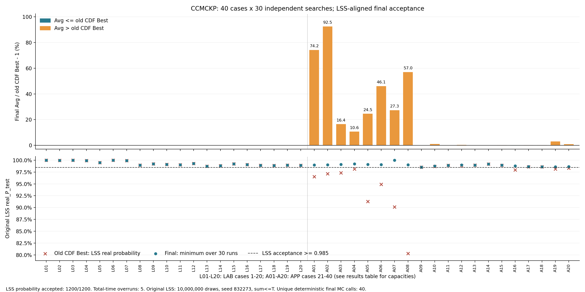

# CCMCKP S9：40×30次正式验证结果

> **2026-11-09三例复核更正：** S9新增的APP尾部重构及概率硬筛改变了原样本模型的候选可行集，不能称作原模型同约束下的等价搜索优化。关闭该模块后三例各30次均恢复原成本（但不通过外部真实概率≥0.985）；另找到14.076616、13.564858、5.796148三个更低且通过双种子复核的候选，表明S9有可避免的保守性。这些候选是单解诊断参考，不是新的30次平均值。以下1200次原记录、源码及Excel数值均保留。[完整复核、原LSS重现及证据](https://github.com/quanliangwen/1/blob/745e7b157909e86a0187a9100261d159fec71d71/CCMCKP/S9_small_case_recheck_20261109/REPORT.md)。

全部40例、每例30次，共1200次独立求解，**1200/1200通过原LSS真实分布仿真概率≥0.985验收**。25/40例的Avg不高于原CDF Best，15例仍有成本差距；40/40例30次成本标准差在1e-10以内。不能将此结果表述为全部40例均追平了原Best。

原Best本身通过同一LSS验收的29例中，24例新Avg不高于原Best；其余5例的最大成本差距为0.938%。全40例结果仍完整列出，未按旧Best是否合格筛除实例。

## 验收与统计范围

- 名义CL=0.99；最终调用上传LSS的原`real_P_test`函数体：10,000,000次仿真、种子832273、事件`sum<=Tmax`、点估计≥0.985合格。未附加置信下界筛选，也未把经验整数证书当成真实分布验收。
- 正式搜索种子940001–940030；名义预算600秒，最多64个并发进程。每个种子都实际独立搜索，未读取旧解或其他运行结果。失败、空解、超时不得补跑覆盖。
- 原LSS每次重置同一检验种子。本轮有40个不同的算例/容量/解向量/种子组合，实际执行40次原函数仿真，并用明确映射关联1200条运行。此复用仅用于确定性的检验函数，未复用求解结果。
- 表中Avg/Std使用全部30条合格运行；Std为总体标准差，样本标准差也保留在JSON。搜索时间包含实例加载、模型构造、搜索、整数验收、末次重计数与主结果写盘；真实仿真耗时单列于逐条记录。
- 最低最终Real P=0.9851032。全部经验整数证书使用独立Decimal解析与未平移整数多项式重新计数，共40个不同证书。

## 时间预算偏差（单列，未剔除）

预注册的含收尾600秒总耗时上限并未全部满足：5次超过600秒，最大实际总耗时617.210秒；选中解在600秒以后才产生的次数为0。全部概率统计仍使用原始1200次记录，不能将1200次概率合格表述成1200次严格时间预算合格。严格600秒核验另保留原始SUMMARY。

|编号|重复|实际总秒|选中解产生秒|
|---:|---:|---:|---:|
|40|3|606.875|470.619|
|40|4|601.821|196.836|
|40|5|602.900|355.193|
|40|8|617.210|354.992|
|40|16|609.316|180.011|

## 全部40例

|编号|算例|T|合格次数|原Best|新Best|新Avg|Std|Avg相对原Best|最低Real P|平均搜索秒|
|---:|---|---:|---:|---:|---:|---:|---:|---:|---:|---:|
|1|LAB_3_5_30_|11|30/30|18.630805|18.630805|18.630805|0.000000|+0.000%|0.9997518|0.11|
|2|LAB_3_5_30_|14|30/30|10.778718|10.778718|10.778718|0.000000|+0.000%|0.9995776|0.06|
|3|LAB_4_5_30_|18|30/30|19.414900|19.414900|19.414900|0.000000|+0.000%|0.9999844|0.16|
|4|LAB_4_5_30_|26|30/30|10.355628|10.355628|10.355628|0.000000|+0.000%|0.9991468|0.09|
|5|LAB_5_5_30_|11|30/30|21.421782|21.421782|21.421782|0.000000|+0.000%|0.9949996|0.21|
|6|LAB_5_5_30_|20|30/30|12.632377|12.632377|12.632377|0.000000|+0.000%|0.9999917|0.11|
|7|LAB_5_10_30_|10|30/30|17.367968|17.367968|17.367968|0.000000|+0.000%|0.9990123|2.17|
|8|LAB_5_10_30_|16|30/30|11.185084|11.185084|11.185084|0.000000|+0.000%|0.9896428|1.76|
|9|LAB_10_10_500_|19|30/30|49.713091|49.713091|49.713091|0.000000|+0.000%|0.9921073|379.23|
|10|LAB_10_10_500_|23|30/30|32.025303|32.025303|32.025303|0.000000|+0.000%|0.9909425|172.06|
|11|LAB_10_20_500_|12|30/30|47.870175|47.870175|47.870175|0.000000|+0.000%|0.9901915|504.57|
|12|LAB_10_20_500_|15|30/30|27.188498|27.188498|27.188498|0.000000|+0.000%|0.9931032|423.29|
|13|LAB_20_10_500_|25|30/30|74.806645|74.806645|74.806645|0.000000|+0.000%|0.9871499|249.71|
|14|LAB_20_10_500_|32|30/30|62.138237|62.138237|62.138237|0.000000|+0.000%|0.9883526|251.80|
|15|LAB_30_10_500_|43|30/30|105.731383|105.731383|105.731383|0.000000|+0.000%|0.9922785|210.38|
|16|LAB_30_10_500_|52|30/30|90.238643|90.238643|90.238643|0.000000|+0.000%|0.9906927|343.07|
|17|LAB_40_10_500_|55|30/30|172.552114|172.552114|172.552114|0.000000|+0.000%|0.9890854|434.80|
|18|LAB_40_10_500_|63|30/30|142.271214|142.271214|142.271214|0.000000|+0.000%|0.9888681|447.58|
|19|LAB_50_10_500_|63|30/30|197.986454|197.986454|197.986454|0.000000|+0.000%|0.9896510|414.28|
|20|LAB_50_10_500_|75|30/30|158.942754|158.942754|158.942754|0.000000|+0.000%|0.9890038|407.34|
|21|APP_3_5_30_|21|30/30|9.034717|15.741492|15.741492|0.000000|+74.233%|0.9899530|0.30|
|22|APP_3_5_30_|27|30/30|7.250013|13.956788|13.956788|0.000000|+92.507%|0.9901030|0.33|
|23|APP_4_5_30_|47|30/30|5.239884|6.100159|6.100159|0.000000|+16.418%|0.9910689|0.52|
|24|APP_4_5_30_|49|30/30|5.239884|5.796148|5.796148|0.000000|+10.616%|0.9920997|0.53|
|25|APP_5_5_30_|27|30/30|16.380556|20.400968|20.400968|0.000000|+24.544%|0.9910476|1.30|
|26|APP_5_5_30_|38|30/30|11.026768|16.108035|16.108035|0.000000|+46.081%|0.9906243|1.20|
|27|APP_5_10_30_|16|30/30|26.063998|33.176644|33.176644|0.000000|+27.289%|1.0000000|11.72|
|28|APP_5_10_30_|27|30/30|16.423627|25.784642|25.784642|0.000000|+56.997%|0.9900702|9.58|
|29|APP_10_10_500_|32|30/30|61.494153|61.494153|61.494153|0.000000|+0.000%|0.9851032|237.07|
|30|APP_10_10_500_|37|30/30|52.114348|52.603142|52.603142|0.000000|+0.938%|0.9875594|336.05|
|31|APP_10_20_500_|13|30/30|70.901357|70.901357|70.901357|0.000000|+0.000%|0.9888852|384.15|
|32|APP_10_20_500_|16|30/30|56.558597|56.742882|56.742882|0.000000|+0.326%|0.9897297|433.36|
|33|APP_20_10_500_|43|30/30|111.558326|111.558326|111.558326|0.000000|+0.000%|0.9892880|227.33|
|34|APP_20_10_500_|48|30/30|109.963225|109.963225|109.963225|0.000000|+0.000%|0.9918900|416.26|
|35|APP_30_10_500_|58|30/30|193.774223|194.096209|194.096209|0.000000|+0.166%|0.9892797|485.61|
|36|APP_30_10_500_|70|30/30|159.671852|159.280994|159.280994|0.000000|-0.245%|0.9880154|403.00|
|37|APP_40_10_500_|85|30/30|214.897172|215.171415|215.171415|0.000000|+0.128%|0.9863738|491.16|
|38|APP_40_10_500_|95|30/30|196.002819|196.277062|196.277062|0.000000|+0.140%|0.9860068|498.75|
|39|APP_50_10_500_|91|30/30|321.700547|331.179323|331.179323|0.000000|+2.946%|0.9860037|549.28|
|40|APP_50_10_500_|100|30/30|291.936219|294.509365|294.509365|0.000000|+0.881%|0.9862867|539.24|

## 旧Best成本目标的边界

原CDF Best中，29/40个解通过同一≥0.985检验；其余仅能作为成本参考。旧Best有不合格解，不代表该成本线以内所有其他选择都不合格。为区分这两件事，另对以下小算例作了完整成本前缀穷举：

|算例|T|原Best|不超过原Best的选择数|最高原LSS概率|合格选择数|
|---|---:|---:|---:|---:|---:|
|APP_3_5_30_|21|9.034717|56|0.9651546|0|
|APP_3_5_30_|27|7.250013|44|0.9713810|0|
|APP_4_5_30_|47|5.239884|25|0.9794174|0|
|APP_4_5_30_|49|5.239884|25|0.9854627|5|

APP_3_5的两个容量与APP_4_5的T=47，全部旧成本线以内选择都不合格。因此在固定的原LSS检验函数下，这3例任何全部合格的30次结果，其平均成本必然高于原Best。该结论针对固定种子的验收函数，不宣称证明总体概率的解析最优性。

APP_4_5的T=49存在5个旧成本线以内的LSS合格选择，不能把该例称为仅在LSS条件下旧目标不可行。独立整数上界检查显示，这5个解的原样本经验概率上界约0.9405–0.9596，未达到本实现保留的内部经验门槛0.99。外部0.985验收容差与内部名义概率约束分别记录；没有通过降低内部门槛获得更低成本。其他仍有成本差距的实例，也未被笼统宣称为旧目标不可能。

## 修复、独立性与可复现文件

S8的正式并发试验曾在APP_5_10 T=16第3次返回空解：10万次逐项辅助FFT耗尽搜索时间。S8已中止，原失败、部分结果和中止时活动子任务的核账保留在诊断压缩包及上一任务目录。本轮S9使用全新种子、全量重跑，没有将补跑拼接成原试验。

S9用两半卷积与CDF矩阵乘法计算辅助概率，设60秒辅助上限，并先认证低风险候选。10万组合批量评分12.30秒；对照100个原FFT结果最大误差4.25e-14；合成概率与直接卷积最大误差7.8e-16。12次并发、180秒压力测试全部返回解。

算法参数已在本基准40例的开发阶段校准。本轮验证针对同一基准上的重复运行稳定性，未声称在未见实例上验证泛化。求解器禁止读取真实分布`_dist.txt`、历史解和其他运行文件；独立验证器使用原LSS分布元数据。原LSS参考源文件、函数AST与分布数据均核对哈希。

- `USER_VALIDATION_SUMMARY.json`：40例完整概率统计（时间预算偏差单列）；`FINAL_SUMMARY.json`保留严格600秒核验结果。40例完整统计与1200条运行、整数证书和LSS结果映射。
- `REGISTRATION.json`、`FROZEN_SOURCE_SHA256.json`：正式方案和冻结源码。
- [FORMAL_1200_RECORDS.zip](records/FORMAL_1200_RECORDS.zip)：1200次原始主结果、侧录、日志、终止记录与独立重计数。
- [LSS_FINAL_VALIDATIONS.zip](records/LSS_FINAL_VALIDATIONS.zip)：所有不同向量的原LSS检验结果、请求、映射与日志。
- [DEVELOPMENT_AND_FAILURES.zip](records/DEVELOPMENT_AND_FAILURES.zip)、[S8_ABORTED_CAMPAIGN.zip](records/S8_ABORTED_CAMPAIGN.zip)：开发和失败记录；不计入S9正式1200次。
- [OLD_COST_EXHAUSTION.zip](records/OLD_COST_EXHAUSTION.zip)、相关审计JSON：150个成本前缀选择与内部约束差异的证据。
- `CHECKSUMS_SHA256.json`：交付文件校验和；全部交付文件在上传后从GitHub独立拉取并逐字节核验。

求解器环境Python3.13.9 / NumPy2.4.0 / SciPy1.17.1 / python-flint0.8.0；原LSS检验Python3.8.10 / NumPy1.24.4 / SciPy1.10.1。原LSS辅助整理器的历史切片范围与本轮实验规模分开处理；本轮按用户要求统计全部30条运行。

用户统计表原文件未修改；40例原Best、Avg、Std已与服务器原30次记录核对，只有浮点舍入差异。工作表没有真实概率列或LSS原始解，故其LSS成本只列作参考，未冒称已验证其真实概率。
