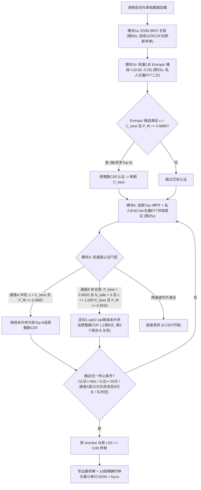

# CCMCKP 预算鲁棒优化 R05 冻结设计文档

**版本代号**：R05（双视角轻量母体 + 认证门控型边界精炼）  
**文档日期**：2026-11-27  
**文档状态**：待第 0 步历史日志复核与第 1 步轻冒烟后冻结（冻结后源码与参数严禁在正式运行中修改）  
**承接基线**：
- R01（`266e2424fbbe772d1f49320c7d2692d80c9457f2`）：样本最大偏差 + 固定线性预算网格
- R02（`68ee7eb912c7f32de376fef3e18d331095b1e57b`）：ES95 尾部偏差 + 可行 $\Gamma$ 定位 + MIP 解池
- R03b（`ef4cbb9da8ad129cf7119d74a1cc9a3015535870`）：经验 log-MGF 熵风险 / Chernoff 代理
- R04（`6fd97b0692b1fcb14fec32f7fe917d57dc310150`）：R02 母体 + 私人 FFT 邻域精炼

---

## 1. 背景承接与设计目标

### 1.1 前置 990 次正式实验诊断摘要

R02、R03b 和 R04 在三大算例（`19: LAB_50_10_500, T=63`、`35: APP_30_10_500, T=58`、`39: APP_50_10_500, T=91`）上已完成 990/990 全部独立有效运行与独立审计。关键结论收口如下：

| 算例 | 维度 | 同批 D02 参照 | R02 | R03b | R04 | R04 相对扩展门槛状态 |
|---|---|---:|---:|---:|---:|---|
| **19 (LAB50)** | avg / std | `197.986` / `0` | `198.312` / `0` | **`197.986` / `0`** | `198.312` / `0` | **未通过**：均成本高 `0.3257`（显著） |
| **19 (LAB50)** | 完整均时 (s) | `442.87` | **`43.84`** | `110.23` | `267.44` | 通过，但比 R02 空烧 `+223.6s` |
| **35 (APP30)** | avg / std | `194.204` / `0.144` | `194.600` / `0.548` | `194.978` / `1.140` | **`194.175` / `0.132`** | **通过**：avg 与 std 均优于 D02/B01 |
| **35 (APP30)** | 完整均时 (s) | `281.06` | **`90.02`** | `122.10` | `332.21` | **未通过**：比 D02 慢 `51.15s`（显著），比 R02 暴涨 `+242.2s` |
| **39 (APP50)** | avg / std | `322.553` / `0.022` | **`322.156` / `0.136`** | `322.301` / `0.219` | **`322.169` / `0.162`** | **通过**：均成本低 `0.384`（显著） |
| **39 (APP50)** | 完整均时 (s) | `567.32` | `453.11` | **`336.27`** | **`368.99`** | **通过**：比 D02 快 `198.32s`（显著） |

### 1.2 两个未过门槛的精确根因

1. **未过门槛①（`LAB50` 成本高 `0.3257`）**：
   - `LAB50` 总和近似正态（偏度 `0.052`），真实 0.99 前沿由二阶方差主导。`R03b`（log-MGF 熵代理）二阶展开精确匹配 $\mu_j + \frac{t}{2}\sigma_j^2$，因此 30/30 稳定命中 `197.986454`（服务器实测 $t=0.60$ 单点仅 0.13s 即可定位）；
   - `ES95` 预算模型在近正态分布下存在轻微重排误差，将 `197.986454` 切在次优解 `198.312154` 之外，且两解汉明距离达 3–5 组，加上 `197.986454` 紧贴 0.99 边缘（8192-bin 四舍五入 FFT 为 `0.99038`，上取整保守 FFT 仅 `0.98886`），导致 `R04` 未能跨过该盆地壁垒。
2. **未过门槛②（`APP30` 耗时 `332.2s > D02 281.1s`，且 `LAB50` 空烧 `+223.6s`）**：
   - `R04` 私人 FFT 提议仅耗 9–17 秒，但未对下游触发的**原整数 CDF 认证队列**施加成本/安全垫门控和总耗时封顶，导致大量边际收益极低的邻域向量排队执行昂贵的原整数 CDF 认证，产生 200+ 秒冗余开销；
   - `APP30` 的真正收益仅来自 `194.096` 上方狭窄成本带内少数几个高概率（$P \ge 0.992$）LSS 回退安全垫解，根本不需要全量认证上百个邻域候选。

### 1.3 R05 理论定位与设计目标

- **算法定位**：R05 是**预算 RO 与轻量熵代理协同引导、认证预算受控的经验机会约束混合搜索算法**；不将本版称为与 D02 同不确定集合下的 DRO，不声称代理模型单独提供总体 0.99 分布覆盖保证。
- **核心目标**：在不引入任何算例特判、不改动任何验收边界的前提下，**精准消除上述两处短板**，使三算例在新鲜 30 次配对正式评测中同步通过全部四项全 40 例扩展门槛。

---

## 2. 不变的实验红线与审计约束

R05 必须 100% 继承并冻结以下八项边界条件，任何一项不满足即视为实现不合格：

1. **终审口径字节不变**：原 `shortlist` 规则、原 LSS 终审门槛 `0.99`、`quick / MC / exact` 分支、样本索引 `0…499`、严格事件“总消耗小于容量”，以及 18 个继承组件的字节与 SHA256 保持完全不变；不另增“真实概率”作为第二验收标准。
2. **严禁 LSS 泄漏**：任何预算定位、熵参数二分、双通道门控、安全垫判定与早停均**只允许使用本 run 原始 500 样本内部经验分布（私人 FFT 仅作排序门控，正式入池一律以原整数 CDF 认证为准）**，生成器绝不调用 LSS，绝不以 LSS 反馈调参或追加抽样。
3. **公共缓存与证书严格隔离**：私人 FFT 评分绝不写入公共概率缓存，也不作为正式概率证书；所有进入公共候选池的解均须具备原整数 CDF 认证证书。
4. **独立冷启动**：每次 run 仅读取原始算例数据与注册 seed，严禁读取历史版本解、V48 模板、跨重复解或外部 MIP start。
5. **零算例特判**：严禁依据算例名、编号、组数 $G$、容量 $T$ 或偏度做分支硬编码切换母体或阈值；所有算例走完全统一的算法流与冻结参数。
6. **模型见证精确可核验**：ES95 预算候选继续采用安全舍入（系数向上、右端向下）并用精确有理数复算预算约束；Entropic 候选继续采用有向高精度包络系数并保留可独立复算的见证记录。
7. **完整 600 秒时钟口径**：计时从进程启动前计至结果保存、`fsync` 及返回完成；不截断计时、不补跑、不挑 seed、不以旧解兜底。
8. **扩展门槛保持不变**：继续沿用 R04 冻结的四项全 40 例扩展判定标准，不因局部接近而放宽。

---

## 3. R05 总体架构与执行流程



---

## 4. 分模块冻结技术规格

### 4.1 模块 1：双视角轻量母体（总预算硬上限 `90s`）

#### 1.1 主段：带早停的 `ES95-BRO`（时间上限 `65s`）
- **偏差构造与分解**：与 R02 完全一致：
  $$
  \mu_j = \frac{1}{500}\sum_{k=1}^{500} a_{jk},\qquad
  d_j = \frac{1}{25}\sum_{r=1}^{25} a_{j,(501-r)} - \mu_j.
  $$
- **预算定位与精搜**：保持 R02 的精确 $\Gamma_{\max}$、9 轮临界二分、5 点细化 $\Gamma$ 窄带、保守成本下界剪枝与 Gurobi Solution Pool。
- **新增主段早停规则（解决 R02 在 `APP50` 上尾部冗余 CDF 认证耗时）**：
  - 从进程启动起满 **`65s`** 强制切入辅段；
  - 在 5 点细化窄带阶段，若已有至少 1 个原整数 CDF 认证可行解，且**连续 `15` 次原整数 CDF 认证**均未刷新最优认证成本 $C_{\text{best}}$，立即提前结束主段。

#### 1.2 辅段：极轻量 2 点 `Entropic/Chernoff` 补充（时间上限 `25s`）
- **固定倾斜点集合**：仅访问 2 个跨尺度倾斜值，按顺序为：
  $$
  \mathcal{T}_{\text{ent}} = [0.60,\; 0.25].
  $$
  （$t=0.60$ 优先覆盖近似正态二阶方差前沿；$t=0.25$ 覆盖中等偏度重尾前沿。）
- **系数构造与安全包络**：与 R03b 一致，采用高精度有向向上包络计算等效权重 $\tilde{w}_j^{\uparrow}(t)$ 与向下包络计算右端 $T_{\max} - \eta / t$，保留可独立读者复算的系数见证。
- **零 CDF 开销的快速定位与严格冲优准入（防重演 R03b 在 APP30 上的退化）**：
  1. 对每个 $t \in \mathcal{T}_{\text{ent}}$，在 $\eta \in [0.80,\; 4.605]$ 上执行 **8 轮二分**：每轮求解单次确定性 MCKP（单线程 Gurobi，限 `0.5s`），**全程仅使用私人 8192-bin 无偏 FFT 评估**（判断 $P_{\text{fft}} \ge 0.9900$），绝不调用原整数 CDF；
  2. 在收敛临界值 $\eta^*$（及微松弛点 $\eta^* - 0.05$）处求解 1 次 MIP，开启 `PoolSearchMode = 2`、`PoolSolutions = 10`；若当前已有认证最优成本 $C_{\text{best}} < +\infty$，直接附加目标硬截断约束 $\sum_j c_j x_j \le C_{\text{best}} - 10^{-6}$；
  3. 汇总该 $t$ 产生的所有去重新解，仅保留满足**冲优准入条件**的候选：
     $$
     c(x) \le C_{\text{best}} - 10^{-6} \quad \text{且} \quad P_{\text{fft}}(x) \ge 0.9885,
     $$
     按成本升序取**最多前 5 个**送入原整数 CDF 认证；若命中更低 $C_{\text{best}}$ 则立即刷新截断线；
  4. **辅段不向回退池注入劣于 $C_{\text{best}}$ 的候选**：当 `ES95` 主段已经找到极低成本解时，辅段触发的原整数 CDF 认证数接近 0，在 2–5 秒内自动结束。

---

### 4.2 模块 2：私人无偏 FFT 排序器与前缀-后缀卷积引擎

- **分箱口径统一为 8192-bin 无偏四舍五入**：
  令格点宽度 $h = T_{\max} / B$（$B = 8192$，零填充长度 $2B = 16384$），对每个物品 $j$ 预计算：
  $$
  b_{jk} = \left\lfloor \frac{a_{jk}}{h} + 0.5 \right\rfloor,\qquad
  H_j[b] = \frac{1}{500}\sum_{k=1}^{500} \mathbb{I}(b_{jk} = b)\;\;(0 \le b < B),\qquad
  \widehat{H}_j = \mathrm{rfft}(H_j,\, 2B).
  $$
  - *修改理由*：上取整保守分箱会把 `LAB50` 真实最优解 `197.986454`（真实经验概率 `0.99038`）压低至 `0.98886`，导致排序失真与误筛；无偏四舍五入分箱误差在 $10^{-4}$ 量级，更适合排序与预筛。
- **前缀-后缀卷积边际评估（Leave-One-Group-Out）**：
  对当前解 $x=(j_1,\dots,j_G)$，计算前缀积 $L_g$、后缀积 $R_g$ 与去掉第 $g$ 组后的逆 FFT 累积分布 $F_{-g}$，单次 $O(G \cdot B \log B)$ 即可获得全部 $n$ 个单组替换的近似概率 $P_{g,j} = \sum_{b=0}^{B-1} H_j[b]\,F_{-g}[B-1-b]$。
- **严格隔离**：本模块一切数值仅在进程私有上下文用于排序与门控，绝不写入公共概率缓存，也不免除任何候选的原整数 CDF 认证。

---

### 4.3 模块 3：精炼阶段“双通道认证门控”与资源硬封顶

本模块是消除 `R04` 认证耗时爆炸（`+224s / +242s`）的核心机制。设当前已通过原整数 CDF 认证的最低成本解为 $x_{\text{best}}$（成本 $C_{\text{best}}$，原整数 CDF 概率 $P_{\text{best}}$）。

#### 3.1 通道 A（冲优通道，始终开启）
- **准入条件**（新去重向量 $x$）：
  $$
  c(x) \le C_{\text{best}} - 10^{-6} \quad \text{且} \quad P_{\text{fft}}(x) \ge 0.9885.
  $$
- **排序与分批认证**：
  - 按 $(c(x),\; -P_{\text{fft}}(x))$ 升序排列；
  - 每轮精炼最多取队首 **Top-8** 依次送入原整数 CDF 认证；
  - 一旦某解通过原整数 CDF 并刷新 $C_{\text{best}}$：
    1. 立即更新 $x_{\text{best}}, C_{\text{best}}, P_{\text{best}}$；
    2. 立即淘汰待检队列中所有 $c(x) \ge C_{\text{best}} - 10^{-6}$ 的候选项；
    3. 将通道 A 连续无改进计数器 `no_improve_A` 清零，并重新评估通道 B 是否需要开启。

#### 3.2 通道 B（LSS 安全垫回退通道，按需开启、满额即永久关闭）
- **安全垫定义**：一个已通过原整数 CDF 认证的解 $x$ 被称为“有效安全垫”，当且仅当：
  $$
  C_{\text{best}} \le c(x) \le C_{\text{best}}\cdot (1 + \delta_{\text{fb}}) \quad \text{且} \quad P_{\text{CDF}}(x) \ge P_{\text{safe}},
  $$
  默认冻结参数为 $\delta_{\text{fb}} = 0.005$（成本高出不超过 `0.5%`）、$P_{\text{safe}} = 0.9920$、目标数量 $M_{\text{safe}} = 3$。（第 0 步校验后正式锁死，详见第 6 节。）
- **触发条件**：统计当前已认证池中满足上述条件的去重安全垫数 $N_{\text{safe}}$：
  - 若 $P_{\text{best}} \ge P_{\text{safe}}$ **或** $N_{\text{safe}} \ge M_{\text{safe}}$：**通道 B 保持关闭（0 次认证）**；
  - 仅当 $P_{\text{best}} < P_{\text{safe}}$ 且 $N_{\text{safe}} < M_{\text{safe}}$ 时开启通道 B。
- **定向生成与准入**：
  - 利用 $x_{\text{best}}$ 的前缀-后缀边际表直接执行一次**安全垫定向 1-opt 扫描**（耗时 <10ms），若满足准入条件的候选不足 6 个再补做一次定向 2-opt（单步稳健换入 + 单步降价或双步小加价换高概率）；
  - 放行准入条件：
    $$
    C_{\text{best}} \le c(x) \le C_{\text{best}}\cdot (1 + \delta_{\text{fb}}) \quad \text{且} \quad P_{\text{fft}}(x) \ge P_{\text{safe}} - 0.0002\;\;(=0.9918).
    $$
  - 按**成本升序**送入原整数 CDF 认证。
- **关闭条件**（满足任一立即关闭通道 B，本轮不再重启，除非 $C_{\text{best}}$ 被通道 A 刷新）：
  1. 已认证安全垫数 $N_{\text{safe}} \ge 3$；
  2. 通道 B 累计原整数 CDF 认证次数达到 **`8` 次**；
  3. 通道 B 队列耗尽。

#### 3.3 精炼阶段全局硬天花板与联合早停
- **提议时间上限**：`polish_proposal_time_cap = 25.0s`（原 R04 为 `60.0s`）；
- **认证时间上限**：`polish_cdf_time_cap = 60.0s`（原 R04 无限制，此处覆盖通道 A + 通道 B 的原整数 CDF 总耗时）；
- **认证次数上限**：`polish_cdf_call_cap = 35` 次（通道 A + 通道 B 合计）；
- **联合早停规则**（满足任意一条立刻终止精炼，转入原 shortlist 与原 LSS）：
  1. 触达 `polish_proposal_time_cap`、`polish_cdf_time_cap` 或 `polish_cdf_call_cap`；
  2. 通道 A 连续 **`10` 次**原整数 CDF 认证均未刷新 $C_{\text{best}}$，**且**通道 B 处于关闭状态；
  3. 本轮私人提议器未能产出任何满足通道 A 或通道 B 准入条件的新未认证向量；
  4. 进程总剩余安全时间不足进入原 LSS 终审（保持原版预留机制不变）。

---

### 4.4 模块 4：精简版私人邻域提议器

1. **种子池控制**：从母体所有产生解中选取最多 **4 个**去重种子：第 1 个固定为当前 $x_{\text{best}}$，其余最多 3 个按 $|P_{\text{fft}} - 0.9900|$ 升序、成本尽量低的边缘解选取。
2. **三步提议顺序**：
   - **步 1（1-opt / 定向 2-opt 冲优）**：沿前缀-后缀 FFT 边际表做最小代价修复与降本搜索，收集所有满足通道 A 准入的候选；
   - **步 2（按需执行：安全垫定向扫描）**：仅当通道 B 开启时，在 $x_{\text{best}}$ 邻域收集满足通道 B 准入的候选并优先完成通道 B 认证；
   - **步 3（限轮局部线性化 MCKP，Local Branching）**：仅当步 1 完成后通道 A 仍未触达早停/预算上限时执行，最多 **2 轮**：
     - 以当前 $x_{\text{best}}$ 的 Leave-One-Group-Out 局部风险增量 $r_{g,j} = P_{\text{fft}}(x_{\text{best}}) - P_{g,j}$ 构造单次确定性 MCKP：
       $$
       \begin{aligned}
       \min_x\quad & \sum_{j=1}^n c_j x_j \\
       \text{s.t.}\quad
       & \sum_{g=1}^G\sum_{j \in G_g} r_{g,j} x_j \le P_{\text{fft}}(x_{\text{best}}) - 0.9895, \\
       & \sum_{g=1}^G (1 - x_{j_g^{\text{best}}}) \le 5, \\
       & \sum_{j=1}^n c_j x_j \le C_{\text{best}} - 10^{-6}, \\
       & \sum_{j \in G_g} x_j = 1\;\;\forall g,\qquad x_j \in \{0,1\},
       \end{aligned}
       $$
       附加已访问解 binary no-good cut，启用 `PoolSolutions = 10`（限 `1.0s`），仅将通过私人 FFT 复算且满足通道 A 准入的候选送检。

---

## 5. 端到端冻结算法伪代码

```text
Algorithm R05: Dual-Surrogate Light Mother + Certification-Gated Boundary Polishing
Input:  原始500样本 {a_{jk}}, 成本 {c_j}, 分组 {G_g}, 容量 T_max, seed
Output: 通过原LSS>=0.99的最低成本解与完整审计JSON

0. [初始化与预计算]
   t_start = monotonic()
   记录 load_and_model 耗时
   预计算私人 8192-bin 无偏四舍五入 FFT 频谱 {H_j, H_fft_j} (仅私有)
   C_best = +inf, x_best = None, P_best = 0.0
   CertifiedPool = {}, VisitedPrivate = set()

1. [模块1a: ES95-BRO 主段 (限启动后 65s)]
   计算精确均值 mu_j 与 ES95 尾部偏差 d_j
   精确求 Gamma_max; 执行 9 轮二分 + 5 点细化窄带 + 保守下界剪枝 + MIP解池
   during 5点细化窄带:
     if (monotonic() - t_start >= 65.0) or (C_best < +inf and no_improve_es95 >= 15):
       break
   所有通过精确有理数核验与原整数CDF的解入 CertifiedPool, 更新 (x_best, C_best, P_best)

2. [模块1b: 轻量2点 Entropic 辅段 (限 25s, 总母体 <= 90s)]
   t_ent_start = monotonic()
   for t in [0.60, 0.25]:
     if (monotonic() - t_ent_start >= 25.0) or (monotonic() - t_start >= 90.0):
       break
     构造高精度有向包络权重 w_up(t)
     在 eta in [0.80, 4.605] 上用私人无偏FFT做 8 轮二分 (0 原整数CDF调用) -> eta*
     在 eta* 与 (eta* - 0.05) 求解 MIP (PoolSolutions=10, 附加 c*x <= C_best - 1e-6)
     过滤出未认证且满足 (c(x) <= C_best - 1e-6 and P_fft(x) >= 0.9885) 的前 5 解
     逐个调用原整数CDF认证 -> 若通过则入 CertifiedPool 并更新 (x_best, C_best, P_best)

3. [模块3 & 4: 认证门控型边界精炼]
   t_pol_prop = 0.0, t_pol_cdf = 0.0, n_pol_cdf = 0
   no_improve_A = 0, calls_B = 0, channelB_closed = False

   function check_channelB_status():
     N_safe = count(x in CertifiedPool where C_best <= c(x) <= C_best*(1+0.005) and P_CDF(x) >= 0.9920)
     if (P_best >= 0.9920) or (N_safe >= 3) or (calls_B >= 8):
       return False, N_safe
     return True, N_safe

   3a. [按需优先构建安全垫 (通道B)]
       active_B, N_safe = check_channelB_status()
       if active_B and x_best is not None:
         在 x_best 上用前缀-后缀FFT做安全垫定向1-opt/2-opt扫描 (计时入 t_pol_prop)
         收集满足 (C_best <= c(x) <= C_best*1.005 and P_fft(x) >= 0.9918) 的去重候选, 按成本升序
         for x in cand_B:
           if (t_pol_cdf >= 60.0) or (n_pol_cdf >= 35) or (calls_B >= 8) or (N_safe >= 3):
             break
           调用原整数CDF认证 (计时入 t_pol_cdf, n_pol_cdf += 1, calls_B += 1)
           if P_CDF(x) >= 0.99:
             入 CertifiedPool
             if P_CDF(x) >= 0.9920: N_safe += 1
         active_B, N_safe = check_channelB_status()

   3b. [冲优精炼循环 (通道A: 1-opt/2-opt + 至多2轮局部MCKP)]
       选取最多 4 个种子 (含 x_best 及最贴近 0.99 的低成本边界解)
       round_idx = 0
       while (t_pol_prop < 25.0) and (t_pol_cdf < 60.0) and (n_pol_cdf < 35):
         active_B, N_safe = check_channelB_status()
         if (no_improve_A >= 10) and (not active_B):
           stop_reason = "early_stop_no_improve"; break
         if round_idx == 0:
           对4个种子执行私人1-opt/2-opt冲优搜索 -> 生成 cand_A (计时入 t_pol_prop)
         elif round_idx <= 2:
           以当前 x_best 的边际增量 r_{g,j} 求解1轮局部MCKP (Hamming<=5, c*x<=C_best-1e-6, no-good cuts)
           -> 生成 cand_A (计时入 t_pol_prop)
         else:
           stop_reason = "max_rounds"; break
         round_idx += 1

         过滤 cand_A: 未认证 且 c(x) <= C_best - 1e-6 且 P_fft(x) >= 0.9885
         if cand_A 为空:
           if round_idx > 2: stop_reason = "queue_empty"; break
           continue
         按 (c(x), -P_fft(x)) 升序取 Top-8:
         for x in cand_A[:8]:
           if (t_pol_cdf >= 60.0) or (n_pol_cdf >= 35): break
           if c(x) >= C_best - 1e-6: continue          # 动态剪枝
           调用原整数CDF认证 (计时入 t_pol_cdf, n_pol_cdf += 1)
           if P_CDF(x) >= 0.99:
             入 CertifiedPool
             if c(x) < C_best - 1e-6:
               更新 (x_best, C_best, P_best), no_improve_A = 0
               若新 P_best < 0.9920, 允许补充触发通道B (受总 calls_B <= 8 约束)
             else:
               no_improve_A += 1
           else:
             no_improve_A += 1
             记录 x 到局部MCKP no-good cut 集合

4. [原 shortlist 与原 LSS 终审]
   将 CertifiedPool 严格按原 shortlist 策略排序并送入原 LSS >= 0.99 终审
   写出最终结果、10段时钟拆账、认证漏斗日志并执行 fsync
```

---

## 6. 全量冻结参数表（R04 vs R05）

| 参数名 | R04 数值 | **R05 冻结值** | 作用说明 | 冻结前复核项 |
|---|---:|---:|---|---|
| `mother_total_cap_sec` | `120.0` | **`90.0`** | 双视角母体总墙钟上限 | — |
| `mother_es95_cap_sec` | `120.0` | **`65.0`** | ES95 主段墙钟上限 | — |
| `mother_es95_no_improve_stop` | 无 | **`15`** | ES95 细化窄带连续无刷新 CDF 认证次数早停 | — |
| `mother_entropic_cap_sec` | 无 | **`25.0`** | 轻量 Entropic 辅段墙钟上限 | — |
| `entropic_t_grid` | 无 | **`[0.60, 0.25]`** | 跨尺度 2 点倾斜参数（先近正态后重尾） | — |
| `entropic_max_cdf_per_t` | 无 | **`5`** | 每个 $t$ 最多送入原整数 CDF 的冲优候选数 | — |
| `private_fft_bins` | 继承 | **`8192`** | 私人 FFT 分箱数（**无偏四舍五入**） | — |
| `channelA_fft_min_prob` | 无明确统一门控 | **`0.9885`** | 冲优通道私人 FFT 最低放行概率 | — |
| `channelA_batch_top_k` | 无 | **`8`** | 每轮冲优通道最多送检前 $K$ 个 | — |
| `channelA_no_improve_stop` | 无 | **`10`** | 通道 A 连续无刷新 CDF 次数早停阈值 | — |
| `channelB_cost_band_ratio` ($\delta_{\text{fb}}$) | 无 | **`0.005`** | 安全垫相对最优成本最大溢价比例（`+0.5%`） | **第 0 步核对 R04 APP30 日志** |
| `channelB_safe_prob` ($P_{\text{safe}}$) | 无 | **`0.9920`** | 安全垫要求达到的原整数 CDF 最低概率 | **第 0 步核对 R04 APP30 日志** |
| `channelB_fft_min_prob` | 无 | **`0.9918`** | 通道 B 私人 FFT 放行门槛 | 随 $P_{\text{safe}} - 0.0002$ 联动 |
| `channelB_target_count` ($M_{\text{safe}}$) | 无 | **`3`** | 安全垫满额关闭阈值 | — |
| `channelB_max_cdf_calls` | 无 | **`8`** | 通道 B 累计最大原整数 CDF 认证次数 | — |
| `polish_proposal_time_cap` | `60.0` | **`25.0`** | 精炼阶段私人提议总耗时上限 (s) | — |
| `polish_cdf_time_cap` | 无限制 | **`60.0`** | 精炼阶段原整数 CDF 认证总耗时上限 (s) | **第 0 步核对单次 CDF 均耗** |
| `polish_cdf_call_cap` | 无限制 | **`35`** | 精炼阶段原整数 CDF 认证总次数上限 | **第 0 步核对单次 CDF 均耗** |
| `local_mckp_max_rounds` | 继承 | **`2`** | 局部线性化 MCKP 最多迭代轮数（汉明距离 $\le 5$） | — |

---

## 7. 审计日志与 10 段精确时钟拆账规范

每次正式 run 输出的紧凑 JSON 中**强制包含以下两个结构化对象**，确保任何性能变化都可精确归因到毫秒级模块：

```json
{
  "r05_timing_breakdown_sec": {
    "load_and_model": 0.0,
    "mother_es95_mip": 0.0,
    "mother_es95_native_cdf": 0.0,
    "mother_entropic_mip_fft": 0.0,
    "mother_entropic_native_cdf": 0.0,
    "polish_private_proposal": 0.0,
    "polish_channelA_native_cdf": 0.0,
    "polish_channelB_native_cdf": 0.0,
    "final_lss": 0.0,
    "save_and_fsync": 0.0,
    "unaccounted_overhead": 0.0
  },
  "r05_cert_funnel": {
    "es95_cdf_calls": 0,
    "es95_stop_reason": "completed | time_cap | no_improve",
    "entropic_cdf_calls": 0,
    "entropic_improved_best": false,
    "entropic_best_cost_before": 0.0,
    "entropic_best_cost_after": 0.0,
    "channelA_proposed_unique": 0,
    "channelA_passed_gate": 0,
    "channelA_cdf_calls": 0,
    "channelA_improved_best_count": 0,
    "channelB_triggered": false,
    "channelB_cdf_calls": 0,
    "channelB_safe_certified_count": 0,
    "polish_stop_reason": "early_stop_no_improve | proposal_time_cap | cert_time_cap | cert_call_cap | queue_empty | max_rounds",
    "fallback_ladder_top3": [
      {"cost": 0.0, "native_cdf_prob": 0.0, "source": "es95 | entropic | polish_A | polish_B"}
    ]
  }
}
```

**独立审计必检项**（延续 R02–R04 审计链并新增 2 条）：
1. 18 个继承组件与原 LSS 字节 SHA256 零变动；
2. 100% ES95 候选精确有理数见证复算通过；
3. 100% Entropic 候选有向高精度系数包络独立复算通过；
4. 100% 最终输出解原整数 CDF 证书与 LSS 抽样索引 `0…499` 核验通过；
5. **新增审计项 1**：验证私人 FFT 零写入公共概率缓存；
6. **新增审计项 2**：验证 `r05_timing_breakdown_sec` 10 段之和与总墙钟偏差 $< 1.0\text{s}$，且 `polish_channelA_native_cdf + polish_channelB_native_cdf <= 60s + 单次收尾余量`、`channelA_cdf_calls + channelB_cdf_calls <= 35`。

---

## 8. 实验验证协议、预期假设与扩展判定门槛

### 8.1 三步验证阶梯（严禁跳过第 0 步和第 1 步直接跑 360 次）

1. **第 0 步：R04 历史日志阈值校验（冻结前，零新计算）**
   - 读取 R04 在 `APP30`（30 次）与 `LAB50`（30 次）的已归档逐次明细，核查：
     - `APP30` 触发 LSS 回退并最终被接受的前 3 档解，其实际相对成本溢价（确认 $\delta_{\text{fb}}=0.005$ 是否完全覆盖）与原整数 CDF 概率分布（确认 $P_{\text{safe}}=0.9920$ 是否过严或过宽）；
     - 三大算例单次原整数 CDF 认证平均耗时，确认 `polish_cdf_time_cap=60s` 与 `polish_cdf_call_cap=35` 匹配无矛盾；
   - 若发现明显偏差，仅在本步调整并一次性冻结参数表；进入第 2 步后严禁再修改任何数字。
2. **第 1 步：冻结前轻冒烟（3 算例 × 5 次新鲜配对 seed，共 15 runs）**
   - 核对三项功能性健康指标：
     1. `LAB50` 上 `entropic_improved_best == true` 且内部最优解达到 `197.986454`；
     2. `LAB50` 与 `APP30` 的 `polish_channelA_native_cdf + polish_channelB_native_cdf` 均被稳定压在 `60s` 内（不再出现 200+ 秒失控）；
     3. `APP30` 的 `fallback_ladder_top3` 在 `194.10–194.50` 区间稳定形成 2–3 个高概率护航解。
3. **第 2 步：冻结正式配对评测（3 算例 × 30 次新鲜配对 seed，同批 `B01 / D02 / R04 / R05`，共 360 runs）**
   - 统计口径与 R04 完全一致：仅同批同 seed 配对比较；成本族采用 Holm18 校正，时间族另作 Holm18 校正，有效率单检；全部 360 runs 独立有效并完成独立审计。

### 8.2 待检验预期假设（非已证实结论）

| 算例 | 预期 avg vs 同批 D02 | 预期完整均时 vs 同批 D02 | 预期机理 |
|---|---|---|---|
| **19 (LAB50)** | 持平 `197.986454`（`std = 0`） | `80–130s`（大幅低于 D02 `~440s`） | $t=0.60$ 辅段零特判命中 `197.986`；门控砍掉 ~200s 无效认证 |
| **35 (APP30)** | `194.15–194.20`（不高于 D02 `~194.20`） | `130–190s`（显著低于 D02 `~280s`） | 通道 B 用 3–8 次认证复现低回退优势；砍掉 ~180s 冗余认证 |
| **39 (APP50)** | `322.12–322.20`（显著低于 D02 `~322.55`） | `220–320s`（显著低于 D02 `~565s`） | ES95 早停 + 60s 认证封顶，在保持显著低成本下进一步提速 |

### 8.3 全 40 例扩展冻结门槛（与上轮完全一致，绝不放宽）

只有当第 2 步 360 次正式配对评测**同时全部满足**以下四项条件，才允许启动全 40 例扩展：

| 冻结条件 | 判定标准 |
|---|---|
| 1. 有效性、来源与时钟干净 | R05 与同批 D02 全部 30/30 独立有效，审计全过，无资源保护终止 |
| 2. 三例平均成本不劣于 D02 | 三个算例未舍入 `avg(R05) <= avg(D02)` 全部成立 |
| 3. 至少一例成本显著更低 | 经 Holm18 校正后至少有一个算例 `R05` 成本显著低于 `D02` |
| 4. 三例完整均时全部显著更快 | 经时间族 Holm18 校正后三个算例 `R05` 完整均时均显著低于 `D02` |

---

## 9. 潜在风险与代码级防线

1. **风险 1：`APP30` 通道 B 阈值 $P_{\text{safe}}=0.9920$ 偏高，导致 `194.10–194.50` 间找不到 3 个解**
   - *防线*：第 0 步先用 R04 已有 `APP30` 日志直接核验回退解的真实原整数 CDF 概率分布；若最优回退解主要落在 `0.9912–0.9918`，在第 0 步一次性将冻结值调整为 $P_{\text{safe}}=0.9915$（通道 B FFT 放行线 `0.9913`）。
2. **风险 2：单次原整数 CDF 认证在大算例上耗时偏长，60s 内只够跑少数几次**
   - *防线*：通道 B 优先于通道 A（仅在 $P_{\text{best}} < P_{\text{safe}}$ 时执行，且最多 8 次），保证回退梯队不被冲优队列饿死；通道 A 按成本严格升序认证，确保最便宜的冲优解最先被检验。
3. **风险 3：Entropic 辅段在非目标算例上浪费时间或引入劣质池**
   - *防线*：辅段仅做 2 个 $t$ 点，二分全程零原整数 CDF 调用（私人 FFT 总耗时 <1s），且 MIP 显式附带 $\sum c_j x_j \le C_{\text{best}} - 10^{-6}$ 硬截断——只要 ES95 已找到极低成本解，辅段会在 2–5 秒内自动空队列退出，绝不向回退池灌入劣解。
4. **风险 4：未通过四项门槛时的治理纪律**
   - *防线*：若第 2 步正式评测仍有任一门槛未过，立即停止扩展、完整归档负证据，借助 10 段时钟与漏斗审计字段直接定位剩余唯一瓶颈，绝不事后放宽门槛或补跑挑 seed。
