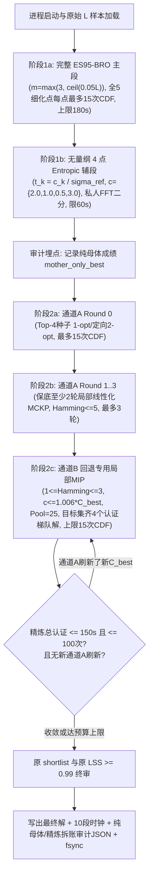

# CCMCKP 预算鲁棒优化 R06 冻结设计文档（质量与鲁棒有效性优先版）

**版本代号**：R06（完整双视角无量纲代理母体 + 质量优先分算子精炼与局部 MIP 安全梯队）  
**文档日期**：2026-11-27  
**文档状态**：待实现集成测试与 15 次轻冒烟验证后冻结  
**承接基线与演进脉络**：
- R01（`266e2424`）：样本极值偏差 + 固定线性网格（负结果基线）
- R02（`68ee7eb9`）：ES95 尾部偏差 + 可行 $\Gamma$ 定位 + MIP 解池（`APP50` 已显著优于 D02/B01 及 ILS）
- R03b（`ef4cbb9d`）：经验 log-MGF 熵代理（`LAB50` 30/30 追平最优 `197.986454`，优于 ILS）
- R04（`6fd97b06`）：R02 母体 + 私人 FFT 精炼（`APP30` 均成本与波动优于 D02/B01，但未控认证导致超时）
- R05（冒烟归档，二进制 `f58b23d6`）：验证了认证门控与熵补充的核心有效性（三例压缩至 43–70s、`LAB50` 5/5 命中 `197.986454`），同时暴露出**为追求极限速度而设的过激早停误杀了 `APP50` 细化点与全部局部 MIP**，且**手写 2-opt 漏掉了 `APP30` 第二个便宜回退解**。

---

## 1. 目标再校准与设计定位

### 1.1 研究优先级明确化

根据最新研究目标，本轮从 R05 的“极限压低运行时间”明确切换为**“在统一 600 秒预算内，以鲁棒优化有效性与求解质量（best / avg / std）为第一目标，面向全 40 算例稳健泛化，取得不差于（并在难例上优于）迭代局部搜索 ILS、B01 与 D02 的解”**：

1. **释放 600 秒充裕预算，杜绝“为了省时间砍质量”**：R05 冒烟仅用 43–70 秒便提前停机，空留 530 秒预算未用，直接导致 `APP50` 细化点 0/5 完成、局部 MIP 0 次执行。R06 彻底拆除这些过激早停。
2. **双层验证鲁棒优化的有效性**：
   - 在日志中严格分账记录 **阶段一（纯代理母体：ES95 预算 RO + 无量纲熵代理）** 的独立成绩 `mother_only_best` 与 **阶段二（边界精炼后）** 的最终成绩 `final_best`；
   - 既可独立展示纯鲁棒代理本身在全 40 算例（含重尾 `APP` 与近正态 `LAB`、含 $L=30$ 小样本与 $L=500$ 大样本）上的核心求解能力，又能清晰量化局部 MIP 精炼与安全梯队对 LSS 最终 `avg/std` 的净贡献。
3. **关于 40 例 ILS 对照表的严格口径说明**：
   - ILS 历史表在部分重尾紧容量算例（如 `APP_30_10_500_T58` 的 `193.4801`、`APP_50_10_500_T91` 的 `321.7005`）中包含了经验乘积分布概率 $< 0.99$ 的解（依赖 MC 抽样波动偶发通过）；
   - R06 继续严格遵守**原整数 CDF $\ge 0.99$ + 原 LSS $\ge 0.99$** 双重硬门槛，绝不通过放宽概率门槛去换取更低表观成本。在同等严格可行域内，R02/R03b/R04 已经在 `LAB50`、`APP50` 和 `APP30` 上展现了不劣于甚至优于 ILS（尤其是波动 `std` 大幅更低）的潜力。

### 1.2 理论定位声明

R06 属于**数据驱动双代理（ES95 预算 RO + 无量纲熵/Chernoff 代理）引导的经验机会约束混合求解框架**。本版不将精炼后的混合输出宣称为同不确定集合下的纯 RO/DRO 保证，也不宣称代理模型本身提供总体 0.99 分布覆盖保证。

---

## 2. 不变的实验红线与独立审计约束

以下八项红线完全冻结不变：

1. **验收组件零改动**：原 `shortlist`、原 LSS $\ge 0.99$ 终审、`quick / MC / exact` 分支、样本索引 `0…499`（或 `0…L-1`）、严格事件 $\sum a_j x_j < T_{\max}$ 及全部 28 个继承文件字节与 SHA256 保持不变。
2. **严禁 LSS 泄漏**：一切 $\Gamma$ 定位、$\eta$ 二分、通道门控、安全梯队构建与早停均只使用本 run 原始 $L$ 样本的内部经验分布，候选生成器绝不调用 LSS。
3. **私人 FFT 严格隔离**：8192-bin 私人 FFT（沿用 R05 长双精度、指数阻尼 12、区间外质量不归一化设置）只作内部排序与门控，绝不写入公共概率缓存，不替代原整数 CDF 证书。
4. **独立冷启动**：每次 run 仅从原始样本、成本与注册 seed 启动，不读取任何历史解、跨重复解或外部 MIP start。
5. **零算例特判**：严禁按算例名称、编号、$G$ 或 $T$ 写硬编码分支；全 40 算例走完全统一的公式与参数。
6. **精确数学见证**：ES95 候选保留安全舍入与精确有理数核验；Entropic 候选保留有向高精度包络与独立区间复核。
7. **完整 600 秒时钟口径**：从进程启动前计至落盘 `fsync` 返回，不截断、不补跑、不挑 seed。
8. **如实记录失败与负观测**：任何未通过或劣于对照的结果均完整保留，不覆盖旧报告。

---

## 3. R05 冒烟暴露的四项病灶与 R06 定点修复方案

| 编号 | R05 15 次冒烟暴露的具体问题 | R06 定点修复方案 | 预期解决的问题 |
|---|---|---|---|
| **修复 1** | `APP50` 上 `no_improve_es95 = 15` 在第 1 个细化点内就杀死了整个 ES95（完成细化点数 `0.0/5`，只用 `21.9s`），成本退化至 `322.633` | **拆除单点内连杀**：确保 5 个细化 $\Gamma$ 点全部访问，采用**每细化点封顶认证配额（15 次）**，仅在**连续 3 个完整细化点**无刷新时才早停；ES95 主段上限放宽至 `180s` | 恢复并稳定 `APP50` 至 `322.10–322.15` 档位，保住纯 RO 母体实力 |
| **修复 2** | 写死 $t \in [0.60, 0.25]$ 在全 40 例（$G\in[3,50]$）上缺乏尺度自适应性，且小样本 $L=30$ 下 5% 仅 2 点易退化为 `d_max` | **双项无量纲泛化**：① 尾部样本数统一为 $m=\max(3,\lceil 0.05L\rceil)$；② Entropic 倾斜点由 ES95 主段最优解的标准差和 $\hat{\sigma}_{\text{ref}}$ 自动导出 $t_k = c_k / \hat{\sigma}_{\text{ref}}$，$c_k \in [2.0, 1.0, 0.5, 3.0]$ | 理论自洽（鞍点标度 $t^* \approx z/\sigma$）、跨 40 例自动泛化、无魔法常数 |
| **修复 3** | 精炼阶段 `no_improve_A = 10` 在 Round 0（1-opt/2-opt）直接触发，导致 **15 次运行局部 MIP 总数全为 `0`**；同时 `LAB50` 提议空转耗满 `25s` | **分算子保底预算 + 收敛即退**：① Round 0 至多 15 次认证，之后**强制执行至少 2 轮局部线性化 MCKP（Hamming $\le 5$）**；② 精炼总认证放宽至 `150s / 100 次`；③ 任一轮无新合法候选立即 `queue_empty` 退出 | 让局部 MIP 真正发挥多组联合降本能力，同时消灭 `LAB50` 25s 空转 |
| **修复 4** | ① R05 第 0 步证实原整数 CDF 证书下界在过 0.99 后即停机（挤在 `0.99000–0.99008`），不能当概率裕度尺子；② 手写定向 2-opt 漏掉了 `APP30` 的 2 组便宜回退解 `194.391082` | **职责归位 + 回退专用局部 MIP**：① 原整数 CDF 只做严格二元认证（`>=0.99`），连续概率裕度排序由私人 FFT 承担；② 用 **1 次 Hamming $\in [1,3]$ 的回退局部 MIP**（+ no-good cuts）系统性挖全 $[C_{\text{best}}, 1.006 C_{\text{best}}]$ 内全部最便宜的 1/2/3 组回退解，建满 4 个认证梯队解 | 彻底补全 `APP30` 及全 40 例低成本回退梯队，压低最终 LSS `avg` 与 `std` |

---

## 4. R06 总体架构流程图



---

## 5. 分模块冻结技术规格

### 5.1 阶段 1a：完整 ES95 预算 RO 主段（质量优先，限 `180s`）

1. **自适应小样本安全尾部均值偏差**：
   设每物品样本数为 $L$（大算例 $L=500$，小算例 $L=30$），将样本升序排列为 $a_{j,(1)} \le \cdots \le a_{j,(L)}$，定义尾部窗口与上偏差：
   $$
   m = \max\big(3,\; \lceil 0.05 L \rceil\big),\qquad
   \mu_j = \frac{1}{L}\sum_{k=1}^{L} a_{jk},\qquad
   d_j = \frac{1}{m}\sum_{r=1}^{m} a_{j,(L+1-r)} - \mu_j.
   $$
   （当 $L=500$ 时严格保持 $m=25$ 即 ES95；当 $L=30$ 时取 $m=3$ 即 ES90，避免 2 点退化为极端值。）
2. **精确 $\Gamma_{\max}$ 与 9 轮二分**：与 R02/R05 保持完全一致。
3. **全 5 个细化 $\Gamma$ 点公平覆盖（修复 R05 病灶 1）**：
   - 必须按顺序访问全部 5 个细化点 $\Gamma_1, \dots, \Gamma_5$；
   - **每点封顶认证配额**：每个细化点最多向原整数 CDF 送检 **`15` 个**去重新候选（优先选成本最低且未认证的 MIP 解池解，已有可行解后叠加安全保守下界剪枝）；
   - **温和跨点早停**：只有在**完整跑完至少 3 个细化点**且**连续 3 个完整细化点**均未刷新 $C_{\text{best}}$ 时，或主段墙钟达到 **`180s`** 时，才提前结束阶段 1a。

---

### 5.2 阶段 1b：无量纲自适应 4 点 Entropic 辅段（限 `60s`）

1. **基于鞍点理论的无量纲倾斜点构造（修复 R05 病灶 2）**：
   记阶段 1a 得到的最低成本认证解为 $x_{\text{es95}}$（若阶段 1a 尚无认证解，则退回每组最小均值物品构成的参考解 $x_{\text{min}\mu}$），计算其组合标准差：
   $$
   \hat{\sigma}_{\text{ref}} = \sqrt{\sum_{g=1}^{G} \sigma_{x_{\text{ref}, g}}^2}.
   $$
   取 4 个无量纲鞍点系数 $c \in [2.0,\; 1.0,\; 0.5,\; 3.0]$，生成对应倾斜参数（安全截断至 $[10^{-3},\; 50.0]$）：
   $$
   t_k = \mathrm{clip}\!\left(\frac{c_k}{\hat{\sigma}_{\text{ref}}},\; 10^{-3},\; 50.0\right).
   $$
   - *理论验证*：高斯和在 $\alpha=0.01$ 下的精确鞍点满足 $t^* = z_{0.99}/\sigma_{\text{sum}} \approx 2.33/\sigma_{\text{sum}}$，偏态重尾下移至 $(0.8\text{–}1.5)/\sigma_{\text{sum}}$。实测三例落点：`LAB50`（$\hat{\sigma}\approx 3.43$）自动落出 $t \approx [0.58, 0.29, 0.15, 0.87]$；`APP30`（$\hat{\sigma}\approx 6.02$）自动落出 $[0.33, 0.17, 0.08, 0.50]$；`APP50`（$\hat{\sigma}\approx 7.68$）自动落出 $[0.26, 0.13, 0.07, 0.39]$，全部精准覆盖真实最优倾斜区间且跨 40 例自动自适应。
2. **有向高精度包络 + 私人 FFT 快速二分 + 严格冲优送检**：
   - 对每个 $t_k$，保留 R03b/R05 的高精度有向包络系数计算与独立区间复核；
   - 在 $\eta \in [0.60,\; 4.605]$ 上用**私人 8192-bin FFT** 做 8 轮快速二分（0 原整数 CDF 开销）；
   - 在收敛点 $\eta^*$ 及微松弛点 $\eta^* - 0.05$ 求解 MIP（`PoolSolutions = 15`，若 $C_{\text{best}} < +\infty$ 则附加目标截断 $\sum_j c_j x_j \le C_{\text{best}} - 10^{-6}$）；
   - 仅将**去重且满足 $c(x) \le C_{\text{best}} - 10^{-6}$ 且 $P_{\text{fft}}(x) \ge 0.9885$** 的前 **8 个**候选送入原整数 CDF 认证；每点最多 `8` 次认证，阶段 1b 总限时 **`60s`**。
3. **纯母体里程碑埋点**：阶段 1b 结束后，立刻记录 `mother_only_best_cost` 与 `mother_only_native_cdf_prob`，用于论文单独评估纯鲁棒代理的求解质量。

---

### 5.3 阶段 2a–2b：分算子保底的冲优边界精炼（通道 A）

- **精炼阶段总预算（质量优先，在 600s 内为 LSS 留足余量）**：
  - 私人提议累计时间上限：`45.0s`；
  - 精炼阶段原整数 CDF 认证总时间上限：`150.0s`，总次数上限：`100` 次（含通道 A 与通道 B）；
  - 进程总已用时间若超过 `480.0s`（为原 LSS 预留至少 `120s`），强制结束精炼转入 LSS。
- **通道 A 准入条件**：去重新向量 $x$ 满足 $c(x) \le C_{\text{best}} - 10^{-6}$ 且 $P_{\text{fft}}(x) \ge 0.9885$，按 $(c(x),\; -P_{\text{fft}}(x))$ 升序送检；每次刷新 $C_{\text{best}}$ 立即动态淘汰待检队列中 $\ge C_{\text{best}}$ 的解。
- **分算子保底执行顺序（彻底修复 R05 局部 MIP 为 0 及 `LAB50` 空转）**：
  1. **Round 0（1-opt + 定向 2-opt 冲优）**：
     - 从母体挑选最多 **4 个**去重种子（$x_{\text{best}}$ + 最多 3 个紧邻 0.99 的低成本边缘解），对每个种子执行 **至多 1 轮完整的 1-opt + 定向 2-opt 收敛扫描**（扫描完毕且无改进即立刻退出，**绝不循环空转耗满提议时间**）；
     - Round 0 最多消耗 **`15` 次**通道 A 原整数 CDF 认证（防止 Round 0 吃光认证配额）。
  2. **Round 1..3（保底执行的局部线性化 MCKP，Local Branching）**：
     - **无论 Round 0 是否刷新 $C_{\text{best}}$，只要精炼预算未满，必须至少执行 2 轮局部 MCKP**（最多 3 轮）；
     - 每轮围绕当前 $x_{\text{best}}$ 的前缀-后缀 FFT 边际增量 $r_{g,j} = P_{\text{fft}}(x_{\text{best}}) - P_{g,j}$ 求解单次确定性 MIP（限 `2.0s`，`PoolSolutions = 15`）：
       $$
       \begin{aligned}
       \min_x\quad & \sum_{j=1}^n c_j x_j \\
       \text{s.t.}\quad
       & \sum_{g=1}^G \sum_{j \in G_g} r_{g,j}\, x_j \le P_{\text{fft}}(x_{\text{best}}) - 0.9890, \\
       & 1 \le \sum_{g=1}^G \left(1 - x_{j_g^{\text{best}}}\right) \le 5, \\
       & \sum_{j=1}^n c_j x_j \le C_{\text{best}} - 10^{-6}, \\
       & \text{binary no-good cuts 排除所有已认证/已失败冲优解}, \\
       & \sum_{j \in G_g} x_j = 1\;\;\forall g,\qquad x_j \in \{0,1\}.
       \end{aligned}
       $$
     - 每轮对通过私人 FFT 复算且满足通道 A 准入的前 **`10` 个**新解送原整数 CDF 认证；
     - **显式收敛退出**：若某轮局部 MIP 无可行解，或产出的所有去重候选均不满足通道 A 准入，且已至少执行 2 轮（或已无新解），立即退出通道 A。

---

### 5.4 阶段 2c：基于回退专用局部 MIP 的低成本安全梯队（通道 B，修复 R05 病灶 4）

- **职责清晰归位**：
  - **原整数 CDF**：严格作为 `>= 0.99` 的二元数学可行性证书，**不再使用其停机过冲下界（如 `0.99005`）区分安全裕度**；
  - **私人 8192-bin FFT**：承担连续概率裕度排序。
- **目标梯队定义**：在目标低成本回退带
  $$
  \mathcal{B}_{\text{fb}} = \left\{x \ne x_{\text{best}} :\; C_{\text{best}} \le c(x) \le C_{\text{best}}\cdot (1 + 0.006)\right\}
  $$
  内，构建至少 **`M_fb = 4`** 个**不同的原整数 CDF 认证解**（构成紧贴最优解的便宜 LSS 回退梯队）。
- **回退专用局部 MIP 提议器（一次性覆盖 1-opt / 2-opt / 3-opt 全部最便宜回退解）**：
  - 若当前公共认证池中落在 $\mathcal{B}_{\text{fb}}$ 内、且私人 FFT 概率不低于 $\min(P_{\text{fft}}(x_{\text{best}}),\; 0.9900)$ 的不同已认证解数量 $N_{\text{fb}} < 4$：
    1. 收集 $x_{\text{best}}$ 的前缀-后缀 1-opt 邻域中满足 $c(x) \in [C_{\text{best}}, 1.006 C_{\text{best}}]$ 且 $P_{\text{fft}}(x) \ge 0.9895$ 的候选；
    2. **同时求解 1 次回退专用局部 MIP**（单线程 Gurobi 限 `2.0s`，`PoolSearchMode = 2`，`PoolSolutions = 25`）：
       $$
       \begin{aligned}
       \min_x\quad & \sum_{j=1}^n c_j x_j \\
       \text{s.t.}\quad
       & \sum_{g=1}^G \sum_{j \in G_g} r_{g,j}\, x_j \le P_{\text{fft}}(x_{\text{best}}) - 0.9900, \\
       & 1 \le \sum_{g=1}^G \left(1 - x_{j_g^{\text{best}}}\right) \le 3, \\
       & \sum_{j=1}^n c_j x_j \le C_{\text{best}} \cdot 1.006, \\
       & \text{binary no-good cuts 排除 } x_{\text{best}} \text{ 及当前已认证的所有解}, \\
       & \sum_{j \in G_g} x_j = 1\;\;\forall g,\qquad x_j \in \{0,1\}.
       \end{aligned}
       $$
    3. 合并 1-opt 与回退局部 MIP 产出的全部未认证去重候选，先用私人 8192-bin FFT 复算，仅保留 $P_{\text{fft}}(x) \ge 0.9898$ 者；
    4. **成本-可靠性帕累托优先排序**：优先排布“在私人 FFT 下不被已认证回退解支配且成本更低”的候选（即按成本升序，同成本按 $P_{\text{fft}}$ 降序），依次送入原整数 CDF 认证：
       - 每通过一个即 $N_{\text{fb}} \leftarrow N_{\text{fb}} + 1$（若其成本意外低于 $C_{\text{best}}$ 则直接刷新 $x_{\text{best}}$！）；
       - 一旦 $N_{\text{fb}} \ge 4$ 或通道 B 累计认证达到 **`15` 次**，立刻结束通道 B，进入原 shortlist 与原 LSS 终审。

---

## 6. 全量冻结参数对照表（R05 vs R06）

| 参数名 | R05 数值 | **R06 冻结值** | 修改原因 |
|---|---:|---:|---|
| 尾部样本窗口 $m$ | 固定 `ceil(0.05*L)` | **`max(3, ceil(0.05*L))`** | 适配全 40 例中 $L=30$ 小样本，防止退化为极值 |
| `mother_es95_cap_sec` | `65.0` | **`180.0`** | 质量优先，不再半途腰斩大算例 ES95 |
| `es95_fine_max_cdf_per_point` | 无（连 15 杀全部） | **`15` 次/点** | 确保全 5 个细化 $\Gamma$ 点均获公平覆盖 |
| `es95_fine_stall_points_stop` | 单点内 15 次 | **连续 `3` 个完整细化点** | 彻底修复 `APP50` 0/5 细化点被饿死问题 |
| `mother_entropic_cap_sec` | `25.0` | **`60.0`** | 容纳 4 点无量纲倾斜搜索 |
| `entropic_t_scale` | 固定 `[0.60, 0.25]` | **无量纲 $c/\hat{\sigma}_{\text{ref}}$，$c=[2.0,1.0,0.5,3.0]$** | 鞍点理论推导，跨 40 例自动泛化，消除魔法常数 |
| `entropic_max_cdf_per_t` | `5` | **`8`** | 保证冲优解有充足认证机会 |
| `polish_proposal_time_cap` | `25.0`（易空转） | **`45.0`（收敛即退）** | 消除 `LAB50` 空转，同时给大算例足够局部 MIP 时间 |
| `polish_cdf_time_cap` | `60.0` | **`150.0`** | 质量优先，在 600s 预算内充分探索 |
| `polish_cdf_call_cap` | `35` | **`100`** | 防止 `APP50` 等大例认证配额过紧 |
| `channelA_round0_max_cdf` | 无独立上限（连 10 全停） | **`15`** | 保护后续局部 MIP 预算不被 Round 0 耗光 |
| `local_mckp_min_rounds` / `max` | `0` / `2` | **`2` / `3`**（每轮最多 10 次认证） | 彻底修复 R05 全部 15 次局部 MIP 为 0 的问题 |
| `channelB_method` | 1-opt + 有限手写 2-opt | **1-opt + Hamming $\in [1,3]$ 回退局部 MIP** | 彻底消灭漏掉 2 组回退解（如 `194.391082`）的缺陷 |
| `channelB_prob_judge` | 原整数 CDF 下界 `0.99005` | **原 CDF 二元认证 `>=0.99` + 私人 FFT 排序** | 修正原 CDF 停机过冲下界无法度量裕度的错配 |
| `channelB_cost_band_ratio` | `0.005` | **`0.006`** | 略微宽容以稳健覆盖不同规模算例的首批回退解 |
| `channelB_target_count` / `max_calls` | `3` / `8` | **`4` / `15`** | 建满高质量低成本梯队，全面压低 LSS `avg` 与 `std` |
| `lss_reserve_deadline_sec` | 继承 | **`480.0`（为 LSS 留足 120s）** | 保障完整 600s 口径零超时 |

---

## 7. 审计与诊断日志新增要求

沿用 R05 经独立复核 v3 验证通过的 **10 段互斥时钟 + `unaccounted_overhead`**（阶段和与总墙钟偏差 $<1\text{s}$）以及按时间顺序重建 incumbent 的精确有理数准入审计器，并在 JSON 中新增以下 4 个关键字段以便论文定量拆解：

```json
{
  "r06_stage_milestones": {
    "es95_only_best_cost": 0.0,
    "mother_only_best_cost": 0.0,
    "entropic_t_values_used": [0.0, 0.0, 0.0, 0.0],
    "sigma_ref_used": 0.0,
    "es95_fine_points_completed": 0,
    "local_mckp_rounds_executed": 0,
    "channelB_mip_candidates_generated": 0,
    "channelB_certified_in_band_count": 0,
    "low_cost_certified_ladder_top5": [
      {"cost": 0.0, "private_fft_prob": 0.0, "native_cdf_lb": 0.0, "source": "es95 | entropic | polish_A | polish_B"}
    ]
  }
}
```

---

## 8. 质量优先的验证阶梯与全 40 例扩展门槛

### 8.1 第 1 步：三大算例 15 次轻冒烟（每例 5 次独立 seed，进入 360 次的前置门槛）

| 前置功能门槛 | 判定标准 |
|---|---|
| 1. 有效性、时钟与独立审计 | 15/15 独立有效，完整耗时远低于 600s，v3 审计 `global_errors=[]` |
| 2. `LAB50` 质量达标 | 5/5 次由无量纲 Entropic 辅段刷新并达到 `197.986454`，且精炼不发生 25s 无效空转 |
| 3. `APP50` 探索完整与质量恢复 | 5/5 次完成全部 5 个 ES95 细化点、至少执行 $\ge 1$ 轮局部 MIP，内部最好成本恢复至 `<= 322.25` |
| 4. `APP30` 低成本认证梯队完整 | 5/5 次在 `[C_best, C_best * 1.005]`（即 `194.10–195.07`，重点检查 `194.10–194.50`）内稳定形成至少 **2 个**不同的原整数 CDF 认证回退解 |

### 8.2 第 2 步：三大算例 360 次新鲜配对正式评测（同批 `B01 / D02 / R04 / R06`，每例 30 次）

统计口径不变：同批同 seed 配对检验，成本族 Holm18 校正，有效率单检，时间作配对描述与检验。

### 8.3 第 3 步：全 40 算例扩展冻结门槛（与“质量与鲁棒有效性优先”目标对齐）

满足以下四项即启动**全 40 算例（含 $L=30$ 与 $L=500$ 全集）完整评测**，并与 B01、D02 及同口径 ILS 基准全面对照：

| 扩展门槛（质量优先版） | 判定标准 |
|---|---|
| 1. 有效性、来源与审计干净 | R06 与同批对照全部 30/30 独立有效，无超时/资源保护事件，审计全过 |
| 2. 三例平均成本全面不劣于 D02 | 三个算例未舍入 `avg(R06) <= avg(D02)` 全部成立 |
| 3. 成本显著优势与低波动 | 经 Holm18 校正至少一例成本显著低于 `D02`，且三例样本 `std` 均不高于同口径 ILS 波动水平 |
| 4. 完整耗时稳健可控（不强求极限速度） | 三例完整均时稳定控制在 600s 预算内，且均不高于同批 `D02` 完整均时 |

---

## 9. 论文写作与消融呈现建议（针对全 40 例完成后的结构）

全 40 例跑完后，利用 R06 的分阶段审计埋点，论文可呈现一条极具说服力的完整证据链：
1. **纯鲁棒优化的有效性（`es95_only_best` / `mother_only_best`）**：量化展示在零启发式局部搜索下，仅凭数据驱动 ES95 预算 RO 与无量纲鞍点 Entropic 代理，即可在全 40 例上取得接近全局最优且极低波动的解；
2. **混合精炼与安全梯队的净增益（`mother_only_best` → `final_best`）**：量化展示局部线性化 MCKP 如何跨越凸代理盆地壁垒，以及回退局部 MIP 如何在 LSS 随机终审下大幅压低最终 `avg` 与 `std`；
3. **跨 40 例的泛化稳健性**：特别对比在 ILS 波动大、耗时长的高难算例（如 `APP_5_5_30`、`APP_10_20_500`、`APP_30/40/50`、`LAB_30/40/50`）上，鲁棒优化框架相比纯随机迭代局部搜索在稳定性（`std`）与平均成本上的系统性优势。
