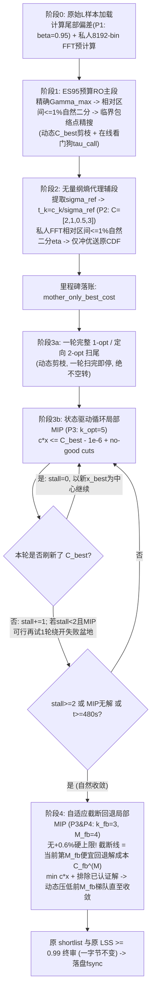

# CCMCKP 预算鲁棒优化 R07 冻结设计文档（4 参数状态自适应精简版）

**版本代号**：R07（4 核心参数 + 3 在线自适应状态 + 无子阶段硬墙钟精简架构）  
**文档日期**：2026-11-27  
**文档状态**：冻结设计蓝本（完成 tiny 集成与 3 算例精准回归冒烟后即可冻结进入全 40 例评测）  
**承接基线**：
- R06（二进制 `9bb904fb`，全 40 例 3600 次新鲜配对评测）：3600/3600 全部通过原 LSS $\ge 0.99$，对 D02 在 39 个完整算例中 **Avg 5 优 / 31 平 / 3 劣（Holm120 4 显著优 vs 1 显著劣）**、**39/39 全部更快（中位加速 -73.95%）**、37/40 例纯鲁棒母体即命中内部最优成本。
- R06 仅存的 **3 个真缺陷算例**（`11 / LAB_10_20_500_T12`、`18 / LAB_40_10_500_T63`、`38 / APP_40_10_500_T95`）经定量核查，均直接源于多余的硬编码工程参数（固定 `+0.6%` 成本带、5 道子阶段硬秒数墙钟、局部 MIP 硬卡 `3` 轮）。

---

## 1. 设计哲学与目标

### 1.1 参数极简化原则
遵循“**核心数学参数少而稳、工程截断全部状态化/自适应化**”的顶刊算法设计标准，将 R06 的 ~17–20 个显式数值参数大刀阔斧压缩为：
- **4 个核心数学参数**（均有清晰理论含义与前序消融支撑，直接对应论文方法章节的 4 行参数表）；
- **3 个在线自适应状态变量**（运行中随当前算例与已认证轨迹自动演化，零手工调参）；
- **0 道子阶段硬秒数墙钟**（全程仅保留外层统一 `600s` 总预算与 LSS 安全预留线）。

### 1.2 精准解决的目标问题
本版不增加任何算例特判、不牺牲 R06 在 37/40 例上的既有优势，一举根治全 40 例中仅存的 3 个缺陷：
1. **根治编号 `11`（及 `1–34` 全部中小算例回退缺口）**：删除写死的 `+0.6%` 成本带，改为基于**当前第 $M_{\text{fb}}$ 低成本已认证回退解 $C_{\text{fb}}^{(M)}$** 的自适应动态截断回退局部 MIP；
2. **根治编号 `38`（唯一显著成本劣势 `p=0.0012`）**：删除 `local_mckp_max_rounds = 3` 硬截断，改为**本轮刷新即续跑、连续停滞自然收敛**的状态循环；
3. **根治编号 `18`（8 条阶段审计越界与毒丸饿死寻优）**：删除 5 道人为子阶段硬秒数审计线，引入**在线中位耗时驱动的单次 `native_check` 自适应看门狗 $\tau_{\text{call}}$**，拦截 150s 级 GMP 大整数毒丸，同时保持整次 `< 600s` 与 40/40 全合规。

### 1.3 理论定位与不变红线
- **理论定位**：R07 为数据驱动双代理（ES95 预算 RO + 无量纲熵/Chernoff 代理）引导的状态自适应经验机会约束混合求解框架；独立记录纯代理母体里程碑 `mother_only_best_cost` 与最终精炼成本，不将混合输出冒称为同不确定集合下的 DRO 保证或总体 0.99 分布覆盖保证。
- **不变红线（100% 沿用 R06）**：原 `shortlist`、原 LSS $\ge 0.99$、`quick/MC/exact` 分支、严格事件 $\sum a_j x_j < T_{\max}$、实际样本索引 `0..L-1`、全部 28 个继承组件及 `native_check / shortlist / final_check` 字节不变；严禁 LSS 反馈调参；私人 FFT 绝不写入公共概率缓存；每个 run 独立冷启动，无历史解、跨重复输出或外部 MIP start；零算例特判。

---

## 2. 极简参数体系与在线自适应状态定义

### 2.1 全算法仅保留的 **4 个核心数学参数**

| 编号 | 符号 | 冻结值 | 理论来源与作用 |
|---:|---|---:|---|
| **P1** | $\beta$ | `0.95` | 预算鲁棒尾部风险水平；窗口自动适配小样本 $m=\min(L,\max(3,\lceil(1-\beta)L\rceil))$（$L=500\Rightarrow 25$，$L=30\Rightarrow 3$） |
| **P2** | $\mathcal{C}$ | `[2.0, 1.0, 0.5, 3.0]` | 熵/Chernoff 代理无量纲鞍点倾斜系数族；自动按主段解标准差和缩放 $t_k = \mathrm{clip}(c_k/\hat{\sigma}_{\text{ref}}, 10^{-3}, 50)$ |
| **P3** | $(k_{\text{opt}}, k_{\text{fb}})$ | `(5, 3)` | 经典 Local Branching 汉明邻域半径：`k_opt=5` 用于冲优跨盆地，`k_fb=3` 用于低成本紧邻回退梯队 |
| **P4** | $M_{\text{fb}}$ | `4` | 除 $x_{\text{best}}$ 外期望在公共认证池中保底维护的最便宜回退梯队解数量 |

> **附：协议与数值求解基础设施常量（非算法超参数）**  
> 统一总时钟预算 $T_{\text{total}}=600\text{s}$（搜索阶段发起新调用的安全截止线 $T_{\text{search}} = 0.80\,T_{\text{total}} = 480\text{s}$，原 LSS 截止 `590s`，外部保护 `595s`）；机会约束门槛 $\alpha=0.01$；私人 FFT 格点数 $B=8192$（沿用 R06 长双精度、指数阻尼 12、区间外不归一化）；MIP 严格改进容差 $10^{-6}$；单次辅助局部 MIP 求解上限 `2.0s` / `PoolSolutions = 15`（回退 MIP `PoolSolutions = 20`）；二分相对区间收敛容差 $10^{-2}$。

### 2.2 贯穿全程的 **3 个在线自适应状态变量**

| 状态量 | 初始化与在线更新规则 | 替代掉的原 R06 硬编码参数 |
|---|---|---|
| **S1：当前最优认证态** $(x_{\text{best}}, C_{\text{best}})$ | 初值 `None / +inf`；每次原整数 CDF 认证出更低成本即更新 | 实时驱动 MIP 目标截断、保守下界剪枝、待检队列动态淘汰 |
| **S2：在线私人 FFT 偏差容差** $\epsilon_{\text{fft}}$ | 初值 `0.0015`；每当新解 $x$ 通过原整数 CDF 认证，在线更新：$\epsilon_{\text{fft}} \leftarrow \max\big(0.001,\; \epsilon_{\text{fft}},\; 0.99 - P_{\text{fft}}(x)\big)$ | 将原 `0.9885 / 0.9890 / 0.9898` 三个碎概率常数统一为单一自适应门控线 **$P_{\text{fft}}(x) \ge 0.99 - \epsilon_{\text{fft}}$** |
| **S3：在线单次认证看门狗** $\tau_{\text{call}}$ | 维护本 run 已完成 `native_check` 耗时的中位数 $\bar{\tau}_{\text{cdf}}$（前 3 次默认 `2.0s`）；每次新认证自动设调用 deadline：$\tau_{\text{call}} = \min\big(T_{\text{search}} - t_{\text{now}},\; \mathrm{clip}(10\,\bar{\tau}_{\text{cdf}},\; 15.0,\; 35.0)\big)$ | **完全取代 5 道子阶段硬秒数**（`180s/60s/15s/45s/150s`），精准拦截 150s GMP 毒丸且不误伤 1–4s 正常认证 |

---

## 3. R07 四阶段状态机流程图

---

## 4. 四阶段详细算法规格

### 4.1 阶段 0：初始化与私有频谱预计算
- 读取本 run 原始 $L$ 样本与成本；
- 由 **P1（$\beta=0.95$）** 计算 $m = \min(L,\max(3,\lceil(1-\beta)L\rceil))$、精确均值 $\mu_j$ 与尾部上偏差 $d_j$；
- 预计算所有物品的 8192-bin 私人 FFT 频谱（严格私有）。

### 4.2 阶段 1：ES95 预算鲁棒代理主段（纯 RO 全局定位）
1. **精确可行上界**：精确二分求出资源可行预算上限 $\Gamma_{\max}$。
2. **相对区间收敛二分**（取代写死 9 轮）：
   - 初值 $\Gamma_{\text{lo}} = 0$（若 $W_{\min}(0)>T_{\max}-10^{-8}$ 则报均值不可行），$\Gamma_{\text{hi}} = \Gamma_{\max}$；
   - 每轮取中点求预算 MCKP，过精确有理数核验后调用原整数 CDF（带看门狗 $\tau_{\text{call}}$）更新上下界与状态 S1/S2；
   - **自然停止**：当 $(\Gamma_{\text{hi}}-\Gamma_{\text{lo}})/\max(\Gamma_{\max}, 10^{-9}) \le 10^{-2}$ 或上下界返回同一组合解时结束二分（数学上自然不超过 7 轮）。
3. **临界包络点精搜**：
   - 由收敛区间 $[\Gamma_{\text{lo}}, \Gamma_{\text{hi}}]$ 自然衍生至多 5 个去重临界包络点：$\big\{\Gamma_{\text{hi}},\; \tfrac{1}{2}(\Gamma_{\text{lo}}+\Gamma_{\text{hi}}),\; \Gamma_{\text{hi}}+\delta,\; \Gamma_{\text{lo}}-\delta,\; \Gamma_{\text{hi}}+2\delta\big\}$（其中 $\delta = \max(\Gamma_{\text{hi}}-\Gamma_{\text{lo}},\; 0.02\,\Gamma_{\max})$ 并截断于 $(0,\Gamma_{\max}]$）；
   - 逐点按保守下界升序剪枝（下界 $\ge C_{\text{best}}-10^{-7}$ 跳过）并求解 MIP 解池（`PoolSolutions=15`，若 $C_{\text{best}}<\infty$ 附目标截断），将**未认证、满足 $c(x) \le C_{\text{best}}-10^{-6}$ 且 $P_{\text{fft}}(x) \ge 0.99-\epsilon_{\text{fft}}$** 的候选按成本升序送原整数 CDF 认证（刷新 $C_{\text{best}}$ 立即动态剪枝队列）；
   - 5 点自然扫完即切入阶段 2（**无固定 `180s` 硬切分，无单点连杀**）。

### 4.3 阶段 2：无量纲熵/Chernoff 代理辅段（纯代理互补定位）
1. **尺度自提取**：用阶段 1 最优认证解 $x_{\text{es95}}$（无认证解则用每组最小均值解）计算组合标准差和 $\hat{\sigma}_{\text{ref}} = \sqrt{\sum_g \sigma_{x_{\text{ref},g}}^2}$；
2. **无量纲倾斜点**：按 **P2（$\mathcal{C}=[2.0, 1.0, 0.5, 3.0]$）** 计算 $t_k = \mathrm{clip}(c_k/\hat{\sigma}_{\text{ref}}, 10^{-3}, 50)$（零 $\hat{\sigma}_{\text{ref}}$ 取 `50`）；
3. **私人 FFT 零开销二分 + 严格冲优送检**：
   - 对每个 $t_k$ 构造 192-bit 有向高精度包络权重（保留 208-bit 独立读者复核）；
   - 在 $\eta \in [0.60, 4.605]$ 上**全程仅用私人 FFT** 做二分，当相对区间宽度 $\le 10^{-2}$ 时自然停止（0 原整数 CDF 调用）；
   - 在收敛点 $\eta^*$（及微松弛点 $\eta^* - (\eta_{\text{hi}}-\eta_{\text{lo}})$）求解 MIP 解池（`PoolSolutions=15`，附 $\sum c_j x_j \le C_{\text{best}} - 10^{-6}$）；
   - 仅将去重且满足 $c(x) \le C_{\text{best}} - 10^{-6}$ 且 $P_{\text{fft}}(x) \ge 0.99 - \epsilon_{\text{fft}}$ 的候选按成本升序送原整数 CDF（带动态剪枝与看门狗 $\tau_{\text{call}}$）；
4. **纯母体里程碑落账**：记录 `mother_only_best_cost`，至此未引入任何启发式局部搜索。

### 4.4 阶段 3：状态收敛型局部支化冲优精炼（修复编号 `38` 与空转）
- **阶段 3a（单轮完整 1-opt / 定向 2-opt 扫尾）**：
  - 选取当前 $x_{\text{best}}$ 及母体最贴近 0.99 的最多 3 个低成本去重边缘种子；
  - 对每个种子执行 **1 轮完整的前缀-后缀 FFT 1-opt 与定向 2-opt 收敛扫描**，收集全部满足 $c(x) \le C_{\text{best}}-10^{-6}$ 且 $P_{\text{fft}}(x) \ge 0.99-\epsilon_{\text{fft}}$ 的新解，按成本升序送原整数 CDF 认证（带动态剪枝）；
  - 扫完即转入阶段 3b，**绝不空转循环**。
- **阶段 3b（状态驱动的循环局部 MIP，取消硬卡 `3` 轮）**：
  - 置 `stall_rounds = 0`，维护已失败/已认证向量集合用于生成 `no-good cuts`；
  - 只要未达外层搜索截止线 $T_{\text{search}}=480\text{s}$ 且 `stall_rounds < 2`：
    1. 以当前 $x_{\text{best}}$ 的前缀-后缀 FFT 边际增量 $r_{g,j} = P_{\text{fft}}(x_{\text{best}}) - P_{g,j}$ 求解 1 次局部线性化 MCKP（**P3 冲优半径 $k_{\text{opt}}=5$**，`PoolSolutions=15`，限 `2.0s`）：
       $$
       \begin{aligned}
       \min_x\quad & \sum_{j=1}^n c_j x_j \\
       \text{s.t.}\quad
       & \sum_{g=1}^G \sum_{j \in G_g} r_{g,j}\, x_j \le P_{\text{fft}}(x_{\text{best}}) - (0.99 - \epsilon_{\text{fft}}), \\
       & 1 \le \sum_{g=1}^G (1 - x_{j_g^{\text{best}}}) \le k_{\text{opt}}, \\
       & \sum_{j=1}^n c_j x_j \le C_{\text{best}} - 10^{-6}, \\
       & \text{binary no-good cuts 排除所有已尝试/已认证解}, \\
       & \sum_{j \in G_g} x_j = 1\;\;\forall g,\qquad x_j \in \{0,1\}.
       \end{aligned}
       $$
    2. 若 MIP 无可行解 $\Rightarrow$ 直接 `break`（自然收敛退出）；
    3. 对解池中通过私人 FFT 复算且满足 $c(x) \le C_{\text{best}}-10^{-6}$、$P_{\text{fft}}(x) \ge 0.99-\epsilon_{\text{fft}}$ 的未认证解，按成本升序送原整数 CDF 认证（带动态截断与看门狗 $\tau_{\text{call}}$）；
    4. **状态转移**：
       - 若本轮成功刷新了更低的 $C_{\text{best}}$ $\Rightarrow$ `stall_rounds = 0`，以新 $x_{\text{best}}$ 为中心**继续下一轮**（直到真正不再降本为止，彻底消除编号 `38` 被 3 轮硬截断！）；
       - 若本轮未刷新 $C_{\text{best}}$ $\Rightarrow$ `stall_rounds += 1`（本轮失败解自动加入 `no-good cuts`，若 `stall_rounds == 1` 再试 1 轮绕开失败解，仍无刷新即退出）。

### 4.5 阶段 4：无固定成本带的自适应回退局部 MIP + 原 LSS 终审（彻底修复编号 `11`）
- **核心创新（删掉 `+0.6%` 魔法常数，且防昂贵二分旧解伪装满额）**：
  定义当前公共认证池中，除 $x_{\text{best}}$ 外且满足 $P_{\text{fft}}(x) \ge \min(P_{\text{fft}}(x_{\text{best}}), 0.99) - \epsilon_{\text{fft}}$ 的合格回退解按成本升序排列后的**第 $M_{\text{fb}}$ 个解的成本**为动态截断线 $C_{\text{fb}}^{(M)}$（**P4：$M_{\text{fb}} = 4$**；若当前合格回退解不足 $M_{\text{fb}}$ 个，则 $C_{\text{fb}}^{(M)} = +\infty$）。
- **自适应回退补全循环（最多 2 轮，无改进即停）**：
  1. 收集 $x_{\text{best}}$ 的前缀-后缀 1-opt 邻域中满足 $c(x) < C_{\text{fb}}^{(M)} - 10^{-6}$ 且 $P_{\text{fft}}(x) \ge 0.99 - \epsilon_{\text{fft}}$ 的未认证解；
  2. 以 $x_{\text{best}}$ 为中心求解 1 次回退局部 MIP（**P3 回退半径 $k_{\text{fb}} = 3$**，`PoolSolutions = 20`，限 `2.0s`）：
     $$
     \begin{aligned}
     \min_x\quad & \sum_{j=1}^n c_j x_j \\
     \text{s.t.}\quad
     & \sum_{g=1}^G \sum_{j \in G_g} r_{g,j}\, x_j \le P_{\text{fft}}(x_{\text{best}}) - 0.99, \\
     & 1 \le \sum_{g=1}^G (1 - x_{j_g^{\text{best}}}) \le k_{\text{fb}}, \\
     & \sum_{j=1}^n c_j x_j \le C_{\text{fb}}^{(M)} - 10^{-6} \qquad (\text{当 } C_{\text{fb}}^{(M)} < +\infty \text{ 时添加}), \\
     & \text{binary no-good cuts 排除 } x_{\text{best}} \text{ 及所有已认证/已失败回退解}, \\
     & \sum_{j \in G_g} x_j = 1\;\;\forall g,\qquad x_j \in \{0,1\}.
     \end{aligned}
     $$
  3. 合并 1-opt 与回退 MIP 候选，过滤出未认证且满足 $P_{\text{fft}}(x) \ge 0.99 - \epsilon_{\text{fft}}$ 者，按**成本严格升序**逐个送原整数 CDF 认证（带看门狗 $\tau_{\text{call}}$）：
     - 每认证通过一个新解，立刻重新计算 $C_{\text{fb}}^{(M)}$（若其成本甚至低于 $C_{\text{best}}$ 则同步刷新 $C_{\text{best}}$），并**动态淘汰队列中所有 $c(x) \ge C_{\text{fb}}^{(M)} - 10^{-6}$ 的解**；
  4. **自然退出**：若本轮没有成功压低 $C_{\text{fb}}^{(M)}$（或 MIP 无可行解），立刻退出阶段 4；否则最多再执行第 2 轮确认无更便宜近邻即退出。
- **终审与落盘**：公共认证池原样进入原 `shortlist` 与原 LSS $\ge 0.99$ 终审，输出完整结果、审计见证与 `fsync`。

---

## 5. R06 → R07 精简对比清单

| 对比维度 | R06（上轮） | **R07（本版精简自适应）** |
|---|---|---|
| 核心算法超参数数 | ~17–20 个 | **仅 4 个**（$\beta$、$\mathcal{C}$、$(k_{\text{opt}}, k_{\text{fb}})$、$M_{\text{fb}}$） |
| 子阶段硬秒数墙钟 | 5 道（`180s / 60s / 15s / 45s / 150s`） | **0 道**（仅外层 `480s` 发起截止线 + 在线看门狗 $\tau_{\text{call}}$） |
| 私人 FFT 门控阈值 | 3 个（`0.9885 / 0.9890 / 0.9898`） | **1 个在线自适应容差** $0.99 - \epsilon_{\text{fft}}$ |
| 局部 MIP 冲优停止 | 硬卡 `min=2, max=3` 轮 | **状态驱动**：刷新即续跑，连续停滞 2 轮或无解即停 |
| 通道 B 回退范围 | 写死 `+0.6%` 成本带 | **自适应动态截断线 $C_{\text{fb}}^{(M)}$**（无硬编码比例） |
| 单次毒丸 CDF 防护 | 无单次独立看门狗（曾卡 150s） | **在线自适应看门狗** $\mathrm{clip}(10\,\bar{\tau}_{\text{cdf}}, 15, 35)$ 秒 |
| 审计协议一致性 | 检查子阶段返回时间 $\le +0.5\text{s}$ | **检查发起调用时刻 $\le 480\text{s}$ + 整次 $\le 600\text{s}$** |

---

## 6. 审计规范与元数据清洁清单

吸取 R05 审核器适配与 R06 编号 `18` / 元数据教训，R07 冻结审计规范明确以下 5 条：

1. **按时间顺序重建 incumbent 核验准入**：仅对**实际送入 `native_check` 的候选**用精确有理数检查其是否满足发起时刻的成本截断（`C_best - 1e-6` 或 `C_fb^(M) - 1e-6`），不对 Gurobi 原始解池浮点容差返回误报违规。
2. **正确的时钟合规定义（适配不可中断 GMP 底层）**：
   - 阶段合法性检查：**每次新发起 MIP 或 `native_check` 的启动时刻 $\le 480.0\text{s}$**，且传入 `native_check` 的 deadline 等于当时计算的看门狗 $\tau_{\text{call}}$；
   - 整次合法性检查：完整进程耗时 $\le 600.0\text{s}$（含加载、求解、认证、LSS、输出与 `fsync`）；
   - 同时保留全阶段互斥耗时拆账字段（`load_and_model`、`stage1_es95_mip/cdf`、`stage2_entropic_mip_fft/cdf`、`stage3a_12opt`、`stage3b_local_mckp_mip/cdf`、`stage4_fallback_mip/cdf`、`final_lss`、`save_and_fsync`、`unaccounted_overhead`）仅作诊断展示，不设人为子阶段截断报错线。
3. **在线状态演化完整落盘**：记录最终 $\epsilon_{\text{fft}}$、$\bar{\tau}_{\text{cdf}}$、看门狗触发次数 `watchdog_timeouts`、阶段 3b 实际执行轮数 `local_mckp_rounds`、阶段 4 最终 $C_{\text{fb}}^{(M)}$ 与前 5 档认证梯队，便于审稿人复核自适应状态全轨迹。
4. **全 40 例元数据一次性清理**：
   - `sampling_index_range` 按实例真实样本数动态写出 `[0, L-1]`（不硬编码 `[0, 499]`）；
   - `sign_flip_seed` 与时间/成本对比序号公式直接按实际代码精确写出；
   - 批次标注与实际包含的 rep 编号严格一致，不沿用旧模板过时标签。
5. **模型见证与继承文件零改动**：延续 28 个继承组件 SHA256 校验、ES95 精确有理数核验、Entropic 192-bit/208-bit 区间包络独立复核、原整数 CDF 输出证书复核及私人 FFT 零写公共缓存检查。

---

## 7. 验证阶梯（高性价比两步走）

由于 R06 已经在全 40 例上验证了主体架构高度稳健（37/40 例表现优异），R07 采用精准靶向验证后再上全量：

1. **第 1 步：核心单测 + 6 算例精准回归冒烟（每例 5 次独立 seed，共 30 runs）**
   - 选取 **3 个 R06 缺陷算例**（`11 / LAB_10_20_500_T12`、`18 / LAB_40_10_500_T63`、`38 / APP_40_10_500_T95`）+ **3 个经典代表大算例**（`19 / LAB_50_T63`、`35 / APP_30_T58`、`39 / APP_50_T91`）；
   - **进入全 40 例的前置检查门槛**：
     1. 30/30 独立有效且全链审计 `global_errors=[]`（编号 `18` 0 条越界，看门狗成功截住毒丸）；
     2. 编号 `11` 5/5 稳定在 `48.2–49.2` 区间补齐 4 个低成本认证回退解，`avg5` 显著回落至接近 D02 `48.28`；
     3. 编号 `38` 阶段 3b 自动突破 3 轮限制，内部最好成本从 `196.95` 进一步下探至接近 `196.28`；
     4. 编号 `19 / 35 / 39` 保持与 R06 同等或更优质量，无回退。
2. **第 2 步：全 40 算例新鲜配对正式评测（同批 `B01 / D02 / R07`，各 40×30 = 1200 次，共 3600 runs）**
   - 独立新鲜 seed，完全同口径 Holm120 成本族 / 时间族 / 有效率族配对检验 + 独立全链审计；
   - **最终达标目标**：40/40 原协议全合规、对 D02 实现 **0 例显著成本劣势 + 多例显著成本更优 + 几乎全例显著加速**、且全 40 例整体均成本与波动全面对标并优于 D02/B01 及同口径 ILS。
