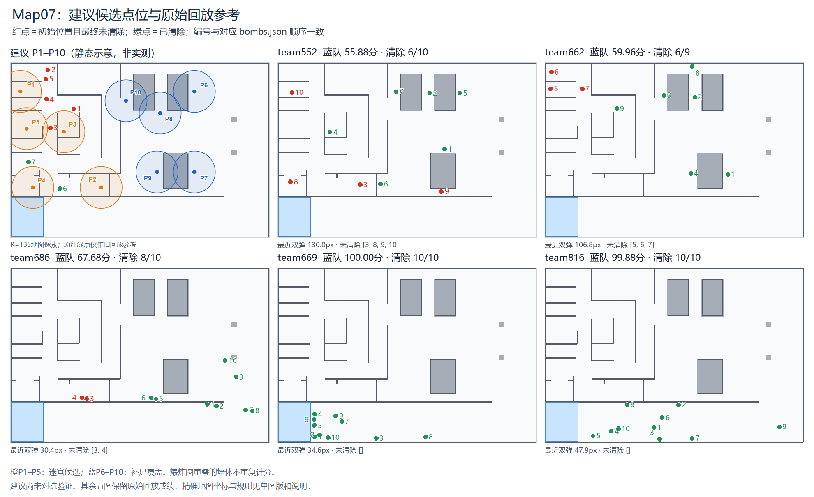
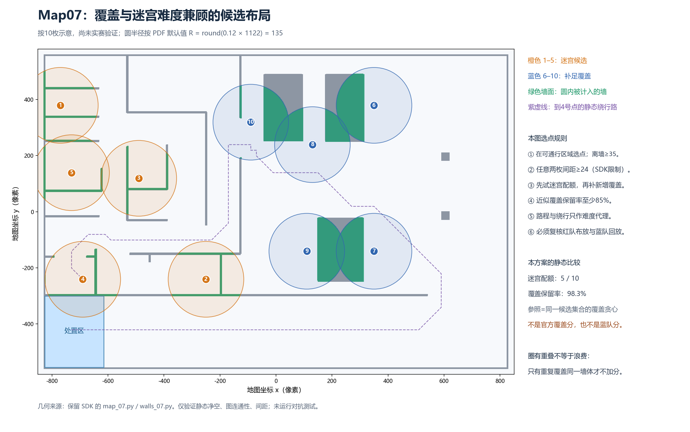

# Map07 建议布弹位置、覆盖圆与选点规则

用户提供原图的原始PNG保持不变。`original_annotated_exact.svg` 嵌入原图并精确叠加建议点，仅替换左上面板标题/说明以避免把旧team525成绩误认为新布局成绩；原红绿点仍作为旧回放参考。其余五个面板保留原图内容。

`map07_coordinate_layout.png/svg` 是根据所读取SDK公开静态几何重新绘制的单图，便于看清坐标、覆盖墙体和绕行路线；不是修改比赛地图。图中绿色只表示本静态模型中被圆覆盖的墙体像素。





## 先明确结论范围

- **这是建议试验布局，不是已验证最优布局，也没有新蓝队成绩。** 没有启动比赛、没有运行蓝队对抗或红队实际布放。
- 10枚仅按用户图中常见数量作示意；实际必须使用本轮 `expected_count`，不能强行固定为10。
- 已核对保留SDK的公开 `map_07.py` 和 `walls_07.py`：地图1660×1122，坐标原点在地图中心，x向右、y向上。
- 按PDF默认半径比例0.12：`R=round(0.12*1122)=135` 地图像素。在原1980×1210图片的左上小面板上，半径约51图像像素。实际上传回合如果配置不同，需要重算。
- 内墙权重1，边界墙权重0.5。这里只做2像素网格采样的静态覆盖估计，不能当作SDK正式评分。
- 用户原图注明上传版本未核验，本次采用保留SDK的公开静态定义；不能据此声称已经核验所有上传回合的具体地图代码。

## 怎么兼顾覆盖与难度

橙色1–5优先考虑隔间、绕行和多段墙的共同覆盖；蓝色6–10补足大块内部墙的覆盖。它们不是“5枚保证难、5枚保证覆盖”的承诺，而是职责分配。

重点看4号：它在处置区上方、隔着长横墙，直线很近；保守静态通行网格计算的到达路线却约3462地图像素。紫虚线是这个静态网格最短路径，不是无人机真实轨迹，也没有把搜索、抓取、并行协作和动力学算进去。

右侧大矩形是真实静态定义中的 NormalBox，墙体栅格有较大面积；把全部炸弹挤进左侧迷宫，会有丢掉这部分覆盖的风险。因此保留6–10补足这些墙体。

**圈相交不一定浪费。** 例如7和9从同一个矩形两侧覆盖，仍然能各自带来新墙体像素；真正不加分的是重复罩住已经覆盖的同一批墙像素。

## 点位表

下面编号只是示意标识和离线选点顺序，不是10架无人机的分配，也不是红队执行顺序。

| 编号 | 地图坐标(x,y) | 角色 | 静态墙净空(px) | 从处置区静态路径(px) | 原因与待核点 |
|---:|---|---|---:|---:|---|
| 1 | (-770, 379) | 迷宫候选 | 37.0 | 3749.9 | 左上隔间：圆覆盖相邻横墙及部分边框；房间入口造成绕行。 |
| 2 | (-250, -241) | 迷宫候选 | 49.0 | 3565.1 | 底部长横墙上侧的隔间：同时罩住横墙、竖隔墙；距处置区看似近，但路径被隔墙分割。 |
| 3 | (-490, 119) | 迷宫候选 | 35.0 | 3529.9 | 中央小隔间：覆盖多段短墙；蓝队需要正确进出隔间并完成抓取运输。 |
| 4 | (-690, -241) | 迷宫候选 | 41.0 | 3461.7 | 左下隔间、处置区上侧：覆盖长横墙和短隔墙；图中的紫虚线展示明显绕行，不能按直线距离判断容易。 |
| 5 | (-730, 139) | 迷宫候选 | 61.0 | 3613.4 | 左侧中间隔间：覆盖上下相邻墙段；和1号点分担不同墙段，避免只堆一处。 |
| 6 | (350, 379) | 覆盖补足 | 36.0 | 2172.5 | 右上大矩形右侧：主要补足较大面积的内部墙覆盖，不把所有炸弹都挤进迷宫。 |
| 7 | (350, -141) | 覆盖补足 | 38.0 | 1722.8 | 右下大矩形右侧：承担覆盖补足，与9号点从两侧覆盖不同的墙体像素。 |
| 8 | (130, 239) | 覆盖补足 | 36.1 | 2135.4 | 上方两个大矩形之间偏下：爆炸圆同时覆盖两块墙体的下部及侧面，优先看新增覆盖量。 |
| 9 | (110, -141) | 覆盖补足 | 38.0 | 2212.5 | 右下大矩形左侧：补上7号点尚未覆盖的左半部分；圆重叠可以接受，重复墙像素不再得分。 |
| 10 | (-90, 319) | 覆盖补足 | 35.8 | 2447.1 | 左上大矩形左侧：补足上方大块墙体，同时保留静态通行净空。 |

## 一套可以落地试验的布弹规则

1. **合法与可达先行。** 候选点在自由区域，避开处置区；本示意预留35地图像素墙净空，并在20像素网格上检查连通性。35是本次自定试验参数，不是SDK保证安全的阈值。实际还需用无人机真实碰撞体和携弹姿态校验，不能只检查炸弹中心点。
2. **遵守最小弹间距。** 所读取公开SDK的 `MIN_BOMB_SEPARATION=24.0`，两枚小于24会拒放。24是合法下限，不是建议把全部炸弹挤成24间距。
3. **每次只看新增覆盖。** 新增覆盖=新爆炸圆内尚未被已有圆覆盖的加权墙体；已经覆盖的墙不重复计分。内墙计1、边界计0.5；爆炸圆有一部分覆盖空地不会得墙分。
4. **在覆盖接近的候选里增加绕行。** 迷宫阶段先保留新增覆盖不低于当轮迷宫最佳候选85%的点，再选到处置区静态可行路径较长的点。这里的85%为可调试验参数；路径长只是一种难度代理，不能换算成蓝队分数。
5. **用整体覆盖约束控制代价。** 对同一合法候选集合先求一个纯覆盖贪心布局作参照；本次分别试0–5个迷宫配额，再用剩余炸弹贪心补覆盖，要求总近似覆盖至少保留参照的85%。本图选中了试过的最大配额5，不是证明5:5在所有地图上最佳。
6. **执行时以放满和可靠性为先。** 规划每架无人机的任务路线与时间预算；高风险点需要有附近替代点。优先保证实际布弹数量，避免为了难点少放炸弹，使布局项被完成度折扣。
7. **最后用公开回放校准。** 同数量、同蓝队、同资源规则比较纯覆盖布局与本候选布局，分别看正式覆盖分、蓝队成绩、红队完成度和红队总分。不同自然随机的一轮结果不能直接解释为布局因果提升。

伪代码：

```text
C = 当前允许使用地图上的合法、可达候选点
reference = 覆盖贪心(C, N)
for q in 0..min(5, floor(N/2)):
    S = 空集
    重复q次：
        计算迷宫候选的新增加权覆盖
        保留新增覆盖 >= 0.85 * 迷宫候选最大新增覆盖的点
        在保留点中选静态运回路径较长者，加入S
    用剩余N-q枚逐次最大化新增覆盖，补足S
    保留总覆盖 >= 0.85 * reference的S
对保留布局做真实布放、抓取运输与蓝队公开回放验证
按实测红队总分选择；不要直接按q最大或路径最长判定更强
```

## 本次静态检查结果

- 候选点数10，全部通过本模型的35px墙净空、最小24px间距、静态网格可达性检查。
- 近似加权墙覆盖：建议布局 **101778**，同候选集合覆盖贪心 **103552**，比例 **98.29%**。
- 这个98%左右的比例不是“官方覆盖项拿98分”，也不能直接乘20得到官方分数。正式满分参照的候选约束、精确栅格和实际落点可能不同。
- 平均静态运输路径：建议 **2861.0**，覆盖贪心 **2792.8**，约增加 **2.44%**。这个变化较小，不能据此声称蓝队显著降分。搜索、协作、抓取、运行时间都尚未验证。
- 半径圆穿墙表示评分几何覆盖；这不是在预测物理爆破传播或真实炸墙动画。

## 文件

- `original_annotated_exact.png/svg`：在原图上精确叠加建议点与覆盖圆，原始图片像素作为底图嵌入。
- `map07_coordinate_layout.png/svg`：按SDK静态定义绘制的大图和绕行示意。
- `candidate_points.json`：10个建议坐标、角色、净空、静态路径与原因；非可直接提交的比赛布局文件。
- `layout_analysis.json`：同候选集合的覆盖参照、0–5配额静态比较及限制。
- `analysis_reproducible.py`：本次离线计算脚本。运行 `python analysis_reproducible.py /你的SDK/src/swarm_rescue`，只读地图定义，结果写入脚本所在目录的deliverables子目录。
- `source_provenance.json`：用户原图及所读公开SDK文件SHA256。

原图SHA256：`1c689c00bc75a4fbd1dbf819aecbe66c18c0ec58ada8a49da0d90c00823df02f`。

最终交付使用坐标叠加和静态几何图；内置图像编辑生成的辅助预览存在点色误差，未作为计量或点位依据。
