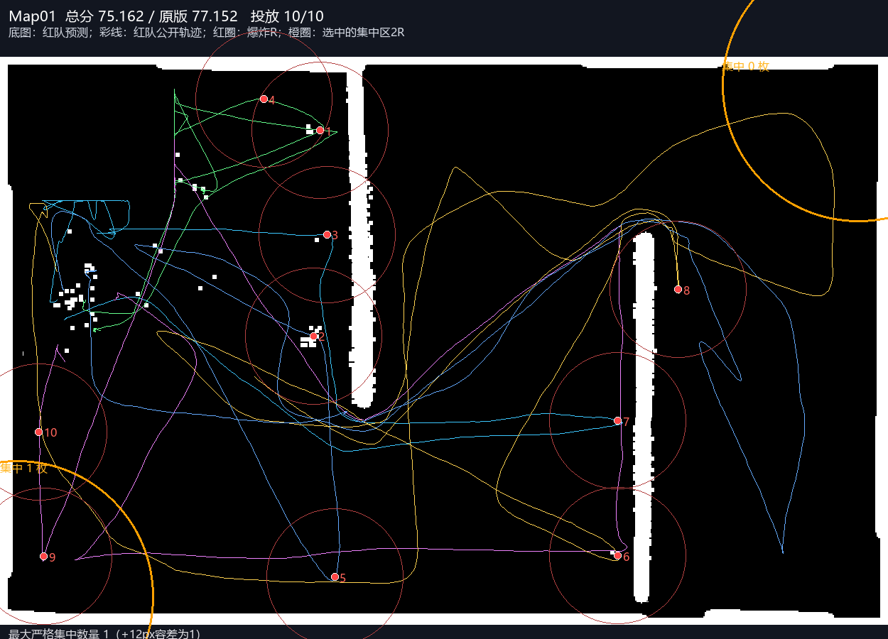
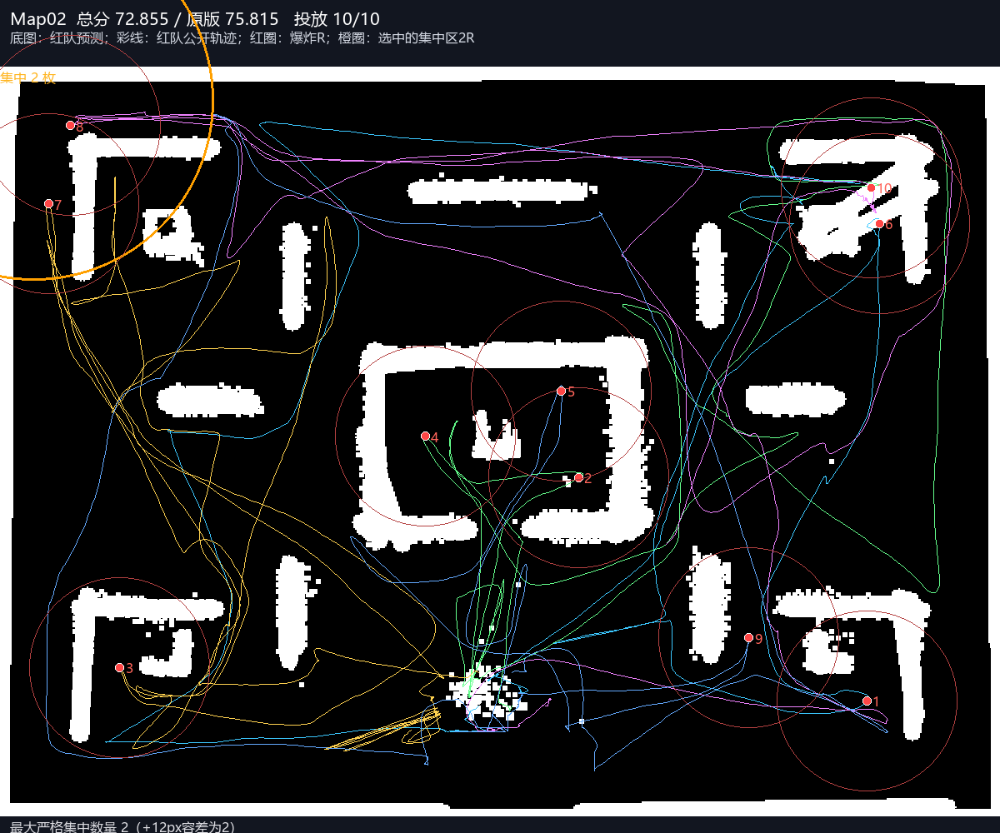
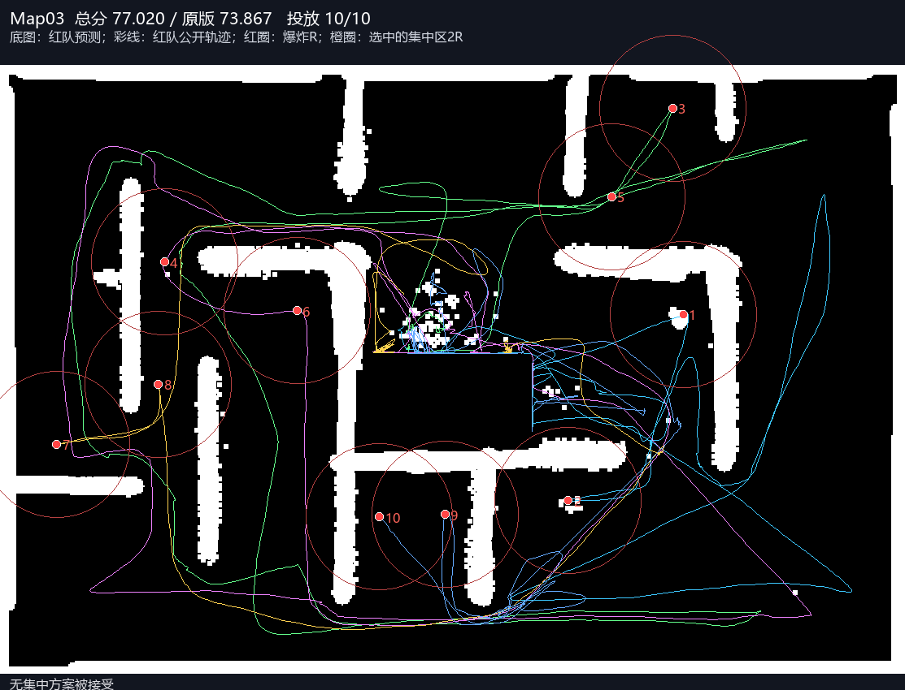
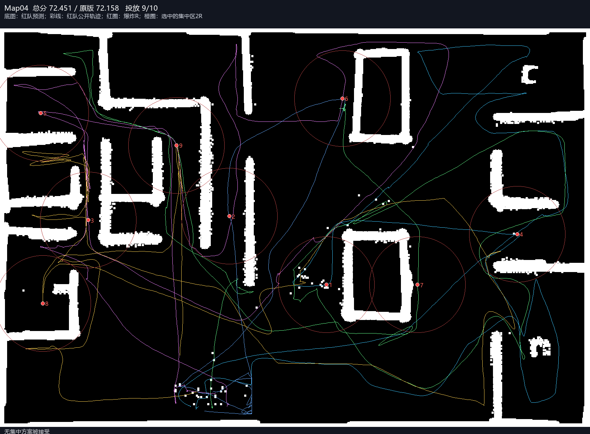
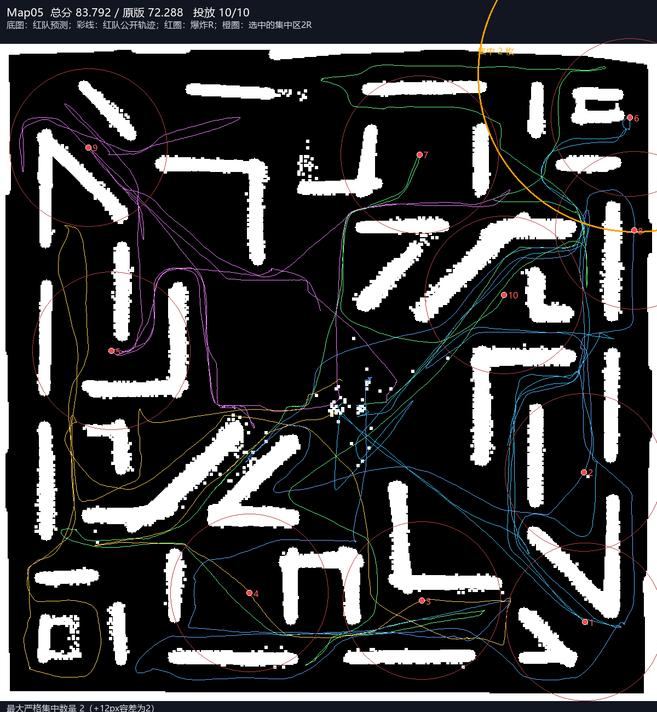

# 角落集中布点：完整五图结果

原P48 A*留存均分 **74.255883**，角落集中方案 **76.256070**，观察差 **+2.000186**；投放49/50。RED/BLUE墙钟超时0/0图。3图实际生成被接受的集中方案，0图最终至少6枚落入同一已选角落（严格半径）。

|地图|原总分|新总分|变化|地图分|覆盖分|时间分|投放|实际角落枚数|蓝队清除|蓝队步数|RED/BLUE超时|
|---|---:|---:|---:|---:|---:|---:|---:|---:|---:|---:|---|
|Map01|77.1515|75.1615|-1.9900|97.0655|82.3139|79.1000|10/10|1|10/10|1268|False/False|
|Map02|75.8150|72.8552|-2.9599|94.0904|78.9698|100.0000|10/10|2|10/10|2109|False/False|
|Map03|73.8673|77.0205|+3.1532|96.4301|90.5391|100.0000|10/10|未接受方案|10/10|2688|False/False|
|Map04|72.1579|72.4507|+0.2928|96.2925|71.5223|100.0000|9/10|未接受方案|9/9|2130|False/False|
|Map05|72.2876|83.7925|+11.5048|94.2294|81.3088|100.0000|10/10|2|9/10|7200|False/False|

各组原始文件首次Windows不透明字节SHA及campaign检查完成，未反序列化NPZ/pickle、不读BLUE私有console；真实投放位置来自公开RED弹药JSON。实际半径=2倍爆炸半径，另在JSON报告+12px原到达容差的数量，不能混用来夸大集中。

90%是每次当前观测模型对条件剩余墙面价值的保护线；真实物理墙体覆盖可能跌得更多，也可能没有大簇可行。无接受方案不能称成功测试了集中布局。此时分数变化包含自然随机差异和计算开销，不能归因集中有效。不存在重复种子/标签救分或追加B组，未自动晋级或发布参赛包。

完整分项、蓝队变化、每次保护线拒绝/接受、实际坐标对应角落与权重分解见FIVE_COMPARISON.json。任何BLUE墙钟超时均明确标记，不拿资源超时宣称稳定增益。

## 公开布局与红队路线图

底图均为红队预测，不是真图；编号只标记初始投放弹药，不表示蓝队最终未清除编号。

