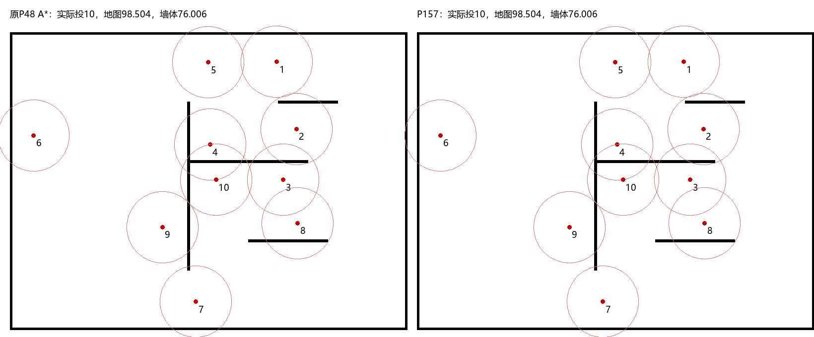

# 内角固定6枚：真实SDK小测试分数细则

P157状态：`STOP_FIRST_AUTHOR_MECHANISM_GATE`。原P48对照只跑一次；P156和P157各新增一臂同作者场景，均未运行BLUE或正式比赛。

|指标|原P48 A*|P156最近单侧内角|P157自由象限|P157−原P48|
|---|---:|---:|---:|---:|
|地图原始分|98.503722|98.503722|98.503722|0.000000|
|地图加权（×0.5）|49.251861|49.251861|49.251861|0.000000|
|墙体原始分|76.006079|76.006079|76.006079|0.000000|
|墙体加权（×0.2）|15.201216|15.201216|15.201216|0.000000|
|时间原始分|100.000000|100.000000|100.000000|0.000000|
|时间加权（×0.1）|10.000000|10.000000|10.000000|0.000000|
|可控加权小计|74.453077|74.453077|74.453077|0.000000|
|布局难度贡献/完整红分|未评估|未评估|未评估|—|

实际投放：10 / 10 / 10；结束步数：508 / 508 / 508；新方案在同一接受角落严格2R圈内最多 **0枚**。没有BLUE时，不能把布局难度填0来凑完整红分。

固定门槛：

- actual_cluster6: False
- fixed_quota_recorded: False
- all10: True
- official_callbacks: True
- finite: True
- no_added_total_damage: True
- actual_loop_under90: True
- submitted: True
- map_loss_at_most_half_pp: True
- wall_retained90: True
- time_nonregress: True
- controllable_loss_at_most_half_point: True

地图细则：

- 原P48提交地图breakdown：{"s_time": 1.0, "s_map": 0.9850372226879289, "credit": 1.0, "penalty": 0.014962777312071117, "wall_pixels": 24045, "wall_hits": 24045, "wall_hit_rate": 1.0, "wall_available": true, "interior_pixels": 6, "interior_hits": 6, "interior_hit_rate": 1.0, "interior_available": true, "predicted_pixels": 71936, "exact_pixels": 24051, "dead_zone_pixels": 41197, "charged_pixels": 6688, "capped_pixels": 796, "total_charge": 1798.89990234375, "truth_pixels": 24051, "surface_pixels": 24045}
- P156提交地图breakdown：{"s_time": 1.0, "s_map": 0.9850372226879289, "credit": 1.0, "penalty": 0.014962777312071117, "wall_pixels": 24045, "wall_hits": 24045, "wall_hit_rate": 1.0, "wall_available": true, "interior_pixels": 6, "interior_hits": 6, "interior_hit_rate": 1.0, "interior_available": true, "predicted_pixels": 71936, "exact_pixels": 24051, "dead_zone_pixels": 41197, "charged_pixels": 6688, "capped_pixels": 796, "total_charge": 1798.89990234375, "truth_pixels": 24051, "surface_pixels": 24045}
- P157提交地图breakdown：{"s_time": 1.0, "s_map": 0.9850372226879289, "credit": 1.0, "penalty": 0.014962777312071117, "wall_pixels": 24045, "wall_hits": 24045, "wall_hit_rate": 1.0, "wall_available": true, "interior_pixels": 6, "interior_hits": 6, "interior_hit_rate": 1.0, "interior_available": true, "predicted_pixels": 71936, "exact_pixels": 24051, "dead_zone_pixels": 41197, "charged_pixels": 6688, "capped_pixels": 796, "total_charge": 1798.89990234375, "truth_pixels": 24051, "surface_pixels": 24045}

墙体细则：

- 原P48：内部命中4961、边界命中2581、边界权重0.5；加权命中6251.5 / 固定10枚SDK参考8225.0。
- P156：内部命中4961、边界命中2581、边界权重0.5；加权命中6251.5 / 固定10枚SDK参考8225.0。
- P157：内部命中4961、边界命中2581、边界权重0.5；加权命中6251.5 / 固定10枚SDK参考8225.0。

相同作者fixture/seed615和合成.05秒每步只用于小机制比较；真实SDK公开传感、真实消息、原七回调和实际投放。真值仅全部输出冻结后评分，不输入控制。SDK参考是确定性贪心参考，不是严格最优；时间原步上限2000，1000步内满分。实际loop时长与健康保留于RESULT_FIRST.json，不与正式墙钟比赛混称。

P156原方案与基线全部508帧相同：它生成6点但未通过90%保护，不能叫成功集中。P157只增加墙角合法自由象限，其他保护未放宽。若实际仍不足6枚或覆盖/时间/健康不达门槛，不能进入五图。详细候选→计划→目标→落点见MECHANISM_REVIEW_FIRST.json。

图为冻结后作者场景评价，非比赛真图；红圈爆炸半径72，橙圈接受集中区域半径144。
