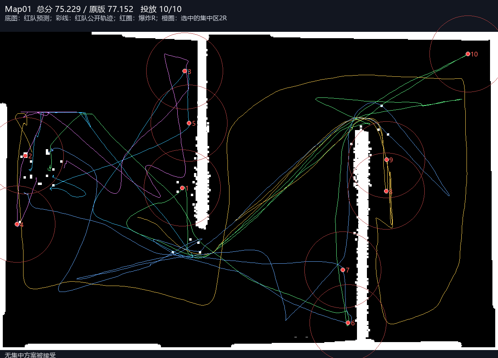
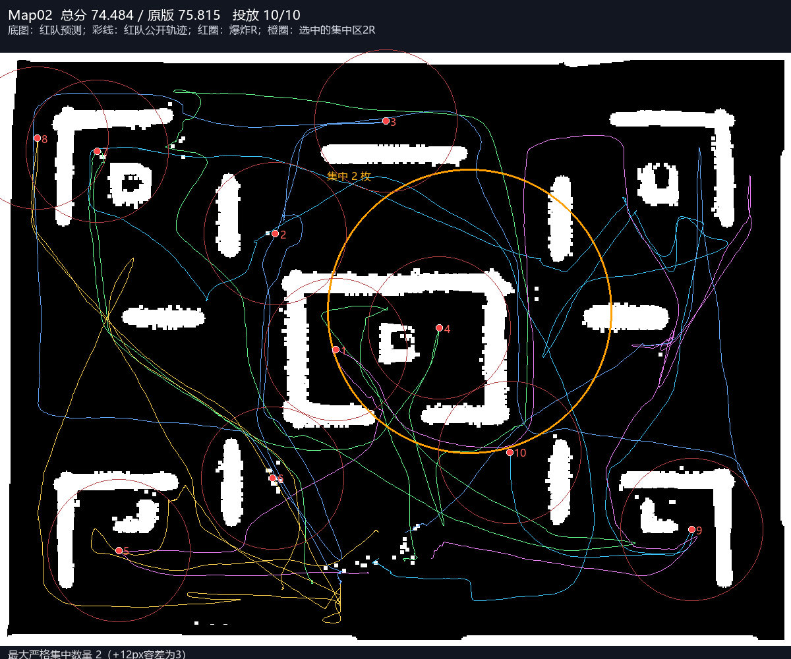
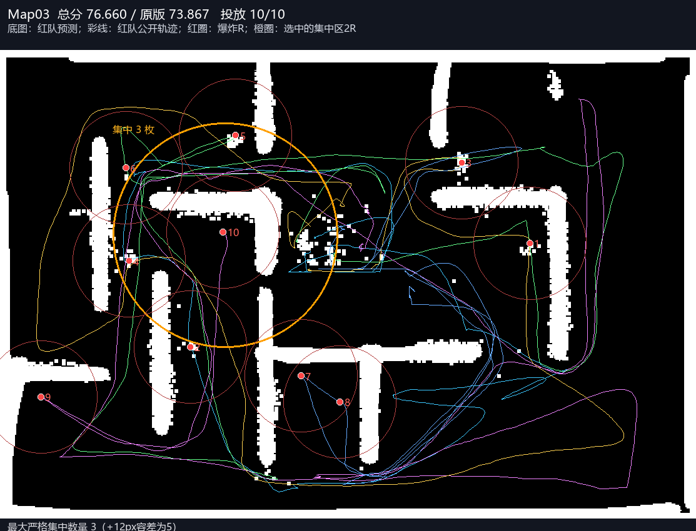
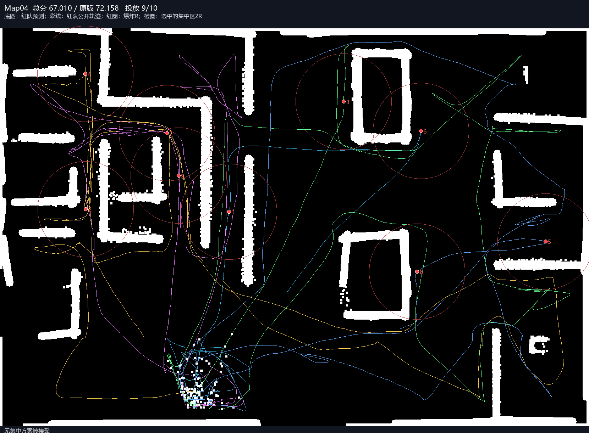
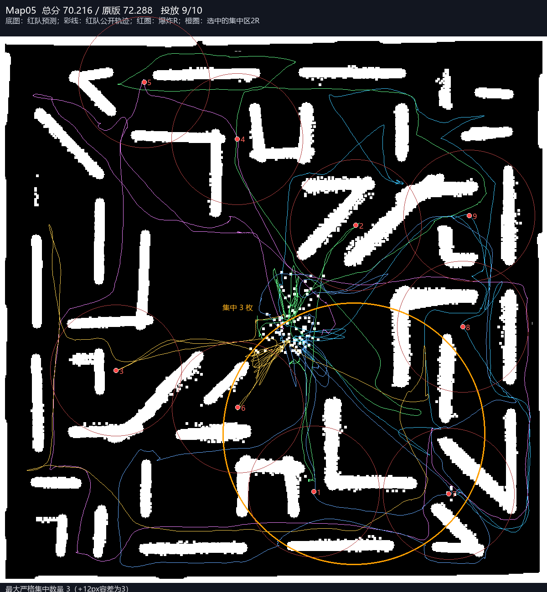

# 角落集中布点：完整五图结果

原P48 A*留存均分 **74.255883**，角落集中方案 **72.719937**，观察差 **-1.535946**；投放48/50。RED/BLUE墙钟超时0/0图。3图实际生成被接受的集中方案，0图最终至少6枚落入同一已选角落（严格半径）。

|地图|原总分|新总分|变化|地图分|覆盖分|时间分|投放|实际角落枚数|蓝队清除|蓝队步数|RED/BLUE超时|
|---|---:|---:|---:|---:|---:|---:|---:|---:|---:|---:|---|
|Map01|77.1515|75.2295|-1.9221|90.0444|85.0262|88.5000|10/10|未接受方案|10/10|1538|False/False|
|Map02|75.8150|74.4841|-1.3309|97.0026|79.6741|100.0000|10/10|2|10/10|2126|False/False|
|Map03|73.8673|76.6601|+2.7928|94.7724|83.5375|100.0000|10/10|3|10/10|3282|False/False|
|Map04|72.1579|67.0098|-5.1481|87.6305|65.9009|100.0000|9/10|未接受方案|9/9|2224|False/False|
|Map05|72.2876|70.2162|-2.0715|93.0761|68.2466|100.0000|9/10|3|9/9|2417|False/False|

各组原始文件首次Windows不透明字节SHA及campaign检查完成，未反序列化NPZ/pickle、不读BLUE私有console；真实投放位置来自公开RED弹药JSON。实际半径=2倍爆炸半径，另在JSON报告+12px原到达容差的数量，不能混用来夸大集中。

70%是每次当前观测模型对条件剩余墙面价值的保护线；真实物理墙体覆盖可能跌得更多，也可能没有大簇可行。无接受方案不能称成功测试了集中布局。此时分数变化包含自然随机差异和计算开销，不能归因集中有效。不存在重复种子/标签救分或追加B组，未自动晋级或发布参赛包。

完整分项、蓝队变化、每次保护线拒绝/接受、实际坐标对应角落与权重分解见FIVE_COMPARISON.json。任何BLUE墙钟超时均明确标记，不拿资源超时宣称稳定增益。

## 蓝队分数与加权细则

|地图|地图×.5|墙体×.2|时间×.1|布局难度贡献|原蓝队得分|本轮蓝队得分|完整红分|
|---|---:|---:|---:|---:|---:|---:|---:|
|Map01|45.022220|17.005248|8.850000|4.352000|90.920000|89.120000|75.229468|
|Map02|48.501307|15.934819|10.000000|0.048000|100.000000|99.880000|74.484126|
|Map03|47.386209|16.707491|10.000000|2.566400|100.000000|93.584000|76.660100|
|Map04|43.815257|13.180173|10.000000|0.014400|96.968000|99.960000|67.009829|
|Map05|46.538051|13.649312|10.000000|0.028800|100.000000|99.920000|70.216163|

BLUE得分来自原team006原SDK同轮公开评分；布局难度贡献采用冻结评测器原值。双队墙钟超时与步数耗尽必须区分；有墙钟超时的图保留分数但不用于稳定性能比较。完整均分是本组自然随机观察，不是同seed配对因果。

## 公开布局与红队路线图

底图均为红队预测，不是真图；编号只标记初始投放弹药，不表示蓝队最终未清除编号。

